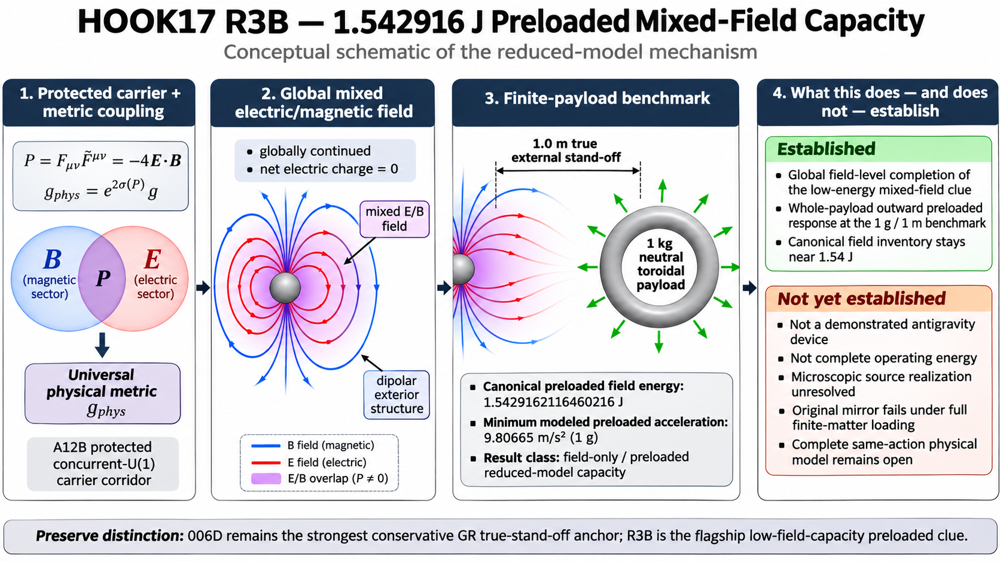
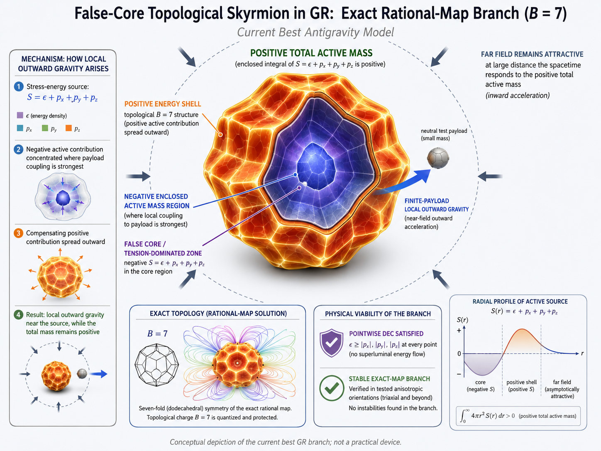

# Antigravity Research

> **For the benefit of humanity**

**Research status: November 11, 2026** · **Program:** `032H17 — HOOK17` · **Latest completed branch:** `R3X3B16` · **Next proposed branch:** `R3X3B17` (onboard spacecraft, Earth-directed interaction) · **Co-primary open investigation:** `R3X3B11-M6` (sourced dynamics) · **Last recorded complete regression:** 1,283 passed (historical; not rerun after the recent focused branches).

**Scientific status:** No experimentally demonstrated antigravity, no complete physically sourced spacecraft-lift model, and no certified complete operating-energy budget below 10 MJ. The numerical results below arise from particular reduced or linearized theoretical models and are not experimental observations.



*The original 1 kg torus and 1 m stand-off remain a **laboratory/theory benchmark**. The new research architecture places the **source apparatus aboard a spacecraft** and investigates a downward-directed interaction with Earth.*

## Mission: an onboard engine, Earth-directed influence, whole-craft lift

The project now prioritizes a **craft-mounted** source system. The generator, its two carrier-field sectors, power supply, physical current sources, mounting structures, possible vacuum enclosure, and every associated reaction load move **with the craft**. The candidate influence is directed **downward toward Earth**, with the goal of reducing the required auxiliary upward propulsion, hovering, or eventually ascending when the novel upward contribution exceeds the craft's weight. Auxiliary propulsion is explicitly allowed.

The new physics must establish at least one of two routes, rather than assuming either works:

1. **Earth-referenced repulsive interaction:** Earth receives downward momentum while the complete spacecraft receives an upward reaction, with all field and gravitational momentum accounted for.
2. **Physical-metric modification of gravitational free fall:** the craft's response to Earth's gravitational field changes consistently within one universal physical metric and complete gravitational dynamics. A reduction in apparent weight is not a license to discard conservation or source reaction.

Ordinary aerodynamic thrust, photon rockets, ground contact and auxiliary engines must be reported as *separate* momentum channels. Forces between the onboard generator and the craft's own hull **do not produce net isolated-vehicle thrust**.

### Craft reference equation (screening approximation only)

For a specified craft mass and near-surface Newtonian comparison, with upward chosen positive:

```math
M_{\mathrm{craft}}a_z
= F_{\mathrm{novel},\uparrow}^{\mathrm{craft}}
  + T_{\mathrm{aux}} + N_{\mathrm{ground}}
  + F_{\mathrm{other,ext}} - M_{\mathrm{craft}}g_{\mathrm{Earth}}
```

Here the novel term must be an independently derived **net force on the entire craft** (or its consistent weak-field effective-weight equivalent), **not** the force on one onboard part or a force counted twice. For a freely suspended craft with negligible other forces, the approximate auxiliary hover requirement becomes:

```math
T_{\mathrm{aux,hover}}
\approx M_{\mathrm{craft}}g_{\mathrm{Earth}}
        -F_{\mathrm{novel},\uparrow}^{\mathrm{craft}}
```

A force insufficient for field-only hover could still reduce auxiliary fuel expenditure. No present R3B calculation establishes a positive value for this whole-craft Earth-directed term.

**Distinct operational scenarios to be modeled:** (i) ground-contact source-off and activation, (ii) launch-pad release/auxiliary-assisted takeoff, (iii) already suspended operation at several clearances, (iv) stable hover, and (v) powered climb. A suspended-operation result does not automatically establish ground liftoff. The Earth is an **external reaction partner**, not a stationary generator carrying the source under a separate payload.

## Flagship mathematical field-capacity result: 1.5429162116460216 J

**`032H17A12D1R3B`** remains the flagship reduced-model **preloaded** field configuration. The modeled, globally continued and net-electric-neutral mixed electric/magnetic exterior was normalized to at least **9.80665 m/s² (1g)** outward acceleration at sampled locations of a finite, neutral **1 kg torus** separated by **1.0 m true external stand-off** from the original source. Its reported canonical **preloaded field-only** inventory is:

```math
\boxed{U_{\mathrm{R3B,preloaded}} = 1.5429162116460216\ \mathrm{J}}
```

**This is not gravitational energy measured in the laboratory, a fully loaded finite-matter solution, source material energy, source work, or a spacecraft's operating energy.** It is a reduced-model field-capacity reference with numerical precision limitations. Finite-matter backreaction causes the original static R3B mirror to **fail** the benchmark.

| Quantity | Recorded value | Interpretation |
|---|---:|---|
| R3B canonical preloaded energy | **1.5429162116460216 J** | Field-only; reduced model |
| Original neutral test distribution | **1 kg torus** | Laboratory/theory control, **not** final spacecraft geometry |
| Minimum sampled *preloaded* outward acceleration | **9.80665 m/s²** | Calculated from proposed physical metric; not observed gravity |
| True laboratory source-to-payload stand-off | **1.0 m** | Original benchmark only |
| Net electric monopole | **Zero** | Mathematical source-field property; no complete microscopic source |
| R3X3B7 10 cm electric-layer control | **1.5473042949759672 J** | Preloaded field-only; finite-width *mathematical* electric source |
| Fully reciprocal original 1 kg static load | **Fails** | Destructive interface screening / force cancellation |
| Onboard source → Earth-down / craft-up force | **Not established** | First fundamental new architecture gate |
| Complete conservative operating energy | **Unknown** | Certification target strictly **below 10 MJ** |

### What the proposed physical metric assumes

A12B supplies a *scoped* protected massless concurrent-`U(1)` carrier corridor. In the R3B reduced model, the proposed universal physical metric contains a mixed-sector topological pseudoscalar. Schematically, and **not as a complete sourced field theory**:

```math
\widetilde g_{\mu\nu}=e^{2\sigma(P_{XY})}g_{\mu\nu}
```

```math
P_{XY}=F_{X\,\mu\nu}\widetilde F_Y^{\,\mu\nu}
```

In a static slow-motion limiting calculation, the modeled metric acceleration is approximated by:

```math
\mathbf a_{\mathrm{modeled}}\simeq-c^2\boldsymbol\nabla\sigma
```

The exact two-sector normalization, signs and complementary field components must be verified from the complete action; the one-sector identity $F_{\mu\nu}\widetilde F^{\mu\nu}=-4\mathbf E\cdot\mathbf B$ must **not** be substituted for the mixed-sector model without derivation. Under time-dependent conditions, the static acceleration formula alone is insufficient.

A fixed linear pseudoscalar metric dependence also raises parity/CP, technical-naturalness and experimental-consistency questions. The carrier, source, matter, physical metric, gravity and support responses must all follow from **one** action. No gravitational experiment has validated this coupling.

## What the fully loaded calculations actually show

The matter action required to produce a universal-metric force also causes reciprocal matter-to-field loading. In the original static R3B construction, gradients near the finite payload's material interfaces reorganize the fields and create strong, opposing local force contributions.

| Grid spacing | Original 1 kg loaded worst-point acceleration | Original 1 kg loaded COM acceleration |
|---|---:|---:|
| 0.075 m | **−46.406 m/s²** | +0.079708 m/s² |
| 0.050 m | **−129.672 m/s²** | +0.154542 m/s² |
| 0.040 m | **−145.638 m/s²** | −0.091742 m/s² |

These are **modeled** reciprocal-loaded responses, not observed forces. The COM result is near zero and changes sign with grid refinement. The original static 1 kg benchmark remains **failed**. [Source: corrected R3B inverse-loading solver](src/antigravity_research/agminer/hook17_fdual_f_r3x3b0_inverse_loading.py); [historical results](results/data/032h17a12d1r3x3b0_inverse_loading_summary.json).

### Unexpected result: approximately 42g *locally inward* (B14/B16)

A follow-up static reciprocal-loading calculation **accidentally produced a very large local inward modeled acceleration** in a lower-mass version of the original neutral torus. In the same full-size geometry with about **100 g** of matter, the 0.040 m B14/B16 result was:

```math
\boxed{a_{z,\min}\approx -410.3889130906965\ \mathrm{m\,s^{-2}}\approx -41.85\,g}
```

This resembles a highly localized **attractive / tractor-beam-like gradient** *inside the numerical reduced model*. It is noteworthy as a clue about material-interface amplification and cancellation, **not** an established 42g tractor beam.

| Grid | Approximate 100 g worst-point acceleration | Approximate 100 g COM acceleration |
|---|---:|---:|
| 0.075 m | −56.67 m/s² | −0.648 m/s² |
| 0.050 m | −174.27 m/s² | +0.216 m/s² |
| 0.040 m | **−410.39 m/s² (−41.85g)** | **−0.2084723 m/s² (−0.0213g)** |

At the finest sampled resolution, the opposing modeled force contributions were approximately **+0.953282 N** and **−0.974132 N**, giving a net **−0.0208503 N**. Thus the dramatic local hotspot almost entirely cancels in the full finite payload, and **the local extremum grows strongly with grid refinement: it is not continuum converged**. Its sign also cannot simply be reversed into Earth-directed lift: if an onboard source *attracted Earth upward*, the craft would generally recoil *downward*.

**Primary sources for the ~42g number:** [B14 100 g reciprocal-loading simulation](simulations/032h17a12d1r3x3b14_100g_payload_quickcheck.py), its [structured output](results/data/032h17a12d1r3x3b14_100g_payload_quickcheck.json), and the **later repeated 100 g sample using the same underlying loaded solver** in [B16 0.040 m response JSON](results/data/032h17a12d1r3x3b16_weakload_h040_summary.json), `results[]` with `density_fraction = 0.1`, `min_loaded_m_s2 = -410.3889130906965`, `density_weighted_com_m_s2 = -0.20847229887377233`, and `net_force_n = -0.020850279624959306`. See also the [B16 simulation](simulations/032h17a12d1r3x3b16_weak_loading_mass_response.py).

**Claim boundary:** This is a **finite-grid, nonconverged, local acceleration value** of a hypothetical metric response. It is **not** a 42g whole-body force, 42g spacecraft acceleration, evidence of a real tractor beam, or an Earth-repulsion success.

### B16: favorable weak-loading numerical control, but no physical rescue

At a nominal **5 mg** payload mass distributed throughout the same large toroidal geometry, the corrected static loaded model retained positive acceleration **everywhere on the sampled torus** across three grids:

| Grid | Loaded minimum acceleration | Loaded COM acceleration | Net modeled force |
|---|---:|---:|---:|
| 0.075 m | +10.42 m/s² | +14.10 m/s² | +70.41 µN |
| 0.050 m | +10.03 m/s² | +14.78 m/s² | +74.11 µN |
| 0.040 m | +10.54 m/s² | +14.52 m/s² | +72.60 µN |

This **is** a positive **finite-nonzero-mass result within the reduced static solver**. It is also equivalent to the already-studied B0 loading homotopy under fixed geometry and frozen density law; it is not a distinct force mechanism. The 5 mg matter is **extremely dilute**, spread throughout the original torus volume rather than packaged in a compact object. The strict sampled 1g threshold declined with refinement from about **11.14 mg** to **8.62 mg** to **7.94 mg**. A continuum-surviving mass threshold is not certified.

**Reproducible outputs:** [B16 0.075 m JSON](results/data/032h17a12d1r3x3b16_weakload_h075_summary.json) · [B16 0.050 m JSON](results/data/032h17a12d1r3x3b16_weakload_h050_summary.json) · [B16 0.040 m JSON](results/data/032h17a12d1r3x3b16_weakload_h040_summary.json) · [simulation source](simulations/032h17a12d1r3x3b16_weak_loading_mass_response.py).

The corresponding portal-scale rescaling links B16's weak density to the distinct **B1 conditional higher-scale loaded** candidate (approximately **0.275–0.301 MJ canonical field-only** near 21.147 keV). These are related ways of weakening the reduced loading parameter, **not two independently proven gravity mechanisms**. B1's tested electron-dipole source family incurred a prohibitive source-material rest-energy bound; other hypothetical sources remain unphysical until established.

## Lessons from B12–B15: field shape and polarization matter, but simple rotation fails

- **B12/B13:** Broad static field amplification and tested axisymmetric source sculpting did not restore a converged 1g-everywhere loaded response. Some arrangements reduced adverse spikes, but they also damaged useful force or failed geometry/support constraints. Some material redistributions produced deceptively favorable COM with deeply inward local regions.
- **B14:** Lowering mass to 100 g did not rescue the original geometry; the extreme inward local gradient became a convergence/cancellation diagnostic. The compact 100 g torus variant was underresolved.
- **B15-M0/M1:** New 3D exterior orientations and small-grid gauge/reciprocity identities were established, **not** a fully loaded 3D survivor.
- **B15-M2A/M2C:** A frozen 1 kg 3D torus interface-demand analysis and exact angular algebra showed that common rigid rotations of the equal-sector original fields do not eliminate their combined leading interface demand. At equal preloaded-normalization, tested 30°, 60°, 90° and perpendicular arrangements had demand ratios **1.181, 1.286, 1.057 and 1.402**, respectively (all **worse** than aligned). An electric-sector-only 90° arrangement reduced the norm but gave inward acceleration at some locations.

For the original equal field configuration, a useful **local algebraic** identity is:

```math
j_\phi^2+|\mathbf j_A|^2
=|\boldsymbol\nabla\theta|^2|\mathbf E|^2
\quad (\mathbf E=\mathbf B)
```

The identity restricts an **angle-only** cancellation at fixed local field strength; it does **not** exclude independently sourced polarization, new 3D dynamical modes, or an independent healthy mediator. The mixed-sector vector $\mathbf E_X\times\mathbf B_Y$ is not, by itself, the canonical same-sector Poynting flux; bending a static field is not equivalent to routing reaction momentum in a waveguide.

**Sources:** [B15-M2A numerical results (0.050 m)](results/data/032h17a12d1r3x3b15_m2a_torus_rhs_h050_r3b_summary.json), [B15-M2C angular result (0.040 m)](results/data/032h17a12d1r3x3b15_m2c_angular_h040_r3b_summary.json), [B15-M2C simulation](simulations/032h17a12d1r3x3b15_m2c_angular_routing_gate.py).

## Next proposed research: B17 onboard craft / atmosphere / Earth

**`032H17A12D1R3X3B17` — proposed; not run.** This replaces the old practice of treating the generator as a fixed ground source and the payload above it. Its first purpose is to **falsify the new architecture cheaply before attempting expensive 3D Earth-loaded numerical simulations**.

1. **Exterior-transmission gate:** Can a physically generated influence leave an onboard, possibly evacuated enclosure and act on matter outside? Distinguish carrier fields extending through the hull from fully confined carrier fields. In the *local algebraic* R3B portal, if both relevant exterior carrier field strengths vanish, the local topological contribution vanishes there; an independently propagating metric/mediator would require a new explicit action.
2. **Whole-craft force/reaction gate:** Derive the net force on all onboard matter plus field momentum, and compare with Earth, atmosphere, radiation and auxiliary-exhaust momentum. Do not count generator-to-hull internal forces as thrust.
3. **Correct source/Earth sign and geometric clearance:** Test the physical source support, oriented downward toward *Earth matter below*, and distinguish a ground-contact craft from a source located underground by accidentally reusing the old torus/source placement.
4. **Material environments:** Compare vacuum exterior, nearly uniform atmosphere, realistic vacuum-wall-air-ground transitions, and the ground's dense matter loading. Nearly uniform air is **not** equivalent to empty space, and the mean density of the historical 1 kg torus was close to sea-level air's density. The source region's vacuum does not erase nearby hull, atmosphere or ground matter loading.
5. **Operational stages:** Test ground contact/release, then 5/10/30/100 m source/ground clearance controls where geometrically meaningful, already airborne suspension, hover and climb. Allow auxiliary propulsion and report the *reduction in auxiliary thrust* as a separate practical metric.
6. **Numerical standards:** Preserve R3B/B7 and known failed loaded controls; check exact action, local/gauge constraints, exterior boundary terms, convergence of *integrated whole-craft forces* and the complete Earth-reaction ledger before promoting results.

**Crucial point:** An enclosure might keep some internal carrier-field regions in vacuum, but it **cannot be assumed** to transmit the proposed metric field while fully blocking the very carrier fields that create it. Earth-directed repulsion itself has not been established; the 1.5 J laboratory field cannot simply be rotated and relabeled as spacecraft lift.

## Co-primary open research: B11-M6 sourced dynamics and finite impulse

**`032H17A12D1R3X3B11-M6` remains proposed, not completed.** Its target is a physically generated two-carrier transient that might avoid the failed **static** response. Before a waveform optimization, derive the complete time-dependent source, gauge, matter, physical-metric and stress-energy equations from one action; recover the failed static limit; establish legal initial conditions and causal response; then test one genuinely sourced pulse and repeated cycles **without arbitrary resets**.

For the whole craft, the useful operational impulse is a different quantity from the old external-payload local acceleration:

```math
\Delta p_{z,\mathrm{craft}}^{\mathrm{external}}
=\int_{t_0}^{t_1}F_{z,\mathrm{craft}}^{\mathrm{net,external}}(t)\,dt
```

A positive first transient is not sustained hover. Track negative impulse, duty cycle, source work, off-state and cycle losses, radiation, field/metric momentum and Earth/air reactions. Healthy propagation, gauge/Noether identities, fully loaded matter and the same-action source cannot be relaxed.

## Two benchmarks, not one

The original **scientific comparator** remains an outward modeled gravitational/universal-metric response of at least **1g at all sampled points of a finite 1 kg neutral torus** at **1 m true external source stand-off**, with convergence ultimately required. This comparator has not been achieved by the fully loaded original static R3B mirror.

The new **engineering physics benchmark** is **positive whole-craft external upward force** or an action-derived reduction of the craft's effective gravitational downward acceleration, including all onboard source reaction, with auxiliary propulsion permitted. Its subsequent tiers are launch assistance, stable hover, climb, independently verified Earth momentum exchange and complete practical energy accounting. It does not require treating a generator mounted on the ground as the device architecture.

A propulsion result using ordinary air/exhaust momentum must be reported as such, **not as gravitational repulsion**. A craft's loss of effective weight is not a loss of inertial mass. No present result reaches the whole-craft benchmark.

### Permanent scientific and energy requirements

- **One complete action** for the physical sources, both carrier fields, matter, the universal physical metric, gravity, support and any truly new mediator; exact source-current, Bianchi, gauge, Ward and Noether identities.
- **Healthy and stable** physical modes, finite-source support and conservation under canonical normalization; no arbitrary internal compensating payload current, ghosts or near-singular numerical gain.
- **Finite neutral matter**, real source-to-external-matter clearance, converged useful force/impulse and complete Earth/air/field momentum accounting.
- **Parity/CP, quantum, UV, technical-naturalness and empirical constraints** before any complete physical model claim.
- **Strict complete conservative operating energy below 10,000,000 J**, with a specified duration and operating protocol. Exactly 10 MJ fails. Field-only inventory must not be presented as complete device energy.
- **No field micro-optimization:** when the relevant preloaded term is already below 100 J, prioritize sourced response, loading, coherence and complete energy rather than pushing the headline field number lower.

## Historical scientific hierarchy and source controls

| Result family | What survives | Critical limitation |
|---|---|---|
| **006D** | Conservative finite positive-energy, locally conserved linearized-GR true-stand-off source; NEC/WEC/DEC pass, outward near field and positive far active mass; **`C = 23.591586299249`** | Catastrophic approximately `1/G` energy scaling; not a complete nonlinear device; **not replaced** |
| **018B / 018C** | Microscopic field existence documented | Fatal tested nonaxisymmetric `m=2` instability for the realization |
| **B7 / 026** | Historical false-core microscopic-GR field results | Primarily embedded/two-sided; historical convergence obligation remains |
| **024–031 / V-series** | Mechanism and scoped negative-result history | No reopening of closed implementations without genuinely new physics |
| **Introspective** | Useful source-efficiency heuristics | `RAW_GE1000X_SIGNAL=PRESENT`, `CERTIFIED_GE1000X_CONTINUUM_SOURCE=NO` |
| **A12B / A12C** | Protected massless carrier corridor; **2.6568591420597114 J** preloaded `F²` capacity | Not the R3B source, not a complete loaded physical model; A12C COM **15.042170908175194 m/s²** belongs to A12C only |
| **R3B / B7** | Preloaded few-joule field and finite-width electric support controls | No microscopic complete source or loaded 1 kg survivor |
| **B1** | Conditional higher-scale, finite-grid loaded result around 0.3 MJ field-only | Minimal electron dipole sourcing energetically excluded; complete energy unknown |
| **B14 / B16** | Local inward ~41.85g anomaly; favorable 5 mg weak-loaded control | Inward peak nonconverged, severe cancellation; weak-loading mass impractical |
| **B15** | 3D geometric/reciprocity machinery, exact angle-only constraint | No fully loaded 3D rescue |
| **B17 / B11-M6** | New research questions on onboard Earth coupling and sourced pulse dynamics | **Not run**, not evidence of propulsion |

AGMINER remains a **theorem-first, candidate-specific falsification program**, not a blind optimizer. Historical source-family closures (ordinary 1-keV `F²` loading/current sculpting, minimal electron Pauli practical sourcing, certain shell-source families, tested static compensation routes and generic past pulse mechanisms) retain their declared scope.

## Reproduction, citations, and documents

**Prioritize direct primary artifacts over prose.** The exact executed output, producing code, test controls and research journal specify the claim; if an old narrative conflicts with newer signed results, preserve the historical narrative as history and use the newer verified calculation.

### Key simulation and result sources

- [R3B global mirror source code](simulations/032h17a12d1r3b_hook17_fdual_f_global_mirror_prefight.py) and [structured field-capacity result](results/data/032h17a12d1r3b_hook17_fdual_f_global_mirror_prefight_summary.json). The historical filename `prefight` is intentional.
- [R3X3B6 corrected electric-source boundary audit](simulations/032h17a12d1r3x3b6_boundary_source_support_audit.py) and [JSON](results/data/032h17a12d1r3x3b6_boundary_source_support_summary.json).
- [R3X3B7 finite-width electric-source control](simulations/032h17a12d1r3x3b7_finite_charge_shell_preflight.py) and [JSON](results/data/032h17a12d1r3x3b7_finite_charge_shell_summary.json).
- [B14 100 g inward-local-force source](simulations/032h17a12d1r3x3b14_100g_payload_quickcheck.py), [B14 result JSON](results/data/032h17a12d1r3x3b14_100g_payload_quickcheck.json) and [B16 independent numerical repetition at 0.040 m](results/data/032h17a12d1r3x3b16_weakload_h040_summary.json).
- [B15 3D angular-interface analysis](simulations/032h17a12d1r3x3b15_m2c_angular_routing_gate.py) and [JSON](results/data/032h17a12d1r3x3b15_m2c_angular_h040_r3b_summary.json).
- [B16 weak-loading finite-mass response](simulations/032h17a12d1r3x3b16_weak_loading_mass_response.py) and [three-grid JSON sample](results/data/032h17a12d1r3x3b16_weakload_h050_summary.json).
- [006D original linearized-GR journal](journal/2026-08-28_006d_constructive_linearized_gr_repulsion.md), [November 9 R3B journal](journal/2026-11-09_032h17a12d1r3b_r3x3b0_hook17_1p542916j_preloaded_capacity_and_interface_obstruction.md), and [November 10 B1–B10 journal](journal/2026-11-10_032h17a12d1r3x3b1_r3x3b10_hook17_field_source_interface_gates_and_pulsed_frontier.md).

### Test-suite integrity

The **last recorded full project regression was 1,283 passed**. Later B15-M0 (6 focused), B15-M1 (5 focused), B15-M2A (5 focused), B15-M2C (7 focused) and B16 (6 focused) tests were run separately. **Do not add these counts and claim a new full regression.** Independent physical reproducibility and continuum checks remain outstanding.

```bash
ROOT="$(pwd)"
PY="$ROOT/.venv/bin/python"
if [ ! -x "$PY" ]; then PY="$(command -v python3)"; fi
export PYTHONPATH="$ROOT/src"
export OPENBLAS_NUM_THREADS=1
export OMP_NUM_THREADS=1
"$PY" -m pytest -q
```

### Documentation and GitHub mathematics

- [Authoritative research buildplan](RESEARCH_BUILDPLAN.md) — craft-mounted, Earth-directed B17 and B11-M6 strategy, scientific stop rules and historical archives.
- [AGMINER theory/failure-memory plan](AGMINER_BUILDPLAN.MD) — scoped closures and cheapest-falsifier logic; its next update is pending.
- [Introspective mechanism notes](INTROSPECTIVE_BUILDPLAN.md) — source-efficiency anatomy only; next update pending.
- [Detailed carry-forward notes](NOTES.md), with the prepared chronology 0038 to be linked after its actual repository path has been confirmed.
- [Formatting and code standards](FORMATTING_AND_CODE_STANDARDS.md) — inline math uses `$...$`, display math uses fenced `math` blocks. The historical appendix below has also been converted to this standard.
- [AI assistance disclosure](AI_ASSISTANCE.md), [licenses](LICENSE.md), and [GitHub mathematical-formatting reference](https://docs.github.com/en/get-started/writing-on-github/working-with-advanced-formatting/writing-mathematical-expressions).

*Documentation synchronization is still in progress:* the new craft research buildplan is prepared; updates to `AGMINER_BUILDPLAN.MD`, `INTROSPECTIVE_BUILDPLAN.md`, individual journals, project instructions and a final `NOTES.md` merge must not be represented as already completed.

## Disclosure and licensing

Antigravity Research is **human-directed and AI-assisted**. ChatGPT by OpenAI has assisted with derivations, source code, simulations, checking, falsification and documentation. AI output is not automatically correct; scientific claims require reproducibility and independent verification. Use of ChatGPT does not imply endorsement or sponsorship by OpenAI, and novelty relative to the published literature is not established.

**Software licensing:** MIT OR Apache-2.0, at the user's option. **Original project research materials, generated data and figures:** CC0 1.0 Universal, conditional on the actual repository licenses. Third-party content retains its own terms. See [LICENSE.md](LICENSE.md) and `LICENSES/`.

---

# Historical research appendix — preserved September 15, 2026 narrative

> **ARCHIVAL NOTICE (preserved September 15, 2026; contextualized November 11, 2026):** The material below is the September 15, 2026 historical research narrative, retained for provenance, derivations, failures, and numerical reference points. Its then-current A12D0/Pauli priorities, 1,080-test count, and references to 2.656859 J as the lowest field-only result are historical, **not current instructions**. The active status is given above: completed through B16; B17 (onboard Earth coupling) and B11-M6 (sourced pulses) are proposed, not demonstrated. Earlier November 9 R3X3B0 interpretations have been superseded where R3X3B6 corrected boundary leakage. Do not quote archived figures or action queues as the latest result without checking the newer journals and code.

> **Archive interpretation:** The historical sections below are retained as a chronology, including their original dated "current" plans, counts, source rankings, and conclusions. They are **not current recommendations**. The modern B6 source-boundary correction, B14/B16 inward ~41.85g finite-grid diagnostic, B15 geometry gates, B16 weak-loading result and the onboard-craft strategy above supersede older active-frontier wording without retroactively changing old numerical findings.



# 1. Strongest Established Result — 006D

006D is the permanent conservative anchor of Antigravity Research.

It constructs a finite static source in linearized general relativity with:

```text
FINITE_RADIUS=
YES

FINITE_THICKNESS=
YES

NONSINGULAR=
YES

POSITIVE_ENERGY_DENSITY=
YES

LOCAL_CONSERVATION_LINEARIZED_ORDER=
YES

NEC=
PASS

WEC=
PASS

DEC=
PASS

LOCAL_GRAVITATIONAL_FIELD=
OUTWARD

TRUE_EXTERNAL_STANDOFF=
YES

POSITIVE_FAR_FIELD_ACTIVE_MASS=
YES
```

The best tested finite coefficient is:

```math
C_{006D}=23.591586299249
```

in the physical scaling:

```math
E
=
C
\frac{a c^2 h^2}{G}
```

The independent thin conserved reference is:

```math
C_{\rm thin}
=
23.426710175391
```

For the actual 006D finite coefficient producing approximately $1g$ at a characteristic $1\,\mathrm m$ scale, the required stress-energy is of order:

```text
~3.1e29 J
```

This demonstrates the central pure-GR limitation:

> **006D establishes the sign, conservation, energy-condition compatibility, and true stand-off within its linearized scope, but ordinary GR retains catastrophic $1/G$ energy scaling.**

No tested pure-GR mechanism has removed that scaling.

Therefore:

```text
006D=
CURRENT PROOF / CONSERVATIVE ANCHOR

006D=
NOT PRACTICAL
```

For the standalone reconstruction, see:

[`journal/2026-08-28_006d_constructive_linearized_gr_repulsion.md`](journal/2026-08-28_006d_constructive_linearized_gr_repulsion.md)

---

# 2. Standard Physical Performance Floor

The permanent project comparator is:

```math
a_{\rm outward}
\ge
9.80665\ {\rm m/s^2}
```

at:

```math
h_{\rm true\ stand-off}
\ge
1.0\ {\rm m}
```

These are minimum floors, not exact targets.

Therefore:

```text
2 g AT 1 m=
FAVORABLE

1 g AT 3 m=
FAVORABLE

3 g AT 5 m=
FAVORABLE
```

provided all other physical and energy gates pass.

The payload must be:

```text
FINITE

NEUTRAL

UNIVERSALLY COUPLED

RESPONDING THROUGH ONE PHYSICAL METRIC
```

This explicitly excludes treating:

```text
CHARGED-PARTICLE FORCES

MAGNETIC LEVITATION

POINT-PARTICLE SIGN TESTS

COORDINATE ACCELERATION

EMBEDDED SOURCE EFFECTS

OR
TWO-SIDED GEOMETRIES
```

as operational true external antigravity.

---

# 3. Why Positive Energy Can Produce Outward Gravity

For a static type-I stress-energy source, the weak-field active gravitational source is:

```math
S
=
\rho+p_x+p_y+p_z
```

in $c=1$ source units.

Equivalently:

```math
\nabla^2\Phi
=
4\pi G
\left(
\rho+
\frac{p_x+p_y+p_z}{c^2}
\right)
```

The physical acceleration is:

```math
\mathbf a=-\nabla\Phi
```

Positive energy density by itself therefore does not fix the local gravitational sign.

Relativistic stresses also gravitate.

For a finite payload the useful response can be written schematically as:

```math
A_P
=
\int
S(\mathbf x)
K_P(\mathbf x)\,d^3x
```

where $K_P$ represents the finite-payload gravitational kernel.

This established a permanent project principle:

> **Useful repulsion depends on physical source per joule, where that source is located, how strongly it overlaps the payload kernel, how much energy participates productively, and how much response is cancelled.**

---

# 4. Microscopic Field Realization — 018

006D establishes a stress-energy construction.

The next problem was whether an actual microscopic field could realize outward gravitational response.

## 018B — field existence

018B produced a complete finite-energy microscopic field configuration satisfying its declared field equations and yielding outward finite-payload linearized response.

This remains an important microscopic-field existence result.

## 018C — fatal instability

A later nonaxisymmetric analysis found a robust negative $m=2$ mode.

Therefore:

```text
018B_MICROSCOPIC_FIELD_EXISTENCE=
PRESERVED

018C_M2_STABILITY=
FAIL

018_CURRENT_PHYSICAL_REALIZATION=
CLOSED / DEMOTED
```

Permanent lesson:

> **Field existence does not imply stability.**

Protected-vector implementations through `022A` also remain closed in their tested forms.

---

# 5. False-Core B7 Skyrmion Program

The strongest older microscopic pure-GR field architecture remains the false-core:

```text
B=7
ETA=0.4
M=8
```

Skyrmion.

This program established:

* robust topology;
* pointwise DEC in tested representatives;
* positive total active mass;
* unrestricted Cartesian stationarity at high resolution;
* and outward finite-payload sign in the tested geometry.

Representative force values were:

```text
F65 ≈ 0.1893
F73 ≈ 1.9664
F81 ≈ 7.2641
```

Absolute continuum-force convergence remains unresolved.

`026C` at `N=89` remains the next historical convergence obligation if that line is resumed.

The strongest B7 response is also principally embedded/two-sided rather than the clean external stand-off represented by 006D.

Therefore:

```text
006D=
CONSERVATIVE TRUE-STANDOFF ANCHOR

B7=
OLDER MICROSCOPIC GR-FIELD ANCHOR
```

---

# 6. Introspective — Learning the Anatomy of Efficient Repulsion

The project next asked:

> **Which parts of a source actually produce useful finite-payload response efficiently?**

This became **Introspective**.

Introspective is mechanism knowledge.

It is not a physical field theory.

Preserve:

```text
RAW_GE1000X_SIGNAL=
PRESENT

CERTIFIED_GE1000X_CONTINUUM_SOURCE=
NO
```

The strongest conservative source-level improvement was approximately:

```text
12.8X TO 17.9X
```

relative to B7.

The relaxed teacher displayed raw headroom of approximately:

```text
17,230X
```

but did not earn the declared continuum-source certificate.

---

## 6.1 Durable Introspective lessons

Efficient source anatomy favored:

```text
HIGH KERNEL LEVERAGE

COMPACT PAYLOAD-ADJACENT PRODUCTIVE STRUCTURE

HIGH RESPONSE PER JOULE

LOW CANCELLATION

HIGH PRODUCTIVE PARTICIPATION

LOW SCAFFOLDING TAX
```

Approximately:

```text
19.7%
```

of teacher energy supplied roughly:

```text
92.2%
```

of gross outward influence.

The B7 source also exhibited approximately a:

```text
9.7X
```

productive-participation gap relative to the relaxed optimum.

The permanent lesson is:

> **A practical successor needs not only the correct gravitational sign, but an unusually productive physical source, strong kernel leverage, low cancellation, and little energetically useless scaffolding.**

See:

[`INTROSPECTIVE_BUILDPLAN.md`](INTROSPECTIVE_BUILDPLAN.md)

---

# 7. Scalar-Metric Program 031

Because pure GR retained catastrophic $1/G$ scaling, the project investigated metric charge not rigidly tied to ordinary inertial stress-energy.

Program 031 produced important intermediate results.

Representative energies included:

```text
PRESCRIBED SOURCE BENCHMARK
≈82.75 GJ

MINIMAL B7 SCALAR DRESSING
≈575 GJ
CLOSED

CENTERED U(1) Q-BALL
≈273 GJ

OPTIMIZED U(1) Q-BALL
≈96.141 GJ
```

The Q-ball work developed substantial microscopic, finite-source, stability, and Einstein/Jordan-frame machinery.

However `031F0` found that the tested unprotected ultralight-scalar implementation failed radiative-naturalness / protection gates.

Therefore:

```text
031_MICROSCOPIC_SOURCE_PROGRESS=
PRESERVED

031F0_UNPROTECTED_ULTRALIGHT_SCALAR=
CLOSED

031_REOPEN_CONDITION=
GENUINELY_NEW_PROTECTION
```

This helped motivate the AGMINER program.

---

# 8. AGMINER — Theorem-First Model Discovery and Falsification

AGMINER was developed because the physically relevant theory space became too large for serial manual candidate selection.

It is **not** primarily a blind parameter optimizer.

Its current role is:

```text
THEOREM-FIRST

ACTION-FAMILY AND CANDIDATE-SPECIFIC

SOURCE-PHYSICALIZATION

FALSIFICATION

FAILURE MEMORY

CERTIFICATION CONTROL
```

The central rule is:

> **Use the cheapest calculation capable of permanently answering the most important physical question.**

AGMINER uses:

```text
ACTION PROVENANCE

WARD / NOETHER IDENTITIES

CANONICAL NORMALIZATION

SOURCE-EXISTENCE TESTS

SOURCE PROJECTORS

HEALTHY-MODE TESTS

FIELD-REDEFINITION AUDITS

FINITE-PAYLOAD OBSERVABLES

ENERGY LOWER BOUNDS

NATURALNESS / UV FILTERS

EMPIRICAL MATCHING

SUPPORT / REACTION ACCOUNTING

FAILURE MEMORY

MODEL DEDUPLICATION

PARETO / INFORMATION-GAIN RANKING
```

The mature candidate progression is approximately:

```text
ACTION FAMILY

-> SYMMETRY

-> MICROSCOPIC SOURCE

-> EXACT SOURCE CURRENT

-> SOURCE WARD

-> HEALTHY PHYSICAL MODE

-> CANONICAL NORMALIZATION

-> UNIVERSAL PHYSICAL METRIC

-> METRIC WARD

-> FIELD-REDEFINITION AUDIT

-> PHYSICAL SOURCE-TO-METRIC RESPONSE

-> OUTWARD SIGN

-> FINITE PAYLOAD

-> TRUE STANDOFF

-> SOURCE / SUPPORT ENERGY

-> QUANTUM / RG / UV

-> EMPIRICAL CONSISTENCY

-> STABILITY / REACTION

-> COMPLETE OPERATING LEDGER

-> NONLINEAR CERTIFICATION
```

Current:

```text
CERTIFIED_SUB10MJ_SURVIVORS=
0
```

by design.

Promising partial models are not promoted automatically.

---

# 9. Historical Low-Energy Kinetic-Conformal Results

AGMINER previously identified two unusually low-energy finite-payload partial corridors.

## V17 — oblate partial

```text
PARTIAL ENERGY
≈59.4197 kJ
```

## V18 — spherical partial

```text
PARTIAL ENERGY
≈3.419157 MJ
```

These were important milestones.

They were not complete energies.

Later physical implementation work showed that off-state forces, empirical constraints, RG/UV effects, and support can erase large reduced-model headroom.

The tested pure-`j0` implementation was ultimately closed.

V17/V18 remain important historical partials, not the active frontier.

---

# 10. V24 — Intrinsic Dirac Hypermomentum

AGMINER then investigated whether the useful source could be an intrinsic geometric charge instead of ordinary stress or scalar charge.

Dirac matter in metric-affine geometry can source intrinsic hypermomentum.

The project identified source states in which:

```text
TORSION-LIKE CONTRIBUTION
CAN CANCEL

while

NONMETRICITY / HOOK-LIKE CONTRIBUTION
REMAINS OR ADDS
```

in the tested decomposition.

This intrinsic geometric source is not merely a rescaled symmetric stress-energy source.

It remains one of the key conceptual ingredients behind HOOK17.

---

# 11. V25 — Rejecting Fake Gain

The KGB branch tested whether kinetic braiding could amplify source-to-metric response.

The decisive relation was:

```math
Z_r
=
D+\frac32q^2
```

with:

```math
N=\frac q2
```

Therefore:

```math
\frac{N^2}{Z_r}
\le
\frac16
```

in the declared tested branch.

Large apparent response required physical principal margins to collapse.

Therefore:

```text
TESTED_SOURCE_ALIGNED_KGB_GAIN=
CLOSED
```

Permanent rule:

> **Near-singular kinetic operators are not free efficiency.**

---

# 12. Original HOOK17 Discovery

The intrinsic Dirac source contains a rank-three hook-like tensor schematically:

```math
H_{a(bc)}
```

A zero-derivative metric descendant linear in one hook is obstructed by tensor-rank parity.

At quadratic order this obstruction disappears.

Rank-two descendants include:

```math
A_{\mu\nu}
=
H_{\mu ab}H_\nu{}^{ab}
```

```math
B_{\mu\nu}
=
H_{a\mu b}H^a{}_\nu{}^b
```

and:

```math
C_{\mu\nu}
=
g_{\mu\nu}H_{abc}H^{abc}
```

For the tested V24 source:

```text
A_00 ≈14.2222
B_00 ≈35.5556
C_00 ≈85.3333
```

so a quadratic active metric numerator is definitely present algebraically.

This became the original HOOK17 mechanism clue.

---

# 13. Active / Off-State Separation

For a quadratic metric descendant:

```math
Q(H,H)
```

write:

```math
H=\bar H+\delta H
```

Then:

```math
Q(\bar H+\delta H)
=
Q(\bar H)
+
2Q(\bar H,\delta H)
+
Q(\delta H,\delta H)
```

At exact off state:

```math
\bar H=0
```

the first-order response vanishes.

At active background:

```math
\bar H\neq0
```

the first-order response can be nonzero.

Thus:

```text
OFFSTATE_LINEAR_RESPONSE=
ZERO

ACTIVE_RESPONSE=
NONZERO

PRINCIPAL_MARGIN_COLLAPSE_REQUIRED=
NO
```

at the algebraic mechanism level.

---

# 14. Historical ~17 J HOOK17 Capacity

The original canonical-capacity calculation produced:

```text
R_P=1

E_capacity
≈1.7068e-5 J
```

and under the deliberately extreme stress-test:

```text
R_P=1e12

E_capacity
≈17.0676 J.
```

This produced the internal name:

# **HOOK17**

But:

> **The historical ~17.07 J value was a field-capacity reference only.**

It was not:

```text
COMPLETE ENERGY

SOURCE ENERGY

DEVICE ENERGY

OR
THE FINAL 1g / 1m NORMALIZATION.
```

The newer A12C result is now the scientifically more useful low-capacity reference because it is directly tied to the finalized finite-payload $1g/1m$ benchmark.

---

# 15. HOOK17 Rescue Through A9R3

A long theorem-first rescue program tested multiple possible protected carriers.

Important results included:

```text
A6 / A6R1
TESTED J11 / MINIMAL VECTOR /
MASSLESS STUECKELBERG /
SINGLE-COMPENSATOR SHORTCUTS
CLOSED

A6R2
TESTED CLEAN MASSIVE 1−
ZERO SOURCE OVERLAP

A7
TESTED DIRECT CLEAN ISO-WEYL
CLOSED IN THAT SOURCE STATE

A8
NO ACCEPTABLE TESTED PROTECTED 2+ SURVIVOR

A9
EXACT HEALTHY PROJECTIVE 1+ POLE
NONZERO SOURCE OVERLAP
NUMERATOR=1.44

A9R2
ACTION-LEVEL PROJECTIVE DIRAC COMPLETION

A9R3
COVARIANT PROJECTOR
+
SAME-ACTION CLEAN LINEARIZED METRIC STRESS
+
LINEARIZED DIFFEO WARD
```

The tested Percacci-Sezgin Case-I realization then became blocked on technical naturalness because its healthy coefficient relations were not shown to follow from a protecting symmetry.

This did not close HOOK17 globally.

---

# 16. A10 — First Strict HOOK17 $1g/1m$ Finite-Payload Witness

A10 produced the first major normalized HOOK17 finite-payload result.

Payload:

```text
MASS=
1 kg

NEUTRAL=
YES

GEOMETRY=
TORUS

TRUE EXTERNAL GAP=
1.0 m
```

A10F2 achieved:

```text
MINIMUM PAYLOAD ACCELERATION=
9.80665 m/s²

FIELD / LOADING ENERGY=
562964.8297553215 J
≈0.563 MJ

FIELD + MODELED ELECTRON/POSITRON REST PARTIAL=
567680.6496210952 J
≈0.568 MJ
```

This was already dramatically below pure-GR energy scales.

However the tested ordinary-Dirac microscopic realization required an unexplained loop suppression of approximately:

```text
2.35e-23
```

for the meter-range ultralight vector mass.

Therefore:

```text
A10F2_MACROSCOPIC_REDUCED_EFT_MECHANISM=
PRESERVED

A10F2_TESTED_MICROSCOPIC_REALIZATION=
CLOSED_ON_NATURALNESS
```

This was a major lesson:

> **Low finite-payload energy is not enough if the microscopic carrier scale is radiatively unprotected.**

---

# 17. A11 — Source Protection and K2 Closeout

A11 tested whether the microscopic source could be made technically natural and exactly conserved.

## A11A

Closed several simple repairs:

```text
PERTURBATIVE HEAVY-RADIAL ABELIAN-HIGGS
CLOSED

OLD A10-REQUIREMENT SIMPLE PAULI REALIZATION
INSUFFICIENT UNDER THE OLD SOURCE REQUIREMENT

MINIMAL ORDINARY STABLE-MATTER VECTOR CURRENT
FORCES AN EM-LIKE CHARGE DIRECTION
```

The old Pauli energy conclusion does **not** automatically transfer to the new A12C requirement because the field/source requirement changed enormously.

## A11B / A11C

The direct ordinary-Dirac Wheeler → K2 route was examined exactly.

Using Breit parameter:

```math
0<z<1
```

the exact witness determinant became:

```math
D(z)
=
\frac{
z^2(z-1)^4(z+1)^4(z^2+1)^2
}{
2592
}
```

It has no roots over finite physical momentum transfer.

Therefore:

```text
DIRECT_K2_ORDINARY_DIRAC_ONSHELL_WHEELER_ROUTE=
CLOSED
```

within the declared complete free equal-mass on-shell class.

This prevented further time from being spent scanning source momenta that the theorem already excludes.

---

# 18. A12A — Reopening Iso-Weyl Source Support

A12A revisited the earlier iso-Weyl family using later engineered Dirac source states.

The engineered states:

```text
U1_V1
U2_V2
```

possess nonzero equal-and-opposite axial torsion source.

Through finite iso-Weyl mixing this reopens an effective propagating vector source.

Thus:

```text
ENGINEERED_IW_SOURCE_SUPPORT=
REOPENED
```

However an ordinary massive-Dirac axial current obeys:

```math
\partial_\mu j_5^\mu
=
2im\bar\psi\gamma_5\psi
+
\text{anomaly terms}
```

so it is not an exact Maxwell source.

Therefore:

```text
UNMODIFIED_MASSIVE_DIRAC_AXIAL_IW_MAXWELL=
CLOSED
```

and a generic meter-range Proca mass remained unprotected.

A12A therefore redirected the search toward a genuinely exact conserved source.

---

# 19. A12B — Exact Massless Protected Carrier

A12B produced one of the strongest positive HOOK17 results.

The concurrent vector system admits an exact corridor satisfying:

```math
2b_3b_4-b_5b_6=0
```

and:

```math
4b_1b_4-b_5^2=0
```

Define:

```math
c=\frac{b_5}{2b_4}
```

Then:

```math
J_{\rm eff}
=
(1-c)J_N
```

The surviving source can be the ordinary massive-Dirac vector Noether current:

```math
J_N
\propto
\bar\psi\gamma^\mu\psi
```

which is classically conserved.

The exact gauge direction is:

```text
delta Q=
+d lambda

delta Zc=
-c d lambda

delta Zep=
(1-c)d lambda

delta T_hat=
0
```

A clean rational witness is:

```text
b1=1/4
b2=1
b3=0
b4=1
b5=1
b6=0

c=1/2
```

with:

```text
NONDYNAMICAL HESSIAN DETERMINANT=
4

NONDYNAMICAL EIGENVALUES=
2,2

FULL VECTOR MASS EIGENVALUES=
0,2,5/2

EFFECTIVE SOURCE FRACTION=
1/2
```

Therefore:

```text
EXACT MASSLESS CARRIER=
YES

CLASSICAL SYMMETRY PROTECTION=
YES

CONSERVED DIRAC VECTOR CURRENT=
YES

AUXILIARY SECTOR NONSINGULAR=
YES

GAIN_FROM_NEAR_SINGULAR_MIXING=
NO

ULTRALIGHT PROCA MASS REQUIRED=
NO
```

This removed the specific ultralight-mass naturalness problem that killed A10F2's tested carrier.

---

# 20. Why A12B Required a New Physical Metric

The earlier quadratic vector-potential metric contained structures schematically like:

```math
Q_\mu Q_\nu
```

An exact massless gauge field transforms as:

```math
Q_\mu
\rightarrow
Q_\mu+\partial_\mu\lambda
```

Therefore the old vector-potential metric cannot simply be transferred to the exact A12B gauge theory.

A12B solved the carrier problem but simultaneously required the metric response to be rebuilt using gauge-invariant quantities.

That led directly to A12C.

---

# 21. A12C — Gauge-Invariant $F^2$ Physical Metric

A12C used the field strength:

```math
F^X_{\mu\nu}
```

to construct a universal conformal physical metric:

```math
g^{\rm phys}_{\mu\nu}
=
e^{2\sigma}
g_{\mu\nu}
```

with:

```math
\sigma
=
\frac{
F_X^{\alpha\beta}F^X_{\alpha\beta}
}{
2M_X^4
}
```

For pure magnetostatics:

```math
F_X^2=2B_X^2
```

so:

```math
\sigma
=
\frac{B_X^2}{M_X^4}
```

The metric is:

```text
GAUGE INVARIANT=
YES

OFFSTATE FIRST VARIATION=
ZERO

ACTIVE RESPONSE=
NONZERO

OUTWARD SIGN=
POSSIBLE

INVARIANT TIDAL RESPONSE=
NONZERO
```

within the declared reduced-EFT construction.

---

# 22. A12C — The $2.656859$ J Finite-Payload Result

The field source used a compact divergence-free axisymmetric azimuthal profile inside a source of radius:

```text
2.0 m
```

The finite payload was:

```text
MASS=
1 kg

GEOMETRY=
TORUS

MAJOR RADIUS=
1.0 m

MINOR RADIUS=
0.2 m

NEUTRAL=
YES

TRUE EXTERNAL SOURCE-TO-PAYLOAD GAP=
1.0 m
```

At reference metric scale:

```text
M_X=
1000 eV
```

the production BVP gave:

```text
MINIMUM LOCAL PAYLOAD ACCELERATION=
9.80665 m/s²

MAXIMUM LOCAL PAYLOAD ACCELERATION=
22.889174637504706 m/s²

PAYLOAD COM ACCELERATION=
15.042170908175194 m/s²

TRUE EXTERNAL STANDOFF=
1.0 m
```

Canonical field energy:

```text
2.6568591420597114 J
```

Canonical source work:

```text
2.6577816871671844 J
```

Relative mismatch:

```text
0.000347231470750019
```

or approximately:

```text
0.0347%
```

Compared with A10F2's:

```text
562964.8297553215 J
```

field/loading reference, this is an improvement of:

```text
211891.10888238018X
```

---

# 23. What the $2.656859$ J Result Means

The correct statement is:

> **At the declared 1-keV metric normalization, the A12B/A12C reduced-EFT mechanism generates at least 1 g of outward acceleration across the sampled finite 1-kg neutral payload at a true 1-m external stand-off with approximately 2.656859 J of canonical field energy.**

This is a major project-level mechanism result.

It is **not**:

```text
2.66-J COMPLETE ANTIGRAVITY MODEL

2.66-J ANTIGRAVITY DEVICE

2.66-J MICROSCOPIC SOURCE

OR

2.66-J COMPLETE OPERATING ENERGY.
```

Unknown sectors still include:

```text
MICROSCOPIC SOURCE REALIZATION

SOURCE MATERIAL / REST ENERGY

POLARIZATION

UV COMPLETION

RADIATIVE MIXING

SUPPORT

CONFINEMENT

ACTIVATION

CONTROL

RESET

REACTION

RADIATION

SOURCE BACKREACTION

PAYLOAD BACKREACTION

QUANTUM / RG / UV COST

OFF-STATE COST.
```

This distinction is permanent.

---

# 24. Numerical Status of the A12C BVP

A12C was designed as a high-margin falsification/preflight solve rather than final certification precision.

Representative convergence diagnostics were:

```text
GRID ENERGY RELATIVE DIFFERENCE=
~4.95%

GRID SOURCE RELATIVE DIFFERENCE=
~2.53%

LARGER-DOMAIN ENERGY DIFFERENCE=
~0.523%

SOURCE-WORK RELATIVE MISMATCH=
~0.0347%
```

Therefore:

```text
BVP_PREFLIGHT_CONVERGENCE=
PASS

PROMOTION_QUALITY_PRECISION=
NO

LOADED SOURCE BACKREACTION=
NOT YET

LOADED PAYLOAD BACKREACTION=
NOT YET
```

A higher-quality loaded BVP is deferred until a microscopic source survives.

This is intentional.

There is no reason to spend major compute improving a field solution whose microscopic source may still fail analytically.

---

# 25. Ordinary EM-Like Source Closed

A11A established that an exactly payload-silent stable ordinary e/p/n vector charge requires:

```math
q_n=0
```

and:

```math
q_p=-q_e
```

Thus the minimal ordinary stable-matter direction is EM-like.

For two exactly massless fields coupled to the same current, an orthogonal field rotation produces one coupled photon-like direction plus one sterile direction.

The universal A12C $F^2$ metric then makes ordinary magnetic field strength physically relevant.

At the most favorable field-only 10-MJ metric scale, the A12C mechanism would require only approximately:

```text
B=
0.0805–0.1159 T
```

near the payload for $1g$.

A readily realized MRI-scale magnetic-gradient environment used for the sanity check provides a relevant $\nabla B^2$ approximately:

```text
1484.927287620855X
```

larger than the candidate's $1g$ requirement without anything resembling the corresponding universal acceleration.

Therefore:

```text
ORDINARY_EM_LIKE_MINIMAL_A12C_SOURCE=
CLOSED
```

with a high empirical margin.

Critically:

```text
A12B_CARRIER=
NOT CLOSED

A12C_F2_METRIC MECHANISM=
NOT CLOSED
```

The **source realization** failed.

The low-capacity mechanism survived.

---

# 26. A12D0 — Freezing the Low-Capacity Mechanism

A12D0 formally froze the A12C field mechanism so future work cannot waste time optimizing it downward.

Reference:

```text
REFERENCE_FIELD_ENERGY_J=
2.6568591420597114

FIELD_TERM_BELOW_100J=
YES

FIELD_EFFICIENCY_OPTIMIZATION_AUTHORIZED=
NO
```

This implements the permanent rule:

> **If the relevant modeled field/capacity term is already below approximately 100 J, do not spend research effort lowering it merely to improve the number.**

The project now needs to physicalize the source.

---

# 27. A12D0 — Quadratic Metric-Basis Result

A12D0 also established a useful tensor-basis theorem.

Within the declared class:

```text
4 DIMENSIONS

ONE ABELIAN FIELD STRENGTH

LOCAL

ALGEBRAIC

SYMMETRIC RANK-2

QUADRATIC IN F

NO DERIVATIVES

NO CURVATURE

NO ADDITIONAL FIELDS
```

the parity-even rank-two basis reduces to:

```math
g_{\mu\nu}F_{\alpha\beta}F^{\alpha\beta}
```

and:

```math
F_{\mu\alpha}F_\nu{}^\alpha
```

The parity-odd tensor reduces through:

```math
F_{\mu\alpha}\widetilde F_\nu{}^\alpha
=
\frac14
g_{\mu\nu}
F_{\alpha\beta}\widetilde F^{\alpha\beta}
```

For pure magnetostatics:

```math
F_{0i}=0
```

so:

```math
(F_{\mu\alpha}F_\nu{}^\alpha)_{00}=0
```

and:

```math
F\widetilde F=0
```

Therefore:

```text
PURE_MAGNETOSTATIC_USEFUL_QUADRATIC_STATIC_G00_DIMENSION=
1
```

and the unique useful structure within this declared basis is:

```math
g_{\mu\nu}F^2
```

That is exactly the A12C portal.

This means the A12C magnetostatic metric was not merely one arbitrary lucky choice among many equivalent quadratic structures.

Within the stated low-order algebraic basis, it already exhausts the useful pure-magnetostatic static-$g_{00}$ direction.

This theorem does **not** close:

```text
DERIVATIVE PORTALS

CURVATURE PORTALS

HIGHER-POWER F^4 / F^6 PORTALS

MULTIPLE FIELDS

COMPENSATOR-DEPENDENT PORTALS

NONLOCAL STRUCTURES

ELECTROSTATIC CONFIGURATIONS

MIXED ELECTRIC / MAGNETIC CONFIGURATIONS.
```

---

# 28. A12D0 — Completion Atlas

Rather than beginning another blind theory search, A12D0 constructed a finite completion atlas.

Current counts:

```text
SOURCE FAMILIES=
12

OPEN OR RESEARCHABLE SOURCE FAMILIES=
8

FIELD-SECTOR PORTALS=
9

STRUCTURALLY OPEN PORTALS=
6

TOTAL SOURCE / PORTAL COMBINATIONS=
78

OPEN COMPLETION COMBINATIONS=
35
```

The current highest-priority completion is:

```text
ELECTRON PAULI / MAGNETIZATION
+
MAGNETOSTATIC CONFORMAL F²
```

because it offers:

```text
IDENTICALLY CONSERVED DERIVATIVE CURRENT

EXACT A12C SOURCE-SHAPE COMPATIBILITY

EXACT A12C FIELD-KERNEL REUSE

SOURCE SELECTIVITY

NO NEED FOR THE CLOSED MINIMAL EM-LIKE RENORMALIZABLE CHARGE.
```

The ranking is a research-management heuristic.

It is not a probability.

---

# 29. Immediate Next Gate — A12D1

The immediate branch is:

```text
032H17A12D1

PAULI_MAGNETIZATION_SOURCE_ENERGY
UV
RADIATIVE_MIXING
AND_EMPIRICAL_GATE
```

The central question is:

> **Can an identically conserved electron Pauli/magnetization current supply the frozen A12C canonical source while remaining UV-consistent, technically natural, radiatively stable, empirically allowed, physically supportable, and compatible with the strict <10-MJ complete-energy objective?**

The run should test, before any new field PDE:

```text
EXACT SOURCE WARD IDENTITY

CANONICAL SOURCE NORMALIZATION

REQUIRED MICROSCOPIC SOURCE INVENTORY

SOURCE ENERGY FLOOR

POLARIZATION COST

UV COMPLETION

WILSON COEFFICIENT

EFT CUTOFF

RADIATIVE PHOTON MIXING

LOWER-DIMENSION DESCENDANTS

STELLAR CONSTRAINTS

SPIN-FORCE CONSTRAINTS

ATOMIC / MOLECULAR CONSTRAINTS

SUPPORT

TORQUE / REACTION

ORDINARY MAGNETIC FIELD COST.
```

If Pauli fails decisively, the next ranked sources are:

```text
COMPOSITE ATOMIC / NUCLEAR MAGNETIZATION

FULL SOURCE-SELECTIVE NOETHER CURRENT

INTERACTING / BOUND-STATE DIRAC

KNOWN-PARTICLE FLAVOR-SELECTIVE VECTOR CURRENT

PSEUDOTENSOR DERIVATIVE CURRENT

CURVATURE / COMPOSITE SOURCE CURRENT

NEUTRINO CURRENT
IF SOURCE-POWER PREFLIGHT IS NOT FATAL.
```

---

# 30. Why No New BVP Is Being Run Yet

A12C has already solved the difficult finite-source / finite-payload field problem.

Therefore current AGMINER strategy is:

> **Freeze the field kernel and vary only the microscopic source.**

A new BVP is authorized only after a candidate source survives:

```text
WARD

CANONICAL SOURCE

SOURCE ENERGY

UV / NATURALNESS

RADIATIVE MIXING

EMPIRICAL

SUPPORT

SAME-ACTION PROVENANCE.
```

If the microscopic source reproduces the existing canonical source profile, the A12C kernel is reused directly.

This is one of the project's most important current efficiency improvements.

---

# 31. V26D / DHOST Fallback

The protected $c_T=1$ DHOST/KMM branch remains preserved.

Important durable results include:

```text
V26E0
STATIC-SPACELIKE TENSOR HEALTH
MARGIN=146/147

V26E1A
EXACT NONSINGULAR CLASS-Ia EINSTEIN-FRAME MAP

V26E1B0
LINEAR COMPLETION REDUCES TO CLOSED PURE-j0 CLASS

V26E1B1
QUADRATIC ACTIVE-STATE COMPLETION

A(x)=1+(100/41)x²

ACTIVE beta1=1/21

OFFSTATE beta1=0

MAP MARGIN=40/41

TENSOR MARGIN=146/147

NO TREE-LEVEL R5 TWO-SCALAR MATTER VERTEX
```

Subsequent work showed useful scalar and physical-$g_{00}$ structure but the tested unprotected single-scalar realization remained blocked on technical naturalness / UV control.

Therefore:

```text
V26D=
PRESERVED FALLBACK KNOWLEDGE

V26D=
NOT CURRENT IMMEDIATE FRONTIER
```

It is not currently competing with A12 for research time.

---

# 32. Strict Complete-Energy Policy

The permanent project requirement is:

```math
E_{\rm conservative,\ complete,\ operating}
<
10^7\ {\rm J}
```

Thus:

```text
9,999,999.999 J
MAY PASS

10,000,000 J
FAIL

10,000,000.001 J
FAIL
```

The ledger must eventually include every physically necessary positive-energy sector.

At minimum:

```text
MICROSCOPIC SOURCE

SOURCE PREPARATION

MEDIATOR / FIELD

PHYSICAL-METRIC FIELD

COMPENSATOR / SYMMETRY-BREAKING SECTOR

POLARIZATION

SUPPORT

CONFINEMENT

LOCALIZATION

ACTIVATION

CONTROL

RESET

COOLING

REACTION

RADIATION

SOURCE BACKREACTION

PAYLOAD BACKREACTION

METRIC BACKREACTION

QUANTUM / RG / UV

OFF-STATE COST

LEAKAGE / RANGE CONTROL.
```

Permanent:

```text
FIELD_ONLY <10 MJ
!=
PASS

SOURCE_PLUS_FIELD <10 MJ
!=
PASS

PARTIAL LOWER BOUND <10 MJ
!=
PASS
```

Only:

```text
COMPLETE_CONSERVATIVE_OPERATING <10 MJ
```

can certify the practicality objective.

---

# 33. What Would Allow A12 to Replace 006D?

A12 currently has vastly stronger energy potential than 006D.

It does not yet have comparable physical completeness.

A12 should succeed 006D only after demonstrating:

```text
EXPLICIT MICROSCOPIC SOURCE

SAME-ACTION SOURCE / CARRIER / METRIC

EXACT GAUGE / WARD / NOETHER IDENTITIES

HEALTHY PHYSICAL MODE

CANONICAL NORMALIZATION

NONREMOVABLE UNIVERSAL PHYSICAL METRIC

OUTWARD SIGN

FINITE NEUTRAL PAYLOAD

>=1g THROUGH THE PAYLOAD

>=1m TRUE EXTERNAL STANDOFF

SOURCE SUPPORT

REACTION / CONSERVATION

STABILITY

TECHNICAL NATURALNESS

QUANTUM / RG / UV CONTROL

EMPIRICAL CONSISTENCY

LOADED NONLINEAR BACKREACTION

COMPLETE CONSERVATIVE OPERATING ENERGY <10 MJ.
```

Until then:

```text
006D=
CONSERVATIVE PROOF / ANCHOR

A12=
PRIMARY LOW-CAPACITY SUCCESSOR PROGRAM.
```

---

# 34. What Has Been Closed

Negative results are retained permanently.

Important closed or strongly demoted routes include:

```text
018 CURRENT REALIZATION
m=2 INSTABILITY

PROTECTED VECTOR IMPLEMENTATIONS THROUGH 022A

027 SUPPORT / VIRIAL REDUCED-GAIN ARCHITECTURE

028 TESTED LOCAL SCALAR-GAIN ROUTES

029 TESTED MASSIVE-SPIN2 ROUTE

030 TESTED PULSING / WEAK-GW / MEMORY ROUTES

031 MINIMAL B7 SCALAR DRESSING

031F0 UNPROTECTED ULTRALIGHT SCALAR

V19 TESTED PURE-j0 IMPLEMENTATION

V21 STATIONARY TIME-GRADIENT DISFORMAL

V22 UNPROTECTED LOCALIZED DISFORMAL

V23 TESTED DERIVATIVE HYPERMOMENTUM ROUTE

V24 TESTED LINEAR VECTOR-METRIC BRIDGE

V25 SOURCE-ALIGNED KGB GAIN

V26A NEAR-SINGULAR CROSS-MIXING GAIN

V26C DIRECT MASSLESS HOOK-SHIFT + QUADRATIC METRIC

H17A6 TESTED DIRECT J11 / MINIMAL VECTOR /
STUECKELBERG SHORTCUTS

H17A6R1 TESTED MASSLESS SINGLE-COMPENSATOR CLASS

H17A6R2 TESTED CLEAN MASSIVE 1−

A11C DIRECT FREE ORDINARY-DIRAC WHEELER -> K2

A12A UNMODIFIED MASSIVE-DIRAC AXIAL -> IW MAXWELL

A12C MINIMAL ORDINARY EM-LIKE F² SOURCE

PURE-MAGNETOSTATIC QUADRATIC DISFORMAL STATIC-g00 ROUTE

PURE-MAGNETOSTATIC QUADRATIC PARITY-ODD ROUTE
```

Closed routes are not reopened merely by changing coefficients or notation.

---

# 35. What Remains Open

Important active/open classes include:

```text
A12B EXACT MASSLESS PROTECTED CARRIER

A12C GAUGE-INVARIANT F² METRIC

ELECTRON PAULI / MAGNETIZATION SOURCE

COMPOSITE ATOMIC / NUCLEAR MAGNETIZATION

FULL SOURCE-SELECTIVE NOETHER VECTOR COMPLETION

INTERACTING / BOUND-STATE DIRAC SOURCES

KNOWN-PARTICLE FLAVOR-SELECTIVE CURRENT

PSEUDOTENSOR DERIVATIVE CURRENT

CURVATURE / COMPOSITE SOURCE CURRENT

NEUTRINO CURRENT
SUBJECT TO SOURCE-POWER PREFLIGHT

ELECTROSTATIC CONFORMAL F²

ELECTROSTATIC DISFORMAL FF

MIXED E/B CONFORMAL F²

MIXED E/B DISFORMAL FF

MIXED E/B PARITY-ODD

DERIVATIVE METRIC PORTALS

CURVATURE METRIC PORTALS

HIGHER-POWER FIELD-STRENGTH PORTALS

MULTIPLE-FIELD PORTALS

BROADER HOOK17

V24 INTRINSIC DIRAC HYPERMOMENTUM

GENUINELY NEW PROTECTED METRIC-AFFINE COMPLETIONS

V26D IF NEW PROTECTION APPEARS.
```

An open class is not a viable model.

It simply has not yet been falsified under the relevant assumptions.

---

# 36. Current Research Standards

Antigravity Research follows conservative promotion rules.

1. **Established physics before speculation.**

2. **Reproduce known results before building on them.**

3. **Require finite-payload observables rather than pointwise sign alone.**

4. **Separate local repulsion from true stand-off.**

5. **Require at least 1 g outward acceleration and at least 1 m true external stand-off for the standard benchmark.**

6. **Treat output above either floor as favorable.**

7. **Separate stress-energy constructions from microscopic field realizations.**

8. **Separate field existence from stability.**

9. **Separate algebraic numerators from actions.**

10. **Separate action ingredients from same-action models.**

11. **Require exact source Ward / gauge compatibility.**

12. **Require healthy-mode source overlap.**

13. **Canonicalize before interpreting gain.**

14. **Reject gain produced by principal-margin collapse.**

15. **Require a single universal physical metric.**

16. **Require field-redefinition-invariant physical observables.**

17. **Attempt analytical falsification before expensive simulation.**

18. **Preserve every durable negative result.**

19. **Do not treat numerical failure as a physical no-go without diagnosis.**

20. **Require conservation and source reaction.**

21. **Count support and confinement as part of the source.**

22. **Track reciprocal payload/source response.**

23. **Require relevant stability sectors.**

24. **Require convergence before continuum claims.**

25. **Never weaken a gate because a result is attractive.**

26. **Distinguish field capacity, partial energy, and complete energy.**

27. **Require empirical consistency.**

28. **Require quantum / RG / UV control.**

29. **Require independent reconstruction for central results.**

30. **Do not claim novelty without dedicated comparison.**

31. **Never call the historical ~17 J capacity a device energy.**

32. **Never call the 2.656859 J A12C field term complete operating energy.**

33. **Do not optimize a sub-100-J field term while microscopic physics remains unresolved.**

34. **Do not rerun a field PDE when an existing frozen kernel answers the physical question.**

35. **A source failure does not automatically kill the carrier or metric mechanism.**

Permanent lessons include:

> **Support is part of the source.**

> **Source existence does not imply healthy-mode overlap.**

> **A healthy free mode does not imply a healthy interacting theory.**

> **Off-state linear silence does not imply quantum silence.**

> **Low field capacity does not imply low complete energy.**

> **Near-singular response is not free efficiency.**

> **Technical naturalness is a physical gate.**

> **A mathematically allowed field can still be empirically impossible.**

> **The strongest next calculation is usually the cheapest one capable of permanently falsifying or promoting the candidate.**

---

# 37. Verification and Repository State

Historical protected baseline:

```text
94 passed
```

Current full regression:

```text
1080 passed
```

## Reproduce 006D

From the repository root:

```bash
ROOT="$(pwd)"
PY="$ROOT/.venv/bin/python"

if [ ! -x "$PY" ]; then
    PY="$(command -v python3)"
fi

PYTHONPATH="$ROOT/src" \
"$PY" simulations/006d_finite_thickness_conserved_source.py
```

Reference:

```text
C_FINITE_BEST_TESTED=
23.591586299249

OUTWARD_GRAVITATIONAL_FIELD=
YES

POSITIVE_FAR_FIELD_ACTIVE_MASS=
YES

MAX_DEC_VIOLATION=
0
```

## Run the full regression suite

```bash
ROOT="$(pwd)"
PY="$ROOT/.venv/bin/python"

if [ ! -x "$PY" ]; then
    PY="$(command -v python3)"
fi

PYTHONPATH="$ROOT/src" \
"$PY" -m pytest -q
```

Current expected baseline:

```text
1080 passed
```

This number should be updated whenever additional tests are added.

---

# 38. Important Current Simulation Families

```text
006D
FINITE POSITIVE-ENERGY CONSERVED
LINEARIZED-GR TRUE-STANDOFF SOURCE


018
MICROSCOPIC FIELD EXISTENCE
AND STABILITY FALSIFICATION


023 / 026
FALSE-CORE B7 SKYRMION
STATIONARITY / FORCE / MORPHOLOGY


INT01–INT15
INTROSPECTIVE MECHANISM DISCOVERY


031
ACTIVATED SCALAR-METRIC SOURCE PROGRAM


031F0
RADIATIVE NATURALNESS CLOSEOUT


032
AGMINER


032V13–V18
KINETIC-CONFORMAL /
HIDDEN-AXIAL-SOURCE PROGRAM


032V19–V23
PHYSICAL / OFFSTATE /
DISFORMAL / HYPERMOMENTUM CLOSEOUTS


032V24
INTRINSIC DIRAC HYPERMOMENTUM


032V25
KGB NUMERATOR /
PRINCIPAL-MARGIN CLOSEOUT


032V26A–V26D
GLOBAL RERANK /
HOOK NUMERATOR /
WARD FALSIFICATION /
DHOST FALLBACK


032H17A6–A9R3
HOOK17 PROTECTED-CARRIER
AND SAME-ACTION RESCUE


032H17A10
FIRST STRICT FINITE-PAYLOAD
1g / 1m HOOK17 PHYSICALIZATION


032H17A11
SOURCE PROTECTION /
K2 ORDINARY-DIRAC CLOSEOUT


032H17A12A
ENGINEERED DIRAC ->
ISO-WEYL SOURCE REOPENING


032H17A12B
EXACT MASSLESS PROTECTED
CONCURRENT-U1 CARRIER


032H17A12C
GAUGE-INVARIANT F² METRIC
+
FINITE 1kg / 1m / >=1g
2.656859-J FIELD REFERENCE


032H17A12D0
LOW-CAPACITY MECHANISM FREEZE
+
QUADRATIC METRIC-BASIS THEOREM
+
SOURCE-COMPLETION ATLAS


032H17A12D1
NEXT:

PAULI / MAGNETIZATION
SOURCE ENERGY
+
UV
+
RADIATIVE MIXING
+
EMPIRICAL GATE
```

---

# 39. Durable Research Records

For full scientific detail:

* [`RESEARCH_BUILDPLAN.md`](RESEARCH_BUILDPLAN.md) — current scientific strategy, frozen A12 backbone, source-physicalization queue, promotion gates, stop rules, and 006D succession criteria.

* [`AGMINER_BUILDPLAN.MD`](AGMINER_BUILDPLAN.MD) — AGMINER architecture, A12D0 completion queue, theorem-first source physicalization, kernel reuse, failure memory, and complete-energy policy.

* [`INTROSPECTIVE_BUILDPLAN.md`](INTROSPECTIVE_BUILDPLAN.md) — completed mechanism-discovery methodology and source-efficiency analysis.

* [`NOTES.md`](NOTES.md) — detailed current carry-forward state.

* [`notes/chronology/`](notes/chronology/) — chronological research records.

* [`journal/2026-08-28_006d_constructive_linearized_gr_repulsion.md`](journal/2026-08-28_006d_constructive_linearized_gr_repulsion.md) — full 006D reconstruction.

* [`journal/2026-09-01_introspective_closeout_efficiency_headroom_teacher_anatomy_and_successor_field_handoff.md`](journal/2026-09-01_introspective_closeout_efficiency_headroom_teacher_anatomy_and_successor_field_handoff.md) — completed Introspective results.

* [`journal/2026-09-03_031a_031c_scalar_metric_charge_theorems_z2_scalarization_qball_realization_morphology_and_stability_frontier.md`](journal/2026-09-03_031a_031c_scalar_metric_charge_theorems_z2_scalarization_qball_realization_morphology_and_stability_frontier.md) — scalar-metric / Q-ball program.

* [`journal/2026-09-04_031d3cr3_031f0_stability_switching_einstein_jordan_naturalness_closeout_and_agminer_handoff.md`](journal/2026-09-04_031d3cr3_031f0_stability_switching_einstein_jordan_naturalness_closeout_and_agminer_handoff.md) — 031 closeout and AGMINER handoff.

* [`journal/2026-09-05_032v13_032v18_kinetic_conformal_axial_source_finite_payload_rg_and_support_frontier.md`](journal/2026-09-05_032v13_032v18_kinetic_conformal_axial_source_finite_payload_rg_and_support_frontier.md) — V13–V18 kinetic-conformal frontier.

* `journal/2026-09-07_032v26a_032v26d_hook17_low_capacity_discovery_same_action_ward_falsification_and_dhost_fallback.md` — V26A–V26D, HOOK17 discovery, Ward falsification, and DHOST/KMM fallback.

* `journal/2026-09-08_032h17a6_032v26e1b1_hook17_same_action_projective_completion_naturalness_block_and_dhost_active_state_escape.md` — HOOK17 A6–A9R3 and V26D/E1B1.

* `journal/2026-09-14_032v26e1b2_032h17a10a_032h17a11a_hook17_protected_1minus_finite_payload_naturalness_and_source_protection_closeout.md` — later A10/A11 physicalization and source-protection work.

* [`journal/2026-09-14_032h17a11c_032h17a12d0_k2_closeout_protected_massless_u1_f2_1g1m_low_capacity_and_completion_atlas.md`](journal/2026-09-14_032h17a11c_032h17a12d0_k2_closeout_protected_massless_u1_f2_1g1m_low_capacity_and_completion_atlas.md) — exact K2 closeout, A12B protected carrier, A12C $1g/1m$ $F^2$ mechanism, 2.656859-J field reference, ordinary-source falsification, and A12D0 completion atlas.

* [`FORMATTING_AND_CODE_STANDARDS.md`](FORMATTING_AND_CODE_STANDARDS.md) — mathematics, implementation, validation, and documentation standards.

* [`AI_ASSISTANCE.md`](AI_ASSISTANCE.md) — AI-assistance disclosure.

---

# 40. Selected Literature Foundations

Antigravity Research builds on established theoretical physics and does not claim novelty for the underlying field classes.

Important foundations include work on:

* linearized and classical general relativity;
* Skyrmions and false-vacuum multiskyrmions;
* gravitating solitons;
* scalar-tensor gravity;
* conformal and disformal metrics;
* Q-balls and nontopological solitons;
* metric-affine gravity;
* torsion and nonmetricity;
* Dirac hypermomentum;
* protected connection modes;
* projective symmetry;
* massive and massless higher-spin sectors;
* Stückelberg and Higgs mechanisms;
* degenerate scalar-tensor / DHOST gravity;
* kinetic matter mixing;
* Abelian gauge theory and exact conserved currents;
* higher-dimensional Pauli / magnetization operators;
* fifth-force, spin-force, and power-law gravity constraints.

Examples from earlier project foundations include:

### Rational-map Skyrmions

C. J. Houghton, N. S. Manton, P. M. Sutcliffe

**Rational Maps, Monopoles and Skyrmions**

Nucl. Phys. B 510, 507–537 (1998)

arXiv:hep-th/9705151

### Coupled-current cosmic strings

Marc Lilley, Xavier Martin, Patrick Peter

**Coupled currents in cosmic strings**

Phys. Rev. D 79, 103514 (2009)

arXiv:0903.4328

### Stable gauged vortons

R. A. Battye, S. J. Cotterill, J. A. Pearson

**A detailed study of the stability of vortons**

JHEP 04 (2022) 005

arXiv:2112.08066

### Gravitating vortons

J. Kunz, E. Radu, B. Subagyo

**Gravitating vortons as ring solitons in general relativity**

Phys. Rev. D 87, 104022 (2013)

arXiv:1303.1003

Detailed modern literature comparisons for the HOOK17/A12 source, projective metric-affine, iso-Weyl, rank-three, exact-current, and gauge-invariant metric programs are retained in the journal and buildplans.

Current project position:

```text
NOVELTY=
NOT_ESTABLISHED

NEW_PHYSICS_DISCOVERY=
NO
```

---

# 41. AI-Assisted Research

Antigravity Research is a human-directed research project using **ChatGPT by OpenAI** as an AI research and development assistant.

AI assistance has included:

* mathematical derivation;
* action and mechanism exploration;
* theorem generation and checking;
* Python development;
* simulation design;
* debugging;
* numerical analysis;
* source and payload reconstruction;
* Ward/projector analysis;
* canonical normalization;
* field-redefinition audits;
* naturalness analysis;
* falsification;
* literature-search assistance;
* research planning;
* documentation.

AGMINER itself was developed through this human-directed AI-assisted workflow.

AI-generated results are not assumed correct.

Central results remain subject to:

```text
ANALYTICAL VERIFICATION

NUMERICAL VERIFICATION

DIMENSIONAL CHECKS

LIMITING-CASE CHECKS

INDEPENDENT RECONSTRUCTION

CONVERGENCE TESTING

LITERATURE COMPARISON

ASSUMPTION AUDIT

EVENTUAL EXTERNAL REPLICATION.
```

Use of ChatGPT does not imply endorsement or sponsorship by OpenAI.

See [`AI_ASSISTANCE.md`](AI_ASSISTANCE.md).

---

# 42. Licensing

Antigravity Research uses separate licenses for software and research materials.

**Software:** MIT OR Apache-2.0, at the user's option.

**Original research materials, generated data, and original figures:** CC0 1.0 Universal.

See [`LICENSE.md`](LICENSE.md) and the `LICENSES/` directory.

Third-party materials retain their original copyright and licensing terms.

---

---

## Current closing statement (November 10, 2026)

**R3B remains the flagship low-field-energy numerical clue: 1.5429162116460216 J of canonical *preloaded* mixed-field inventory at the reduced-model 1g/1m finite-neutral-payload benchmark. R3X3B6 corrected the earlier large apparent baseline electric-source leakage; R3X3B7 constructed a finite-width 10-cm electric source layer retaining the exterior field at 1.5473042949759672 J of preloaded canonical energy on the recorded 0.050-m grid. Neither is a complete microscopic source or loaded physical realization. The original static R3B mirror still fails under finite-payload loading. R3X3B8–R3X3B10 constrain specified spherical-interface and auxiliary compensation shortcuts. R3X3B11 is the next, *untested* pulsed-field impulse preflight. The strongest established conservative linearized-GR true-stand-off anchor remains 006D, and no working antigravity device or complete sub-10-MJ system is established.**
