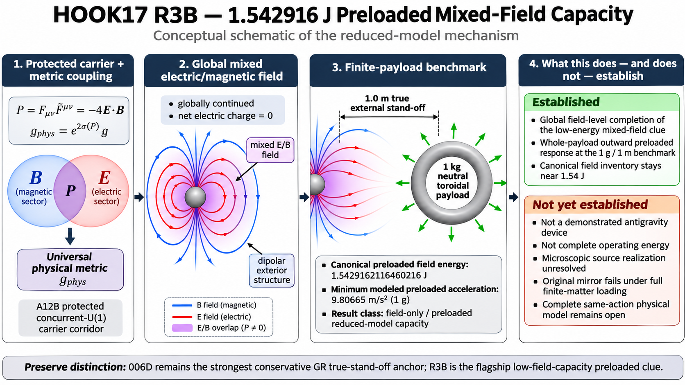
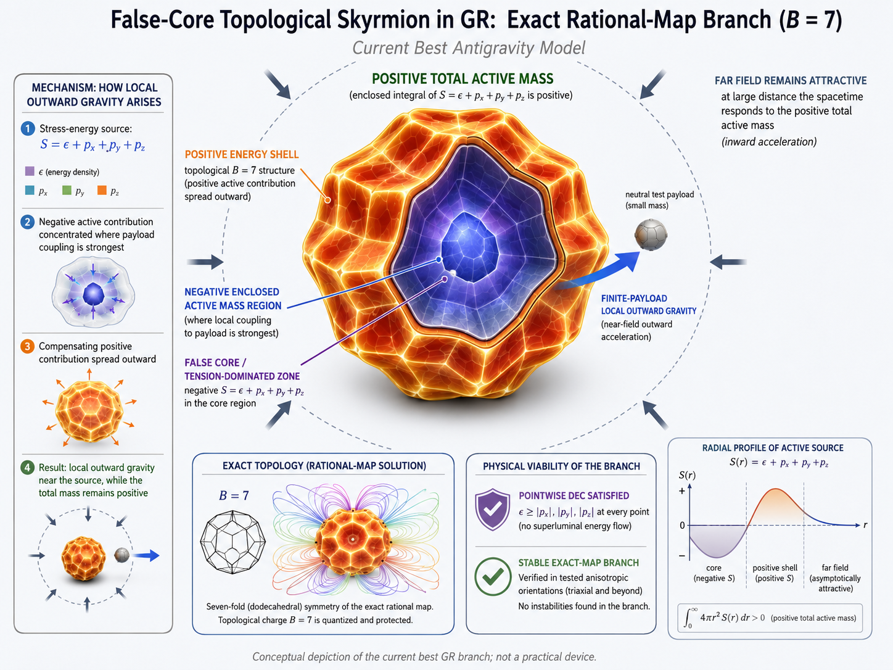

# Antigravity Research

> **For the benefit of humanity**

> **RESEARCH FROZEN — NOVEMBER 22, 2026**  
> **NEXT ACTIVE PROJECT: `R3B_ENGINE` (`r3b_engine` repository).**  
> Active research has moved to the independently governed R3B Engine mathematical-feasibility and, only conditionally, engineering program. **Antigravity Research is paused, not abandoned or declared complete.** Its original goals, source code, scientific achievements, failed hypotheses, test evidence, journals and prior plans remain preserved for a future resumption. The R3B Engine is not an experimentally demonstrated propulsion system.

**Archive status:** `ANTIGRAVITY_FROZEN_FOR_LATER_RESUMPTION`  
**Scientific freeze date:** November 22, 2026  
**This README freeze-summary revision:** November 22, 2026 research frontier; recorded after the R3B Engine strategy decision  
**Primary historical program:** `032 — AGMINER / 032H17 — HOOK17`  
**New, separate active repository:** `r3b_engine`  
**New repository governing plan:** `R3B_ENGINE_BUILDPLAN.md` (*in the new repository, not a continuation order for this one*)  
**Authoritative accepted jointly stationary physical-model checkpoint:** `PH16-04R2` (November 18; finite discrete model only)  
**Last recorded exploratory run before the pause:** `EPSILON1-02` (November 22; necessary-condition / artificial source screening)  
**Latest documented completed full parent-repository regression:** `DELTA1-02` — **3,304 passed** (November 20; later full-suite rerun not evidenced)  
**Strongest conservative true-stand-off GR construction:** `006D`, `C=23.591586299249`, **unreplaced**  
**Frozen informal physical-research maturity:** approximately **37% overall**; **33% R3B reciprocal-loading blocker** — *not* a probability of success or a measure of built hardware.

> **Scientific claim boundary.** No experiment has demonstrated genuine antigravity, an onboard universally coupled gravitational-lift device, or a net physical upward force on the complete spacecraft from the candidate model. There is no complete physical source-to-Einstein/metric action with certified real materials, full dynamical stability, continuum/exterior convergence, Earth-down/whole-craft-up momentum transfer and a complete operating-energy budget strictly below 10 MJ. The historical few-joule field values and conditional approximately 137 kN B17-M3 Earth-target calculation are **not** proof of a 1.54 J engine or actual thrust.

## Why research is paused, and how to return

We are making a **research-priority change, not a change to the antigravity acceptance criteria**. The original objective requires an onboard finite, stable source producing true gravitational repulsion of neutral matter, including at least `9.80665 m/s²` outward everywhere throughout a finite **1 kg neutral torus** at at least **1 m genuine external stand-off**; additional derived net Earth/environment interaction on the whole craft; and complete conservative operating energy **strictly less than `10,000,000 J`** for a defined operating protocol. Exactly 10 MJ fails. Auxiliary propulsion is allowed, but cannot be misclassified as gravitational lift.

Until resumption, **no additional antigravity, ALPHA, BETA, GAMMA, DELTA, GRAVITY2, G01 or EPSILON run is automatically authorized** by a dated plan or older 'next run' statement. A future reopening must begin with the frozen artifacts and genuinely new physical information, rather than recycling closed model families or optimizing a field term already below 100 J.

The new `r3b_engine` repository pursues a **different, narrower question**: can the historical R3B interaction be generated by a physically real onboard source and exchange momentum with an external target to produce independently verified whole-craft propulsion? The new project has its own build plan, evidence records, numerical verification and prospective engineering process. It does not inherit antigravity's 37% planning estimate or certify antigravity by finding ordinary field-mediated forces. **The parent repository's history is not to be moved, rewritten, or deleted.** Any imports into `r3b_engine` must be authenticated copies with original path, byte hash, action assumptions and negative-result context.

## Frozen frontier at a glance

| Result family | Preserved achievement / finding | Permanent restriction or unresolved requirement |
|---|---|---|
| **006D** | Constructive finite, nonsingular, positive-energy locally conserved type-I stress-energy in **static linearized GR**; NEC/WEC/DEC pass; outward near field; positive far active mass; `C=23.591586299249` | Approximately `1/G` energy cost; no demonstrated microscopic stable material, exact nonlinear Einstein realization or practical device; **unreplaced** |
| **018B / 018C; 022A; B7/026; 024–031** | Preserve microscopic field existence, stability tests, topological models, Q-ball/scalar and known failure mechanisms | 018C nonaxisymmetric `m=2` instability; B7/026 continuum/stand-off limitations; tested protected-vector, UV/naturalness and support mechanisms remain scoped failures |
| **Introspective** | Source-efficiency anatomy and high-gain diagnostic | `RAW_GE1000X_SIGNAL=PRESENT`; `CERTIFIED_GE1000X_CONTINUUM_SOURCE=NO` |
| **A12B / A12C** | Protected massless concurrent-U(1) corridor and **2.6568591420597114 J** prescribed `F²` field capacity; finite-torus modeled 1g/1m minimum, COM approximately `15.04217 m/s²` | Not a physical source or complete energy; ordinary EM-like realization empirically obstructed in the tested class |
| **R3B / R3X1 / B7 / B11–B16** | R3B prescribed mixed-field reference **1.5429162116460216 J**; B7 finite electric-shell reference `1.5473042949759672 J`; Lorentzian sign audit and field/geometry controls | Original 1 kg fully loaded R3B fails; B11–B13 source/reciprocity routes fail; B14/B16 `−410.388913 m/s²` inward local hotspot is **not converged** or useful net force; B15 angle-only and B16 weak-loading failures persist |
| **B17-M3** | Historical finite-Earth **prescribed-field** conditional Earth force approximately `−137,370.062620 N`, opposite mathematical source-coordinate derivative `+137,370.062620 N` at the `0.050 m` grid; reduced interaction `90,341.028147 J` | Earth cylinder is not the entire Earth; **zero hull clearance** at headline force; no real source, full craft reaction or complete energy. A later independent *R3B Engine plan review* reportedly reproduced the prescribed-force arithmetic; it did **not** verify propulsion |
| **ALPHA-1 / M5V** | Frozen artificial inverse action `Q=γ(½uᵀHu−uᵀWj)`, `H=WA`; **50/50** cases, zero errors, **1,803 tests**; signed artificial Earth/craft derivatives | Source currents, C2 material, continuum exterior and whole-craft force prescribed/unknown; M5N **81.458%** cross-grid mismatch, M5O–U **40/42** incompleteness, X1 erratum and original source-lineage discrepancy retained |
| **BETA-1 / BETA1-04** | Frozen 1D scalar toy, reciprocal forces `−0.1262097349021427 / +0.12620973490214274`; **43/43** gates, **2,548 tests** | Opposite scalar charges imposed; not universal gravity, physical Earth reaction or a sourced propulsion device |
| **PH12–PH15-P10** | Charged finite source-sector hypotheses, PH14 jointly stationary neutral spherical source; PH15-P10 nonspherical source/X and first-order induced Y | PH14 spherical on-shell Y induction zero; PH15-P10 no Y backreaction; no complete stable universal-metric gravity or physical source material |
| **PH16-04R2** | Joint finite-lattice source `F₊/F₋/X/Y` Routhian plus neutral-fluid equilibrium; fixed Noether numbers `400/400`; **12/12** identities, **19/19** scoped gates, **60/60** focused checks, **2,943** full tests at that checkpoint | Three small preconditioned residuals but not full Lorentzian health, continuum, Einstein response, SI device energy or Earth/craft momentum; original/R1 failed 18/L12 and R2 weak-seed failure retained |
| **GAMMA-1 and DELTA-1** | Executed theorem-first gravity-bridge and reciprocal/source obstruction work **after** November 18; `DELTA1-02` full regression **3,304 passed**; **10/10** focused | No qualifying gravity bridge or complete source; original R3B-loading failures and near-collinear extra invariant survive. **GAMMA1-00 is not an unexecuted 'next' run anymore** |
| **DELTA1-F0–F0G / GRAVITY2** | Source-controllability, global loaded minimum, SI/tensor controls, exterior sign and bounded miner validation | F0C nonconverged; F0D full suite **interrupted**, not passed; F0G exterior axial sign inward; no physical current or lift; no new full-regression certificate |
| **G01-S / G01-T0–T3** | Idealized conditional scalar source and exact ten-shell-mode reciprocal/energy analysis; T3 **10 MJ field-budget** dual upper bound `4.999999576 m/s²` on tested 48-point torus minimum | Bound is **specific to the finite ten-mode control basis**, not a no-go for all actions/materials. Source and universal gravity not derived |
| **G01-U1–U4A** | Scalar/pseudoscalar induction tests, reciprocal angular Maxwell and stationary-source checks | U1 approximately **7.333 MJ** scalar-only favorable conditional result was imposed-source; U3B source projections nonconverged; U4A about **18.46 MJ** fixed-profile weak-feedback estimate and stationarity failure are scoped, not universal theorems |
| **EPSILON1-00–02** | Static Schur-mixing necessary-condition interval, independent auxiliary-source rank/demand test and scale-dependent spectral/parity screens; user-executed scoped verification | **Zero physically sourced survivors**; no complete full-suite rerun for EPSILON; **EPSILON1-03 proposed but unexecuted** at freeze; no viable antigravity source, empirical/UV closure or thrust |

### PH16-04R2 — accepted stationary physical-model checkpoint, not gravitational closure

The November 18 PH16-04R2 branch retained its action, thresholds and `β=40`, with two fixed charged-source Noether numbers `400/400`. The three accepted preconditioned joint gradient residuals were `6.80575961e−08`, `6.53298486e−08` and `9.28480274e−08`. The original PH16-04 and R1 failed the 18/L12 gate at `2.093028110157171e−06`; R2's same-iterate Krylov continuation succeeded without changing the action or threshold. A distinct weak-seed run still failed at `0.018773933`. Frozen magnetic margins are positive **only in their tested scope**, not proof of interacting dynamical stability or uniqueness.

**Immutable PH16-04R2 result:** [`results/data/ph16_04_20261118T164454314313Z.json`](results/data/ph16_04_20261118T164454314313Z.json)  
**Result SHA-256:** `ff700285effc35841fbb8d0e20cffa3c8e4b812e6629b549785a2304b716b2b0`  
**R2 scientific-source SHA-256:** `b5468671f6418fad7b6ed01d916ea65a95a1d59252b84d4411beed9709f86df0`  
**Provenance note:** the early November 18 codebundle predates R2; do not regenerate R2 from that older snapshot.

### Latest full test status and late-run evidence

The most recent **documented completed complete repository regression** was `3,304/3,304` at **DELTA1-02 on November 20, 2026**, plus `10/10` focused checks and independent verification for that checkpoint. The `2,943` number applies specifically to PH16-04R2; `1,803` and `2,548` are separate historical ALPHA and BETA checkpoints, not additional tests to sum. Later DELTA-F0, GRAVITY2, G01 and EPSILON records contain scoped tests, interruptions and independently checked artifacts, **not evidence of another completed full parent regression**. No final archive-lock regression has been claimed by this README edit.

Among the frozen latest exploratory records:

- `G01-T3` established an assumption-scoped finite-control energy-bound failure of the ≥1g torus criterion at a `10 MJ` *field budget*. It does not automatically bound all new source operators or complete device energy.
- `G01-U3B` failed the needed source-projection continuum/exterior convergence; `G01-U4A` exposed a frozen scalar stationarity and profile-specific energy problem. Neither is a gravitational force certificate.
- `EPSILON1-00` screened a positive static mixing interval; `EPSILON1-01` showed why an independent auxiliary source was needed in the tested cases; `EPSILON1-02` constrained modewise spectral mixing and operator parity/symmetry. No microscopic auxiliary current or completed material action was demonstrated.
- `EPSILON1-02` scientific SHA-256: `4dfcf4f998224046f9eaca2c4494c39f525b330fa938919f81eaa2be896e4ec0`; source SHA-256: `28305918d1a1b4be228119fc91e4cc93aea978f7afc4b1dd7cb34dfa6352a4af`; independent verification SHA-256: `11e17c7747609848c69610b2701924ae1f514aac6f5e84ffd678716f6e8866f1`.

### The R3B Engine transfer — no retroactive claims

A separate revised `R3B_ENGINE_BUILDPLAN.md` reports independent reconstruction of the **historical prescribed** B17-M3 finite-cylinder force at `h=0.050 m`; the result does not establish spacecraft thrust. Its ideal canonical fixed-trace **half-space** reflection control gives approximately `−3.86558 nN` instead of the frozen-field half-space `−287,247.24 N` for the same specified incident polarization and source-center height. **Neither half-space row is the finite M3 cylinder**. Its stationary source-free positive-Maxwell-carrier gap result, `E_gap ≥ |F| d`, excludes the 1.54 J/137 kN combination **for a genuine meter-wide vacuum gap under its stated assumptions**, not for every possible gravity or alternative stress channel. These are new, *independently scoped R3B Engine review findings*, not newly executed antigravity experiments or a hardware thrust rating.

The **new repository** must independently establish a physical source action, the actual X/Y moments and source currents, reciprocal source/target relaxation, finite-medium exterior, source/hull/support force, Earth reaction, whole-craft force and impulse, dynamical stability, empirical/quantum/UV viability and complete energy/power. It is permissible for a physical R3B force to turn out to be a non-gravitational external field interaction; any such finding would retain its own classification and would **not** replace 006D or certify antigravity.

## Archive, documentation and reactivation protocol

**This README is a documentation change, not a newly executed scientific run.** The supplied November 18 README is preserved in full immediately below this section as a historical snapshot. Its older 'CURRENT', 'GAMMA-1 next', PH14/PH15, M5N/M5O, regression counts and historical closing statements remain intact but **do not govern the frozen frontier or authorize a future run**. Historical links, images, formulae and original licensing/disclosure text are retained without rewriting old claims or terms.

Before calling the repository *archivally locked* in a local checkout, verify the following separately:

1. Save the five dated journal backfill entries for November 21–22 under `journal/` **without changing the previous 36 journals**. The expected combined total is **41 only if all five were actually installed**.
2. Synchronize the active/frozen banners in `NOTES.md`, `RESEARCH_BUILDPLAN.md`, `ARTIFICIAL_BUILDPLAN.MD`, `AGMINER_BUILDPLAN.MD` and `INTROSPECTIVE_BUILDPLAN.md` while preserving all original derivations, failures, branch IDs and hashes. The other files are **not claimed updated merely because this README is updated**.
3. Record the exact physical source/result paths and checksums from the checkout; compare immutable `results/` artifacts against original manifests. Do not modify source or historical results to reconcile a mismatch.
4. Regenerate journal and code bundles *after* the above documentation synchronization; check counts, sizes, inclusion policy, original executable code and relevant comments. Exclude large documentation corpora from the **code** bundle where intended.
5. If executing a final regression, record its actual completed count, code hash, environment and timestamp. Preserve failures and interruptions. Do not advertise `3,304 passed` as a fresh test of unexecuted later changes.
6. Make a dated read-only and off-machine archive of code, tests, results, journals, source manifests, key plans and this README. Read-only permissions or one SHA string alone do not prove a durable backup.
7. Record any unverified or missing artifacts explicitly. A project can be **scientifically paused** before every administrative archival step is complete; do not claim the latter until verified.

**Evidence hierarchy on restart:** actual executed scientific JSON/source/logs/SHA and independent checks → contemporaneous journals → comprehensive freeze carry-over notes → governing build plans for future actions → historical README summaries. A plan's 'next' entry is historical until explicitly reauthorized. The `CLAIMS.md` file, if present, should be audited and synchronized separately; no edit to it is claimed here.

**Key resumption and preservation references:**

- [`RESEARCH_BUILDPLAN.md`](RESEARCH_BUILDPLAN.md): original physical strategy, source/gravity certification gates, material and energy constraints.
- [`ARTIFICIAL_BUILDPLAN.MD`](ARTIFICIAL_BUILDPLAN.MD): ALPHA/BETA/GAMMA/DELTA artificial-theorem and discovery record; future execution is paused.
- [`AGMINER_BUILDPLAN.MD`](AGMINER_BUILDPLAN.MD): permanent mechanism and failed-candidate memory.
- [`INTROSPECTIVE_BUILDPLAN.md`](INTROSPECTIVE_BUILDPLAN.md): efficiency anatomy and the uncertified raw gain distinction.
- [`NOTES.md`](NOTES.md): detailed historical and later session continuity, to be synchronized for the freeze.
- `ANTIGRAVITY_RESEARCH_FREEZE_R3B_ENGINE_CARRYOVER_20261122.md`: comprehensive November 22 archival handoff, if copied to the repository.
- `journal/2026-11-21_delta1_f0_gravity2_source_controllability_and_miner_validation.md`: DELTA1-F0 and GRAVITY2 closure record, once installed.
- `journal/2026-11-22_g01_s_t0_t3_scalar_source_and_ten_mode_energy_obstruction.md`: G01-S/T bounds, once installed.
- `journal/2026-11-22_g01_u1_u4a_axion_reciprocal_maxwell_and_scalar_stationarity.md`: G01-U observations/failures, once installed.
- `journal/2026-11-22_epsilon1_00_epsilon1_02_healthy_mixing_source_rank_and_spectral_limits.md`: EPSILON screens, once installed.
- `journal/2026-11-22_antigravity_research_freeze_and_r3b_engine_strategy_transition.md`: strategy decision and exact restart scope, once installed.
- [`FORMATTING_AND_CODE_STANDARDS.md`](FORMATTING_AND_CODE_STANDARDS.md): mathematical, implementation, archival and verification conventions.

**When antigravity resumes:** reconstruct source evidence first; preserve 006D and all scoped failures; reopen only with a genuinely specified new operator, physical current, source action or independently verified correction; re-derive universal metric/Einstein response and Earth-down/whole-craft-up momentum with full stability and complete SI energy, rather than treating a positive toy force or separate propulsion result as success. The original strict 1 kg/1 m/1g and less-than-10-MJ benchmarks remain in force.

---

## Historical README snapshot — November 18, 2026 and earlier (byte-for-byte preservation)

> **ARCHIVAL AUTHORITY NOTICE:** Everything after the separator below is the original README supplied for this freeze edit, retained *byte-for-byte*. It contains earlier November 18, November 15, November 13, September 15 and other dated interpretations, including now-obsolete future-work and test-count statements. They remain valuable as evidence of the program's chronology, **not as current execution instructions**. This freeze summary above takes precedence for the project status as of November 22, subject always to the original executed evidence.

---

# Antigravity Research

> **For the benefit of humanity**

**Current README summary:** November 18, 2026  
**Research program:** `032 — AGMINER / 032H17 — HOOK17`  
**Latest verified physical-model experiment:** **PH16-04R2** (scoped finite-lattice source/X/Y/neutral-fluid stationary closure)  
**Latest full repository regression:** **2,943 passed**; **60/60** PH16-04 focused tests, **12/12** exact identities, **19/19** scoped gates, **11/11** parent/provenance checks  
**Next-session research priority:** **GAMMA-1**, beginning with `GAMMA1-00_EXACT_SOURCE_TO_GRAVITY_BRIDGE_FORK` (**not yet executed**)  
**Frozen artificial references:** **ALPHA-1/M5V** and **BETA-1/BETA1-04**  
**Conservative GR true-stand-off anchor:** **006D**, `C=23.591586299249`, **unreplaced**  
**Estimated physical-research maturity:** **~35% heuristic** (not a probability of success or device-completion percentage)

> **Scientific status:** No experimentally demonstrated antigravity or verified whole-spacecraft gravitational lift; no fully sourced, stable continuum Einstein/metric realization; no derived Earth-down/whole-craft-up external reaction; and no certified **strictly below 10 MJ** complete operating-energy budget. All PH16-04R2 results concern a hypothetical, specified **discrete** action, not experimental evidence or a demonstrated engine.

## Current research snapshot — November 18, 2026

| Research stage | Verified outcome | Limit / next obligation |
|---|---|---|
| **006D** | Finite, positive-energy, conserved source with outward near field in static linearized GR; NEC/WEC/DEC compatible and positive far active mass | Catastrophic approximately `1/G` energy scale; no practical stable material realization |
| **ALPHA-1/M5V** | Frozen artificial inverse-design action and translation-derivative audit; 50/50 cases, 1,803 regression passes | Prescribed currents and material response; **not spacecraft thrust** |
| **BETA-1/BETA1-04** | Frozen artificial obstruction and action–reaction toy-model results | Prescribed material charges; no real gravitational interaction or physical Earth–craft model |
| **PH15-P10** | Discrete neutral two-center charged-source/X solution and first-order induced Y without Y backreaction | Continuum, constrained stability and full reciprocal response unproved |
| **PH16-00 through PH16-03** | Source-to-metric obstruction atlas; hydrostatic neutral fluid; stationary Y and fixed-Noether reduced-sector checks | Charged scalar/X backreaction initially frozen, and metric equations unsolved |
| **PH16-04R2** | Joint **finite-lattice** F/X/Y stationary gradients with conserved charged-source numbers and hydrostatic neutral matter; three numerical cases passed | Continuum and exterior consistency, full Lorentzian-mode health, realistic materials/supports, Einstein response and Earth reaction **open** |
| **GAMMA-1 (planned)** | Theorem-first physical-gravity-bridge discovery and falsification | **No GAMMA simulation executed**; begin with GAMMA1-00 only |

### PH16-04R2 verification checkpoint

The Y-preconditioned joint solution gave absolute action-gradient L2 residuals `6.80575961e-08` (`12_L12`), `6.53298486e-08` (`18_L12`) and `9.28480274e-08` (`12_L16`), all below the unchanged `1e-6` acceptance threshold. Both charged-source Noether numbers remained fixed to approximately machine precision. The tested discrete gauge/Bianchi checks passed. The positive **frozen** magnetic-principal diagnostic does **not** certify full dynamical stability.

The original PH16-04 and PH16-04R1 runs failed the `18_L12` convergence criterion (`2.093028110157171e-06`). The PH16-04R2 bounded continuation achieved `6.53298485747981e-08` with native solver success **without changing the action or acceptance threshold**. Its independent weak-field initialization **still failed** on that mesh (`0.018773933` residual), so numerical-basin independence and uniqueness are unresolved.

**Primary immutable result:** [`results/data/ph16_04_20261118T164454314313Z.json`](results/data/ph16_04_20261118T164454314313Z.json)  
**Result SHA-256:** `ff700285effc35841fbb8d0e20cffa3c8e4b812e6629b549785a2304b716b2b0`  
**PH16-04R2 scientific-source SHA-256:** `b5468671f6418fad7b6ed01d916ea65a95a1d59252b84d4411beed9709f86df0`  
**Provenance caution:** The November 18 early codebundle predates the final R2 patch. Consult the verified result, final source hash and the subsequent November 18 journal before reconstructing this run.

### Next session: GAMMA-1, not another broad optimization campaign

The active [`ARTIFICIAL_BUILDPLAN.MD`](ARTIFICIAL_BUILDPLAN.MD) makes **GAMMA1-00** the **only immediately authorized** new research run. It compares the existing PH16 conformal-portal mechanism, finite positive-energy anisotropic GR stress, and minimal genuinely new healthy metric couplings in **one high-information theorem-first atlas**. Derive common-action variations, gauge/Ward/Noether/Bianchi identities, neutral-matter physical response, the gravitational-force sign, real exterior transmission, Earth reaction and SI energy obstructions **before** authorizing additional expensive simulations. A favorable artificial force derivative is not a physical force certificate.

The fixed independent benchmark remains a **finite 1 kg neutral torus with at least `9.80665 m/s²` outward acceleration everywhere at at least `1 m` genuine exterior stand-off**. The distinct spacecraft objective requires a **net whole-craft external upward gravitational interaction** and a corresponding Earth/environment momentum ledger; auxiliary thrust is allowed but must be distinguished. Complete operating energy must be **strictly below `10,000,000 J`**, including source, fields, supports, backreaction, losses, cycles and off-state. Few-joule A12C/R3B numbers remain **prescribed field capacities**, not sourced-device energy. Thursday **November 26, 2026** is an aggressive research decision deadline, **not a promise of a working engine**.

**Reading order:** verified JSON/SHA and producing code/test logs → [November 18 research journal](journal/2026-11-18_032h17a12d1r3x3b17_beta1_ph16_04r2_gamma1_gravity_bridge_handoff.md) (after it is copied into `journal/`) → comprehensive GAMMA carry-over notes → [`ARTIFICIAL_BUILDPLAN.MD`](ARTIFICIAL_BUILDPLAN.MD) for artificial priorities and [`RESEARCH_BUILDPLAN.md`](RESEARCH_BUILDPLAN.md) for physical certification requirements → [`AGMINER_BUILDPLAN.MD`](AGMINER_BUILDPLAN.MD) and [`INTROSPECTIVE_BUILDPLAN.md`](INTROSPECTIVE_BUILDPLAN.md) for preserved failure history. Older descriptions below remain archival and are **not** the current experiment queue.

---

## Historical README — November 15, 2026 and earlier (preserved verbatim)

> **ARCHIVAL NOTICE:** Everything from the next `# Antigravity Research` heading onward is the original supplied README, retained **byte-for-byte** to preserve its historical links, derivations, figures, licensing and dated decisions. Its November 15 **PH14 latest / PH15 next** statement, November 13 M5N queue, and older appendices are historical—not the November 18 research frontier. The active research summary is above.

---

# Antigravity Research

> **For the benefit of humanity**

**README last updated:** **November 15, 2026**  
**Current research program:** `032 — AGMINER / 032H17 — HOOK17`  
**Newest completed experiment:** **`032H17A12D1R3X3B17-PH14`**  
**Most recent full repository verification:** **2,220 tests passed**; PH14 focused suite **47 passed**; historical provenance checks **PASS**  
**Next scientific experiment:** **PH15 — on-shell nonspherical neutral source and trace-induced Y-carrier existence**  
**Conditional successors:** **PH16** (reciprocal two-carrier/metric loading and stability), **PH17** (exterior Earth–craft force), with **B11-M6** causal dynamics co-primary  
**ALPHA-1 artificial campaign:** **FROZEN** at **B17-M5V** (November 14, 2026)  
**Conservative true-stand-off GR anchor:** **006D**, `C=23.591586299249`, **unreplaced**.

> **Current scientific status:** No experimentally demonstrated antigravity, no complete physically sourced universal-metric/gravity action, no verified gravitational lift of a spacecraft, and no certified operating-energy budget strictly below 10 MJ. PH14 is a **classical stationary source-sector solution in a hypothetical field theory**, not a realized material or device. The newest research results are mathematical and computational, not independent experimental evidence.

## Research progress and estimated completion — November 15, 2026

**Estimated theoretical research progress: approximately 35%.** This is an **informal, uncalibrated research-planning estimate**, not the measured percentage of a working spacecraft engine, not a probability of success, and not a linear sum of passed tests. A single unresolved source, stability, conservation, gravitational or empirical obstruction could require substantial new physics or close the present candidate.

| Current milestone | Verified scope | What is still missing |
|---|---|---|
| **35% — current planning estimate** | PH14: jointly solved, net-neutral, localized two-scalar/X-Maxwell **spherical stationary equilibrium** in a hypothetical classical action; PH13: a possible first-order Y induction on an **off-shell** nonspherical pair | Bring nonspherical source equilibrium and induced Y together **on-shell**, then solve full reciprocal action |
| **~40% — provisional next research milestone** | Would require a genuine stationary nonspherical neutral source plus nonzero sourced Y response with meaningful initial health and convergence checks | Not reached; PH15 has not executed |
| **~50% — provisional integrated-field milestone** | Would require full reciprocal scalar/X/Y/matter loading and substantive constrained mode-health/stability evidence | Not reached; PH16 conditional |
| **~60% or higher — ambitious next-session research goal** | Would additionally require a credible, quantitatively derived external Earth–spacecraft reaction and meaningful progress on sourced causal dynamics, physical scales and complete energy | Not reached; not a promised outcome or device-completion certificate |

The percentages are **subjective planning labels** only. Later calculations may move the estimate **downward** if a promising branch fails. Even a theoretical 60% assessment would not establish a buildable or independently verified engine.

### Latest achievement: PH14, an electrically neutral jointly solved source

Within a proposed canonical classical field theory containing **two oppositely X-charged complex scalar species**, their nonlinear scalar self-interactions and a shared massless electromagnetic-like X carrier, PH14 solved the two scalar profiles, electrostatic potential and stationary frequencies **together**. No externally prescribed square-well trap was used. The solution is spherically symmetric, and its scalar profiles have exponentially decaying—not exactly compact—tails.

| PH14 observable | Executed result | Scientific meaning |
|---|---:|---|
| Full repository regression | **2,220 passed** | Software/research checks, not experimental certification |
| PH14 focused tests | **47 passed** | Scoped solver and regression checks |
| Individual conserved Noether numbers | 77.98837343718844 / 77.98837343734536 | Nearly equal within numerical tolerance |
| Total X gauge charge | **−7.845812888263027 × 10⁻¹²** | Near-zero net charge in model units |
| Maximum internal radial electric field | **0.0005383584446341459** | Nonzero internal field despite total neutrality |
| Total source-sector energy | **161.51589053332395** | **Canonical natural units, NOT joules** |
| Two separated equal-Noether-number source energy | **161.889035667003** | Selected classical reference state |
| Energy advantage of joint source | **0.37314513367903146** | Canonical units; not proof of global binding or dynamical stability |
| Relative integrated stress-virial residual | **4.009320452612122 × 10⁻¹¹** | Stationary spherical consistency diagnostic |
| Lowest sampled two-charge-fixed radial Hessian eigenvalue | **+0.20883838665688392** | Only a restricted 12-direction static curvature screen |
| On-shell spherical trace-induced Y magnetism | **Exactly zero by symmetry** | **Decisive missing second-carrier requirement** |

The restricted PH14 Hessian had a **nonzero discrete energy gradient** (about `0.02651045818424791`). No full radial, nonradial, time-dependent, gauge/metric or quantum stability certificate exists. The model's constituent particles and effective interactions have **not** been experimentally realized or matched to physical SI scales. An energy comparison with two selected separated Q-balls does not establish the global minimum over all allowed configurations.

**Primary result:** We now have a more self-consistent *source subsystem* than the earlier prescribed-current or externally trapped source constructions. **Primary negative result:** PH14's symmetry eliminates the proposed Y-induction channel on this source. PH14 neither demonstrates gravitational repulsion nor supersedes 006D.

**Executed result:** [`PH14 JSON`](results/data/032h17_ph14_neutral_composite_20261115T092726920597Z.json) · [`PH14 source equations and solver`](src/antigravity_research/agminer/hook17_ph14_neutral_composite.py) · [`PH14 simulation`](simulations/032h17a12d1r3x3b17_ph14_neutral_composite.py) · [`PH14 tests`](tests/agminer/test_032h17_ph14_neutral_composite.py).

### The exact PH13 → PH14 discovery and obstruction

**PH13** showed a *first-order mathematical* mechanism: two separated charged scalar profiles, superposed **off-shell**, produced a nonzero induced Y magnetic field under the proposed universal-metric matter-trace coupling. Its finest reported control gave an integrated Y magnetic-field-squared value of about `2.1460834478521506e-6` in normalized units. But the two-center source was **not** a jointly solved equilibrium.

**PH14** supplied a jointly on-shell **electrically neutral** source within the restricted scalar–X action, but only in **spherical** symmetry. Both its electric field and matter-trace coefficient are radial. Accordingly, the proposed induced magnetic source vanishes:

```math
\nabla\lambda\times\mathbf E_X=0
```

The key proposed static first-order induction criterion is:

```math
\nabla\lambda\times\mathbf E_X\ne 0
```

where `lambda` is the matter-trace-dependent portal coefficient derived from the chosen action. **Nonspherical shape is necessary for this particular induction mechanism but is not automatically sufficient**: if `lambda` is only a function of the electrostatic potential `A_0`, the gradients remain aligned and the induction still vanishes. The precise carrier constitutive coefficients and signs must be derived from the same Lorentzian action; the displayed criterion is not a complete field-equation solution.

The portal under investigation has a schematic **universal conformal metric**:

```math
\widetilde g_{\mu\nu}=e^{2\sigma(P)}g_{\mu\nu},\qquad
\sigma(P)=\alpha P-\beta P^2
```

with mixed Abelian pseudoscalar `P` formed from the X and Y field strengths. This remains a **candidate interaction**. PH14 has not solved its fully coupled matter–two-carrier–Einstein equations or demonstrated that this coupling is compatible with quantum/UV and empirical constraints. The earlier **PH13 joint kinetic-health control** found that a frozen-carrier positive mode may become negative when coupled scalar perturbations are allowed; actual sourced backgrounds must pass the stronger tests.

**Research record:** [`PH12 isolated gauged scalar JSON`](results/data/032h17_ph12_gauged_qball_20261115T072909800847Z.json) · [`PH13 joint-kinetic and induction JSON`](results/data/032h17_ph13_integrated_go_no_go_20261115T084131765629Z.json).

## What's next — PH15 → PH16 → PH17, with B11-M6 co-primary

The project will **not** repeat a broad artificial inverse-design scan or optimize an already few-joule prescribed field merely for a lower energy headline. The next experiments are **theorem-first, conditional, and falsifiable**:

1. **PH15 — On-shell nonspherical neutral source and Y-induction existence.** First derive exact symmetry, integrability, Ward, Noether and constitutive conditions, particularly whether the candidate source can satisfy the nonzero trace/electric-gradient misalignment above. If this survives, solve a **genuinely stationary axisymmetric** charged-scalar–Maxwell configuration with physically justified winding, necessary magnetic/electric X components, neutrality, stress and boundary conditions. Then test whether Y is actually sourced without prescribing an off-shell current. A nonspherical field plot alone is not a pass.
2. **PH16 — Same-action reciprocal completion and stability.** Only for a surviving PH15 source: solve the coupled X/Y/scalar response with the universal physical metric, source/current and matter backreaction, correct R3X1 Lorentzian signs, full gauge constraints, canonical Hessians, characteristic cones and nonradial modes. Stop if the actual loaded background is unhealthy or cannot satisfy the common field equations.
3. **PH17 — Real exterior Earth interaction and whole-spacecraft reaction.** Only for a healthy sourced configuration: derive exterior transmission, realistic neutral matter coupling, Earth **below the onboard source**, corresponding Earth/down and craft/up momentum exchange, support/hull/enclosure reaction, ordinary gravity and atmosphere. An internal payload push does not constitute propulsion; both the true 1g/1m finite-neutral-payload benchmark and the separate whole-craft force requirement remain open.
4. **B11-M6 — Causal two-carrier driven impulse.** Work on source-driven hyperbolic equations and correct failed static limit in parallel; later test one fully signed pulse, unfavorable phases, source/field recoil, radiation, work, losses and consecutive cycles **without arbitrary resets**. Do not convert a positive transient peak into a claim of hover.

**Progress objective:** reach or exceed a *subjective* **60% research-planning milestone** only if several independent physical gates genuinely close. A negative analytic theorem or an instability is a valuable scientific result but cannot be counted as an earned propulsion or complete-source certificate.

### Updated milestone and claims ledger

| Evidence level | Current conclusion |
|---|---|
| **006D** conservative GR true stand-off | **Unreplaced**; finite positive-energy conserved source in linearized GR, NEC/WEC/DEC passes, `C=23.591586299249`, catastrophic approximately inverse-`G` energy scaling |
| A12C `2.6568591420597114 J` and flagship R3B `1.5429162116460216 J` | **Prescribed preloaded field capacities only**; not sourced, loaded operating energy or lift |
| B17-M5V artificial research | **50/50 completed, zero errors; 1,803 full regression tests**; artificial reduced stationary action and translation derivatives, not physical craft force |
| PH12–PH14 physical-source mathematics | Isolated then jointly solved neutral classical source sector; **not** complete universal-metric gravity |
| PH13 induced Y / PH14 neutral source | **Induced Y: off-shell** / **on-shell neutral source: spherical Y zero**; joint condition remains unsolved |
| Full dynamical mode stability | **Not certified** |
| Physical neutral payload ≥1g at ≥1m true external stand-off | **Not certified in a complete sourced model** |
| Earth-down / full-spacecraft-up external reaction | **Not derived** |
| B11-M6 sourced stable signed operating cycle | **Not run / not certified** |
| Complete conservative operating energy strictly `<10,000,000 J` | **Not certified**; canonical PH14 energies cannot be converted to joules without independent physical normalization |
| Independently demonstrated antigravity or spacecraft lift | **No** |

### Frozen ALPHA-1 reference (completed November 14, 2026)

The deliberate artificial ALPHA-1 campaign has **ended at M5V**. It established a precisely registered stationary reduced-action calculation, **not** a physical force. The numerically supported extended-domain model at `h=0.04 m` reported:

```text
Earth translation derivative      -11.395675919 J/m
Craft translation derivative      +11.397230073 J/m
Common-translation residual       +0.001554154 J/m
Reduced interaction action        -7.975232332 J
Registered numerical cases        50/50 completed, zero errors
Full regression at the freeze     1,803 passed
```

Its source currents and Earth material response were **artificial inputs**. Numerical convergence screens did not prove exact infinite-exterior closure, physical reciprocity, gravitational thrust or complete apparatus energy. Material width and boundary conditions materially affected results. A historical M5V installer-versus-executed-source SHA discrepancy must be preserved as an archival qualification; newer checks of the recorded executed module do not automatically resolve that historical difference.

**No broader M5-series artificial optimization is planned.** M5V is available as a frozen mathematical comparator when a new physical action demands a narrow diagnostic.

### Permanent benchmark and energy policy

The standard independent science benchmark is **at least 1g outward acceleration on finite neutral matter at at least 1m of genuine external stand-off**, traditionally tested on a **1 kg neutral torus**. The physical engine goal is distinct: **an onboard spacecraft with a derived net upward external Earth/environment interaction**, auxiliary propulsion allowed, all source/power/support equipment onboard.

```math
 a_{\mathrm{outward}}\ge 9.80665\ \mathrm{m\,s^{-2}},\qquad
 d_{\mathrm{true\ stand\!\!-\!off}}\ge 1\ \mathrm m
```

The energy acceptance rule remains **strict**:

```math
 E_{\mathrm{complete,conservative,operating}}<10^7\ \mathrm J
```

Exactly 10 MJ fails. This complete ledger must include the necessary physical source, support, fields, enclosures, power/activation, off-state behavior, backreaction, cycling, radiation/losses and a **defined operating protocol**. A small canonical field term is not a complete source or device budget.

### Reproducibility, updated planning records and reading order

**Authoritative active research strategy:** [`RESEARCH_BUILDPLAN.md`](RESEARCH_BUILDPLAN.md) (November 15 PH14→PH17 plan, after the updated file is installed in the repository).  
**Detailed current research handoff:** [`NOTES.md`](NOTES.md) and the November 15 PH1–PH14 research journal, **once copied into the repository**.  
**Scoped failures and mechanism memory:** [`AGMINER_BUILDPLAN.MD`](AGMINER_BUILDPLAN.MD), [`INTROSPECTIVE_BUILDPLAN.md`](INTROSPECTIVE_BUILDPLAN.md).  
**Reproducibility and GitHub math:** [`FORMATTING_AND_CODE_STANDARDS.md`](FORMATTING_AND_CODE_STANDARDS.md) and [GitHub's mathematical expression guidance](https://docs.github.com/en/get-started/writing-on-github/working-with-advanced-formatting/writing-mathematical-expressions).  
**Public claims, legal/disclosure records:** [`AI_ASSISTANCE.md`](AI_ASSISTANCE.md), [`LICENSE.md`](LICENSE.md).

**Evidence precedence:** the newest actually executed result JSON, exact producing code, terminal logs and tests control run status; dated journals and notes provide the interpretation; research plans govern future priority; older historical plans and this README's archive do **not** supersede a newer executed result. Passing 2,220 tests is not proof of a physical antigravity model.

**Documentation update scope:** This November 15 README update **only drafts a new README file** for the user to place into the repository. It does not itself modify local source code, journals, `NOTES.md`, the buildplan, AGMINER/Introspective, or regenerate bundles. The previous README is retained verbatim below for history and original detailed source links.

---

# Historical README snapshot — November 13, 2026 (preserved verbatim)

> **ARCHIVAL AUTHORITY NOTICE — NOT THE CURRENT FRONTIER.** Everything below is the exact original README text as provided on November 15, 2026. It begins with its own November 13 status and contains a September 15 historical appendix. Statements such as “M5N latest,” “M5O next,” “1,455 tests latest,” “B11 proposed,” and earlier Pauli/A12D0 next-step queues were correct *at their historical dates* but are not current research instructions. **The active November 15 status and PH15–PH17 plan are above.** Original links, historical mathematics, research descriptions and licensing disclosures are preserved without retroactive rewriting.

---

# Antigravity Research

> **For the benefit of humanity**

**Research status: November 13, 2026** · **Program:** `032H17 — HOOK17` · **Latest completed numerical branch:** `R3X3B17 / ALPHA-1R9 / M5N` (artificial reduced-model interface audit) · **Next planned numerical gate:** `B17-M5O` (controlled Earth-interface/grid/domain convergence) · **Co-primary open investigation:** `R3X3B11-M6` (physically sourced dynamics and finite impulse) · **Last recorded complete regression:** **1,455 passed** on November 12, 2026 (before the newest ALPHA-1 additions; a fresh full regression is required).

**Scientific status:** No experimentally demonstrated antigravity, no complete physically sourced spacecraft-lift model, and no certified complete operating-energy budget below 10 MJ. The numerical results below arise from particular reduced or linearized theoretical models and are not experimental observations. **ALPHA-1 additionally uses deliberately artificial source amplitudes, prescribed matter-loading functions, and hypothetical reduced carrier interactions: its action derivatives are not demonstrated gravitational forces.**



*The original 1 kg torus and 1 m stand-off remain a **laboratory/theory benchmark**. The new research architecture places the **source apparatus aboard a spacecraft** and investigates a downward-directed interaction with Earth.*

## Mission: an onboard engine, Earth-directed influence, whole-craft lift

The project now prioritizes a **craft-mounted** source system. The generator, its two carrier-field sectors, power supply, physical current sources, mounting structures, possible vacuum enclosure, and every associated reaction load move **with the craft**. The candidate influence is directed **downward toward Earth**, with the goal of reducing the required auxiliary upward propulsion, hovering, or eventually ascending when the novel upward contribution exceeds the craft's weight. Auxiliary propulsion is explicitly allowed.

The new physics must establish at least one of two routes, rather than assuming either works:

1. **Earth-referenced repulsive interaction:** Earth receives downward momentum while the complete spacecraft receives an upward reaction, with all field and gravitational momentum accounted for.
2. **Physical-metric modification of gravitational free fall:** the craft's response to Earth's gravitational field changes consistently within one universal physical metric and complete gravitational dynamics. A reduction in apparent weight is not a license to discard conservation or source reaction.

Ordinary aerodynamic thrust, photon rockets, ground contact and auxiliary engines must be reported as *separate* momentum channels. Forces between the onboard generator and the craft's own hull **do not produce net isolated-vehicle thrust**.

### Craft reference equation (screening approximation only)

For a specified craft mass and near-surface Newtonian comparison, with upward chosen positive:

```math
M_{\mathrm{craft}}a_z
= F_{\mathrm{novel},\uparrow}^{\mathrm{craft}}
  + T_{\mathrm{aux}} + N_{\mathrm{ground}}
  + F_{\mathrm{other,ext}} - M_{\mathrm{craft}}g_{\mathrm{Earth}}
```

Here the novel term must be an independently derived **net force on the entire craft** (or its consistent weak-field effective-weight equivalent), **not** the force on one onboard part or a force counted twice. For a freely suspended craft with negligible other forces, the approximate auxiliary hover requirement becomes:

```math
T_{\mathrm{aux,hover}}
\approx M_{\mathrm{craft}}g_{\mathrm{Earth}}
        -F_{\mathrm{novel},\uparrow}^{\mathrm{craft}}
```

A force insufficient for field-only hover could still reduce auxiliary fuel expenditure. No present R3B calculation establishes a positive value for this whole-craft Earth-directed term.

**Distinct operational scenarios to be modeled:** (i) ground-contact source-off and activation, (ii) launch-pad release/auxiliary-assisted takeoff, (iii) already suspended operation at several clearances, (iv) stable hover, and (v) powered climb. A suspended-operation result does not automatically establish ground liftoff. The Earth is an **external reaction partner**, not a stationary generator carrying the source under a separate payload.

## Research strategy: constraint-first inverse design (ALPHA-1)

Alongside theorem-first searches for a complete physical theory, B17 now uses **ALPHA-1 as a deliberately artificial inverse-design reference model**. Instead of claiming to know a working antigravity source, we **specify a desired, testable Earth–craft interaction and trial source/field/material variables**, solve the reduced mathematical system, then work backward to ask which *real* source matter, gauge symmetries, action terms, stress-energy, geometry, and momentum channels would be necessary to realize it. **The specified inputs are hypotheses and computational controls, not physical discoveries or experimental measurements.**

The workflow is deliberately falsification-first:

1. **Specify the performance and conservation target.** The eventual output is whole-craft, Earth-referenced upward force or reduced effective weight, together with Earth/environment reaction, exterior transmission, neutral-matter response, and a complete energy budget. No desired force is inserted as a physical result.
2. **Construct an explicit artificial reference system.** Use clearly labeled trial current profiles, amplitudes, coupling coefficients, boundary conditions and material-loading functions. Solve and check the reduced carrier equations, source neutrality, variational identities, response and grid limits. Keep all artificially assigned parameters visible in results and journals.
3. **Find the obstruction, not merely a favorable number.** Audit grid phase, continuum-source equivalence, material interfaces, enclosure and finite-box artifacts, step-size sensitivity, and full-system conservation. A force-like derivative in J/m is not automatically mechanical thrust.
4. **Attempt physical completion or close the route.** Derive the same behavior from one healthy source–carrier–matter–metric–gravity action, including exact gauge/Ward/Noether identities, physical current maintenance, canonical normalization, exterior field propagation, Earth–craft reaction, empirical/UV consistency and complete operating energy. If the necessary coupling or source cannot be realized, record the failure; do not relabel artificial input as known physics.

This is **inverse design under physical constraints**, not reverse-engineering a successful device from fabricated data. Its purpose is to identify what a real theory would have to supply and to eliminate numerical mirages before investing in full physical modeling. **It does not raise the evidentiary status of the R3B preloaded field-capacity result or replace 006D.**

### Mathematical status of the artificial reference calculation

For fixed prescribed material loading, ALPHA-1 uses the coupled reduced carrier system $Au=j$, a signed numerical source-pairing matrix $W=\mathrm{diag}(W_\phi,-W_a)$, and $H=WA$. The tested stationary functional is:

```math
Q(u;j)=\frac12u^THu-u^TWj,\qquad H\simeq H^T.
```

At a stationary solution, $Q_*=-\tfrac12u_*^TWj$. With the existing reduced-action conversion factor $\kappa(h)$, the artificial Earth-present minus Earth-free diagnostic is $I=\kappa(h)(Q_{*,\mathrm{Earth}}-Q_{*,\mathrm{air}})$. Holding the source and pairing weights fixed while displacing the **prescribed** Earth material coefficient gives the envelope identity:

```math
\frac{dI}{dz_E}=\frac{\kappa(h)}2 u_*^T\frac{\partial H}{\partial z_E}u_*
```

for the Earth-dependent contribution under the tested assumptions. This is a derivative of the **reduced on-shell carrier action**, not a certified force on a complete physical craft. Its sign and dimensional equivalence $1\,\mathrm{J/m}=1\,\mathrm N$ do not remove the missing dynamical source, material, stress-energy and metric sectors.

## Flagship mathematical field-capacity result: 1.5429162116460216 J

**`032H17A12D1R3B`** remains the flagship reduced-model **preloaded** field configuration. The modeled, globally continued and net-electric-neutral mixed electric/magnetic exterior was normalized to at least **9.80665 m/s² (1g)** outward acceleration at sampled locations of a finite, neutral **1 kg torus** separated by **1.0 m true external stand-off** from the original source. Its reported canonical **preloaded field-only** inventory is:

```math
\boxed{U_{\mathrm{R3B,preloaded}} = 1.5429162116460216\ \mathrm{J}}
```

**This is not gravitational energy measured in the laboratory, a fully loaded finite-matter solution, source material energy, source work, or a spacecraft's operating energy.** It is a reduced-model field-capacity reference with numerical precision limitations. Finite-matter backreaction causes the original static R3B mirror to **fail** the benchmark.

| Quantity | Recorded value | Interpretation |
|---|---:|---|
| R3B canonical preloaded energy | **1.5429162116460216 J** | Field-only; reduced model |
| Original neutral test distribution | **1 kg torus** | Laboratory/theory control, **not** final spacecraft geometry |
| Minimum sampled *preloaded* outward acceleration | **9.80665 m/s²** | Calculated from proposed physical metric; not observed gravity |
| True laboratory source-to-payload stand-off | **1.0 m** | Original benchmark only |
| Net electric monopole | **Zero** | Mathematical source-field property; no complete microscopic source |
| R3X3B7 10 cm electric-layer control | **1.5473042949759672 J** | Preloaded field-only; finite-width *mathematical* electric source |
| Fully reciprocal original 1 kg static load | **Fails** | Destructive interface screening / force cancellation |
| Onboard source → Earth-down / craft-up force | **Not established** | First fundamental new architecture gate |
| Complete conservative operating energy | **Unknown** | Certification target strictly **below 10 MJ** |

### What the proposed physical metric assumes

A12B supplies a *scoped* protected massless concurrent-`U(1)` carrier corridor. In the R3B reduced model, the proposed universal physical metric contains a mixed-sector topological pseudoscalar. Schematically, and **not as a complete sourced field theory**:

```math
\widetilde g_{\mu\nu}=e^{2\sigma(P_{XY})}g_{\mu\nu}
```

```math
P_{XY}=F_{X\,\mu\nu}\widetilde F_Y^{\,\mu\nu}
```

In a static slow-motion limiting calculation, the modeled metric acceleration is approximated by:

```math
\mathbf a_{\mathrm{modeled}}\simeq-c^2\boldsymbol\nabla\sigma
```

The exact two-sector normalization, signs and complementary field components must be verified from the complete action; the one-sector identity $F_{\mu\nu}\widetilde F^{\mu\nu}=-4\mathbf E\cdot\mathbf B$ must **not** be substituted for the mixed-sector model without derivation. Under time-dependent conditions, the static acceleration formula alone is insufficient.

A fixed linear pseudoscalar metric dependence also raises parity/CP, technical-naturalness and experimental-consistency questions. The carrier, source, matter, physical metric, gravity and support responses must all follow from **one** action. No gravitational experiment has validated this coupling.

## What the fully loaded calculations actually show

The matter action required to produce a universal-metric force also causes reciprocal matter-to-field loading. In the original static R3B construction, gradients near the finite payload's material interfaces reorganize the fields and create strong, opposing local force contributions.

| Grid spacing | Original 1 kg loaded worst-point acceleration | Original 1 kg loaded COM acceleration |
|---|---:|---:|
| 0.075 m | **−46.406 m/s²** | +0.079708 m/s² |
| 0.050 m | **−129.672 m/s²** | +0.154542 m/s² |
| 0.040 m | **−145.638 m/s²** | −0.091742 m/s² |

These are **modeled** reciprocal-loaded responses, not observed forces. The COM result is near zero and changes sign with grid refinement. The original static 1 kg benchmark remains **failed**. [Source: corrected R3B inverse-loading solver](src/antigravity_research/agminer/hook17_fdual_f_r3x3b0_inverse_loading.py); [historical results](results/data/032h17a12d1r3x3b0_inverse_loading_summary.json).

### Unexpected result: approximately 42g *locally inward* (B14/B16)

A follow-up static reciprocal-loading calculation **accidentally produced a very large local inward modeled acceleration** in a lower-mass version of the original neutral torus. In the same full-size geometry with about **100 g** of matter, the 0.040 m B14/B16 result was:

```math
\boxed{a_{z,\min}\approx -410.3889130906965\ \mathrm{m\,s^{-2}}\approx -41.85\,g}
```

This resembles a highly localized **attractive / tractor-beam-like gradient** *inside the numerical reduced model*. It is noteworthy as a clue about material-interface amplification and cancellation, **not** an established 42g tractor beam.

| Grid | Approximate 100 g worst-point acceleration | Approximate 100 g COM acceleration |
|---|---:|---:|
| 0.075 m | −56.67 m/s² | −0.648 m/s² |
| 0.050 m | −174.27 m/s² | +0.216 m/s² |
| 0.040 m | **−410.39 m/s² (−41.85g)** | **−0.2084723 m/s² (−0.0213g)** |

At the finest sampled resolution, the opposing modeled force contributions were approximately **+0.953282 N** and **−0.974132 N**, giving a net **−0.0208503 N**. Thus the dramatic local hotspot almost entirely cancels in the full finite payload, and **the local extremum grows strongly with grid refinement: it is not continuum converged**. Its sign also cannot simply be reversed into Earth-directed lift: if an onboard source *attracted Earth upward*, the craft would generally recoil *downward*.

**Primary sources for the ~42g number:** [B14 100 g reciprocal-loading simulation](simulations/032h17a12d1r3x3b14_100g_payload_quickcheck.py), its [structured output](results/data/032h17a12d1r3x3b14_100g_payload_quickcheck.json), and the **later repeated 100 g sample using the same underlying loaded solver** in [B16 0.040 m response JSON](results/data/032h17a12d1r3x3b16_weakload_h040_summary.json), `results[]` with `density_fraction = 0.1`, `min_loaded_m_s2 = -410.3889130906965`, `density_weighted_com_m_s2 = -0.20847229887377233`, and `net_force_n = -0.020850279624959306`. See also the [B16 simulation](simulations/032h17a12d1r3x3b16_weak_loading_mass_response.py).

**Claim boundary:** This is a **finite-grid, nonconverged, local acceleration value** of a hypothetical metric response. It is **not** a 42g whole-body force, 42g spacecraft acceleration, evidence of a real tractor beam, or an Earth-repulsion success.

### B16: favorable weak-loading numerical control, but no physical rescue

At a nominal **5 mg** payload mass distributed throughout the same large toroidal geometry, the corrected static loaded model retained positive acceleration **everywhere on the sampled torus** across three grids:

| Grid | Loaded minimum acceleration | Loaded COM acceleration | Net modeled force |
|---|---:|---:|---:|
| 0.075 m | +10.42 m/s² | +14.10 m/s² | +70.41 µN |
| 0.050 m | +10.03 m/s² | +14.78 m/s² | +74.11 µN |
| 0.040 m | +10.54 m/s² | +14.52 m/s² | +72.60 µN |

This **is** a positive **finite-nonzero-mass result within the reduced static solver**. It is also equivalent to the already-studied B0 loading homotopy under fixed geometry and frozen density law; it is not a distinct force mechanism. The 5 mg matter is **extremely dilute**, spread throughout the original torus volume rather than packaged in a compact object. The strict sampled 1g threshold declined with refinement from about **11.14 mg** to **8.62 mg** to **7.94 mg**. A continuum-surviving mass threshold is not certified.

**Reproducible outputs:** [B16 0.075 m JSON](results/data/032h17a12d1r3x3b16_weakload_h075_summary.json) · [B16 0.050 m JSON](results/data/032h17a12d1r3x3b16_weakload_h050_summary.json) · [B16 0.040 m JSON](results/data/032h17a12d1r3x3b16_weakload_h040_summary.json) · [simulation source](simulations/032h17a12d1r3x3b16_weak_loading_mass_response.py).

The corresponding portal-scale rescaling links B16's weak density to the distinct **B1 conditional higher-scale loaded** candidate (approximately **0.275–0.301 MJ canonical field-only** near 21.147 keV). These are related ways of weakening the reduced loading parameter, **not two independently proven gravity mechanisms**. B1's tested electron-dipole source family incurred a prohibitive source-material rest-energy bound; other hypothetical sources remain unphysical until established.

## Lessons from B12–B15: field shape and polarization matter, but simple rotation fails

- **B12/B13:** Broad static field amplification and tested axisymmetric source sculpting did not restore a converged 1g-everywhere loaded response. Some arrangements reduced adverse spikes, but they also damaged useful force or failed geometry/support constraints. Some material redistributions produced deceptively favorable COM with deeply inward local regions.
- **B14:** Lowering mass to 100 g did not rescue the original geometry; the extreme inward local gradient became a convergence/cancellation diagnostic. The compact 100 g torus variant was underresolved.
- **B15-M0/M1:** New 3D exterior orientations and small-grid gauge/reciprocity identities were established, **not** a fully loaded 3D survivor.
- **B15-M2A/M2C:** A frozen 1 kg 3D torus interface-demand analysis and exact angular algebra showed that common rigid rotations of the equal-sector original fields do not eliminate their combined leading interface demand. At equal preloaded-normalization, tested 30°, 60°, 90° and perpendicular arrangements had demand ratios **1.181, 1.286, 1.057 and 1.402**, respectively (all **worse** than aligned). An electric-sector-only 90° arrangement reduced the norm but gave inward acceleration at some locations.

For the original equal field configuration, a useful **local algebraic** identity is:

```math
j_\phi^2+|\mathbf j_A|^2
=|\boldsymbol\nabla\theta|^2|\mathbf E|^2
\quad (\mathbf E=\mathbf B)
```

The identity restricts an **angle-only** cancellation at fixed local field strength; it does **not** exclude independently sourced polarization, new 3D dynamical modes, or an independent healthy mediator. The mixed-sector vector $\mathbf E_X\times\mathbf B_Y$ is not, by itself, the canonical same-sector Poynting flux; bending a static field is not equivalent to routing reaction momentum in a waveguide.

**Sources:** [B15-M2A numerical results (0.050 m)](results/data/032h17a12d1r3x3b15_m2a_torus_rhs_h050_r3b_summary.json), [B15-M2C angular result (0.040 m)](results/data/032h17a12d1r3x3b15_m2c_angular_h040_r3b_summary.json), [B15-M2C simulation](simulations/032h17a12d1r3x3b15_m2c_angular_routing_gate.py).

## Active B17 research: onboard craft / atmosphere / Earth

**`032H17A12D1R3X3B17` — underway; ALPHA-1R9 / M5N is the latest completed *artificial numerical* gate.** The experimental-physics objective is unchanged: a source apparatus carried aboard the spacecraft, with a physically derived exterior Earth interaction and whole-craft reaction. **No physically complete onboard antigravity model has passed.** The following are the remaining architecture gates; previous ALPHA-1 numerical results do not certify them.

1. **Exterior-transmission gate:** Can a physically generated influence leave an onboard, possibly evacuated enclosure and act on matter outside? Distinguish carrier fields extending through the hull from fully confined carrier fields. In the *local algebraic* R3B portal, if both relevant exterior carrier field strengths vanish, the local topological contribution vanishes there; an independently propagating metric/mediator would require a new explicit action.
2. **Whole-craft force/reaction gate:** Derive the net force on all onboard matter plus field momentum, and compare with Earth, atmosphere, radiation and auxiliary-exhaust momentum. Do not count generator-to-hull internal forces as thrust.
3. **Correct source/Earth sign and geometric clearance:** Test the physical source support, oriented downward toward *Earth matter below*, and distinguish a ground-contact craft from a source located underground by accidentally reusing the old torus/source placement.
4. **Material environments:** Compare vacuum exterior, nearly uniform atmosphere, realistic vacuum-wall-air-ground transitions, and the ground's dense matter loading. Nearly uniform air is **not** equivalent to empty space, and the mean density of the historical 1 kg torus was close to sea-level air's density. The source region's vacuum does not erase nearby hull, atmosphere or ground matter loading.
5. **Operational stages:** Test ground contact/release, then 5/10/30/100 m source/ground clearance controls where geometrically meaningful, already airborne suspension, hover and climb. Allow auxiliary propulsion and report the *reduction in auxiliary thrust* as a separate practical metric.
6. **Numerical standards:** Preserve R3B/B7 and known failed loaded controls; check exact action, local/gauge constraints, exterior boundary terms, convergence of *integrated whole-craft forces* and the complete Earth-reaction ledger before promoting results.

**Crucial point:** An enclosure might keep some internal carrier-field regions in vacuum, but it **cannot be assumed** to transmit the proposed metric field while fully blocking the very carrier fields that create it. Earth-directed repulsion itself has not been established; the 1.5 J laboratory field cannot simply be rotated and relabeled as spacecraft lift.


### B17 / ALPHA-1 results through M5N (November 13, 2026)

The artificial reference sequence made the following progress **without demonstrating gravitational lift**:

| Stage | Scoped numerical result | What remains unresolved |
|---|---|---|
| M5A–M5E | Identified large grid-phase, source-translation and material-interface artifacts in apparent Earth–craft action gradients | Those gradients were not physical forces |
| M5F–M5G | Phase-quadrature error was diagnosed by an exact one-cell endpoint identity; extrapolation reduced the error | Phase averages did not prove reciprocity |
| M5H | Historical source arrays on different grids were not certified as the same continuum source | A new common source was required |
| M5I–M5J | Defined a compact stationary, axisymmetric, net-neutral *trial* charge/current and verified deposition/interface mapping | Source amplitudes were arbitrary; no dynamical source action |
| M5K | Coupled the prescribed source to unchanged R3B reduced carrier equations; residuals around $10^{-15}$ | Reported field energy is model-only; no calibrated physical source |
| M5L | Verified signed weighted stationary variational consistency and reduced-action conversion | No healthy complete dynamical theory or physical force theorem |
| M5M | Recomputed continuously displaced trial sources and reduced-action derivatives | Source neutrality projection is numerical; cross-grid derivatives disagree |
| **M5N** | **Independent fixed-source envelope derivative reproduced M5M and localized the discrepancy to the ground-top material interface** | **Continuum Earth-response and whole-craft lift not certified** |

For the original current orientation, the independent M5N Earth-only derivative was:

| Grid | Reduced Earth-only action derivative |
|---|---:|
| 0.25 m | **−1.833560347103 J/m** |
| 0.20 m | **−9.888729681527 J/m** |

Their absolute difference is **8.055169334424 J/m**, or **81.4581%** relative to the larger magnitude. Approximately **97.96% of the signed cross-grid difference** was attributed numerically to the modeled ground-top interface band. The independently re-solved M5M derivatives agree closely with M5N's fixed-center variational derivatives, so repeated field solving is not the principal explanation of this discrepancy. That row-band attribution is **not** a unique local stress tensor or a derived Earth force.

The matched test current uses an artificial compact toroidal profile $B=[1-((r-1.15)/0.42)^2-(z/0.50)^2]_+^5$, with $\rho_e\propto(z/0.50)B$ and $J_\varphi\propto B$; the amplitudes and portal-scale control are *not* calibrated physical currents or a practical source. Its analytical net neutrality and stationary continuity are source-prescription checks, not a source-sector physicalization certificate. The M5K coupled-carrier field inventories of approximately **1.85–1.95 kJ** belong to this artificial normalization; they do **not** replace the **1.542916 J R3B preloaded field-capacity anchor** or certify apparatus energy.

**Next numerical gate — B17-M5O:** hold the continuum current and physical material geometry fixed while independently refining grid spacing (including a finer grid), mesh/interface phase, physical interface width, quadrature, outer-domain size and boundary conditions. Recheck the stationary-envelope and re-solved derivatives, center actions, local cancellation, source continuity, and positive/negative controls. A converged **reduced** derivative would still require a full source–matter–metric–gravity action, exterior transmission, Earth/environment reaction and whole-craft force balance before promotion. **B11-M6 physically sourced dynamics and net impulse remain co-primary and open.**

## Co-primary open research: B11-M6 sourced dynamics and finite impulse

**`032H17A12D1R3X3B11-M6` remains proposed, not completed.** Its target is a physically generated two-carrier transient that might avoid the failed **static** response. Before a waveform optimization, derive the complete time-dependent source, gauge, matter, physical-metric and stress-energy equations from one action; recover the failed static limit; establish legal initial conditions and causal response; then test one genuinely sourced pulse and repeated cycles **without arbitrary resets**.

For the whole craft, the useful operational impulse is a different quantity from the old external-payload local acceleration:

```math
\Delta p_{z,\mathrm{craft}}^{\mathrm{external}}
=\int_{t_0}^{t_1}F_{z,\mathrm{craft}}^{\mathrm{net,external}}(t)\,dt
```

A positive first transient is not sustained hover. Track negative impulse, duty cycle, source work, off-state and cycle losses, radiation, field/metric momentum and Earth/air reactions. Healthy propagation, gauge/Noether identities, fully loaded matter and the same-action source cannot be relaxed.

## Two benchmarks, not one

The original **scientific comparator** remains an outward modeled gravitational/universal-metric response of at least **1g at all sampled points of a finite 1 kg neutral torus** at **1 m true external source stand-off**, with convergence ultimately required. This comparator has not been achieved by the fully loaded original static R3B mirror.

The new **engineering physics benchmark** is **positive whole-craft external upward force** or an action-derived reduction of the craft's effective gravitational downward acceleration, including all onboard source reaction, with auxiliary propulsion permitted. Its subsequent tiers are launch assistance, stable hover, climb, independently verified Earth momentum exchange and complete practical energy accounting. It does not require treating a generator mounted on the ground as the device architecture.

A propulsion result using ordinary air/exhaust momentum must be reported as such, **not as gravitational repulsion**. A craft's loss of effective weight is not a loss of inertial mass. No present result reaches the whole-craft benchmark.

### Permanent scientific and energy requirements

- **One complete action** for the physical sources, both carrier fields, matter, the universal physical metric, gravity, support and any truly new mediator; exact source-current, Bianchi, gauge, Ward and Noether identities.
- **Healthy and stable** physical modes, finite-source support and conservation under canonical normalization; no arbitrary internal compensating payload current, ghosts or near-singular numerical gain.
- **Finite neutral matter**, real source-to-external-matter clearance, converged useful force/impulse and complete Earth/air/field momentum accounting.
- **Parity/CP, quantum, UV, technical-naturalness and empirical constraints** before any complete physical model claim.
- **Strict complete conservative operating energy below 10,000,000 J**, with a specified duration and operating protocol. Exactly 10 MJ fails. Field-only inventory must not be presented as complete device energy.
- **No field micro-optimization:** when the relevant preloaded term is already below 100 J, prioritize sourced response, loading, coherence and complete energy rather than pushing the headline field number lower.

## Historical scientific hierarchy and source controls

| Result family | What survives | Critical limitation |
|---|---|---|
| **006D** | Conservative finite positive-energy, locally conserved linearized-GR true-stand-off source; NEC/WEC/DEC pass, outward near field and positive far active mass; **`C = 23.591586299249`** | Catastrophic approximately `1/G` energy scaling; not a complete nonlinear device; **not replaced** |
| **018B / 018C** | Microscopic field existence documented | Fatal tested nonaxisymmetric `m=2` instability for the realization |
| **B7 / 026** | Historical false-core microscopic-GR field results | Primarily embedded/two-sided; historical convergence obligation remains |
| **024–031 / V-series** | Mechanism and scoped negative-result history | No reopening of closed implementations without genuinely new physics |
| **Introspective** | Useful source-efficiency heuristics | `RAW_GE1000X_SIGNAL=PRESENT`, `CERTIFIED_GE1000X_CONTINUUM_SOURCE=NO` |
| **A12B / A12C** | Protected massless carrier corridor; **2.6568591420597114 J** preloaded `F²` capacity | Not the R3B source, not a complete loaded physical model; A12C COM **15.042170908175194 m/s²** belongs to A12C only |
| **R3B / B7** | Preloaded few-joule field and finite-width electric support controls | No microscopic complete source or loaded 1 kg survivor |
| **B1** | Conditional higher-scale, finite-grid loaded result around 0.3 MJ field-only | Minimal electron dipole sourcing energetically excluded; complete energy unknown |
| **B14 / B16** | Local inward ~41.85g anomaly; favorable 5 mg weak-loaded control | Inward peak nonconverged, severe cancellation; weak-loading mass impractical |
| **B15** | 3D geometric/reciprocity machinery, exact angle-only constraint | No fully loaded 3D rescue |
| **B17 / ALPHA-1R9–M5N** | Artificial matched-source deposition, reduced coupled-carrier solve, fixed-loading variational action and independently reproduced Earth-interface derivative | **81.46% cross-grid interface discrepancy**; no continuum force, exterior metric transmission or whole-craft lift |
| **B11-M6** | Physically sourced dynamics, cycles and finite impulse remain co-primary | Not completed; static pulse control did not rescue practical loading |

AGMINER remains a **theorem-first, candidate-specific falsification program**, not a blind optimizer. Historical source-family closures (ordinary 1-keV `F²` loading/current sculpting, minimal electron Pauli practical sourcing, certain shell-source families, tested static compensation routes and generic past pulse mechanisms) retain their declared scope.

## Reproduction, citations, and documents

**Prioritize direct primary artifacts over prose.** The exact executed output, producing code, test controls and research journal specify the claim; if an old narrative conflicts with newer signed results, preserve the historical narrative as history and use the newer verified calculation.

### Key simulation and result sources

- [R3B global mirror source code](simulations/032h17a12d1r3b_hook17_fdual_f_global_mirror_prefight.py) and [structured field-capacity result](results/data/032h17a12d1r3b_hook17_fdual_f_global_mirror_prefight_summary.json). The historical filename `prefight` is intentional.
- [R3X3B6 corrected electric-source boundary audit](simulations/032h17a12d1r3x3b6_boundary_source_support_audit.py) and [JSON](results/data/032h17a12d1r3x3b6_boundary_source_support_summary.json).
- [R3X3B7 finite-width electric-source control](simulations/032h17a12d1r3x3b7_finite_charge_shell_preflight.py) and [JSON](results/data/032h17a12d1r3x3b7_finite_charge_shell_summary.json).
- [B14 100 g inward-local-force source](simulations/032h17a12d1r3x3b14_100g_payload_quickcheck.py), [B14 result JSON](results/data/032h17a12d1r3x3b14_100g_payload_quickcheck.json) and [B16 independent numerical repetition at 0.040 m](results/data/032h17a12d1r3x3b16_weakload_h040_summary.json).
- [B15 3D angular-interface analysis](simulations/032h17a12d1r3x3b15_m2c_angular_routing_gate.py) and [JSON](results/data/032h17a12d1r3x3b15_m2c_angular_h040_r3b_summary.json).
- [B16 weak-loading finite-mass response](simulations/032h17a12d1r3x3b16_weak_loading_mass_response.py) and [three-grid JSON sample](results/data/032h17a12d1r3x3b16_weakload_h050_summary.json).
- [006D original linearized-GR journal](journal/2026-08-28_006d_constructive_linearized_gr_repulsion.md), [November 9 R3B journal](journal/2026-11-09_032h17a12d1r3b_r3x3b0_hook17_1p542916j_preloaded_capacity_and_interface_obstruction.md), and [November 10 B1–B10 journal](journal/2026-11-10_032h17a12d1r3x3b1_r3x3b10_hook17_field_source_interface_gates_and_pulsed_frontier.md).

- [M5I common artificial continuum-source module](src/antigravity_research/agminer/hook17_r3b_m5i_continuum_source.py), [M5K matched-source coupled-carrier module](src/antigravity_research/agminer/hook17_r3b_m5k_matched_coupling.py), [M5L variational audit](src/antigravity_research/agminer/hook17_r3b_m5l_variational_audit.py), [M5M continuous-source translation](src/antigravity_research/agminer/hook17_r3b_m5m_translation_consistency.py), and [M5N independent Earth-interface derivative](src/antigravity_research/agminer/hook17_r3b_m5n_earth_interface_audit.py). These implement **artificial reduced-model controls**, not a physical propulsion device.
- M5N primary live artifacts: `results/data/b17_m5n_20261113T192542Z_h0.25_original.json`, `results/data/b17_m5n_20261113T192542Z_h0.2_original.json` and `results/data/b17_m5n_20261113T192542Z_h0.25_magnetic_reversed.json`. Preserve the M5F–M5M intermediate controls and focused logs as well. The proposed November 13 journal entry should be added to `journal/` before the journal bundle is regenerated.

### Test-suite integrity

The **last recorded complete project regression was 1,455 passed in 77.37 seconds**, in `b17_full_regression_20261112T024113Z.log`. This **predates** the M5F–M5N additions; the newest recorded **M5N focused suite passed 18 tests**. Focused suites overlap and must **not** be added to invent a new complete-project count. Run a fresh complete regression and independently check physical consistency and continuum convergence before promoting any new claim.

```bash
ROOT="$(pwd)"
PY="$ROOT/.venv/bin/python"
if [ ! -x "$PY" ]; then PY="$(command -v python3)"; fi
export PYTHONPATH="$ROOT/src"
export OPENBLAS_NUM_THREADS=1
export OMP_NUM_THREADS=1
"$PY" -m pytest -q
```

### Documentation and GitHub mathematics

- [Authoritative research buildplan](RESEARCH_BUILDPLAN.md) — craft-mounted, Earth-directed B17 and B11-M6 strategy, scientific stop rules and historical archives.
- [AGMINER theory/failure-memory plan](AGMINER_BUILDPLAN.MD) — scoped closures and cheapest-falsifier logic; its next update is pending.
- [Introspective mechanism notes](INTROSPECTIVE_BUILDPLAN.md) — source-efficiency anatomy only; next update pending.
- [Detailed carry-forward notes](NOTES.md), with the prepared chronology 0038 to be linked after its actual repository path has been confirmed.
- [Formatting and code standards](FORMATTING_AND_CODE_STANDARDS.md) — inline math uses `$...$`, display math uses fenced `math` blocks. The historical appendix below has also been converted to this standard.
- [AI assistance disclosure](AI_ASSISTANCE.md), [licenses](LICENSE.md), and [GitHub mathematical-formatting reference](https://docs.github.com/en/get-started/writing-on-github/working-with-advanced-formatting/writing-mathematical-expressions).

*Documentation synchronization is still in progress:* this README records the November 13 ALPHA-1/M5N frontier. The comprehensive carry-over notes and the new November 13 journal entry were drafted for inclusion, but their insertion into the live repository has not been verified here. Updates to `RESEARCH_BUILDPLAN.md`, `AGMINER_BUILDPLAN.MD`, `INTROSPECTIVE_BUILDPLAN.md`, project instructions, and any subsequent codebundle/journal-bundle regeneration must not be represented as completed until they are actually applied.

## Disclosure and licensing

Antigravity Research is **human-directed and AI-assisted**. ChatGPT by OpenAI has assisted with derivations, source code, simulations, checking, falsification and documentation. AI output is not automatically correct; scientific claims require reproducibility and independent verification. Use of ChatGPT does not imply endorsement or sponsorship by OpenAI, and novelty relative to the published literature is not established.

**Software licensing:** MIT OR Apache-2.0, at the user's option. **Original project research materials, generated data and figures:** CC0 1.0 Universal, conditional on the actual repository licenses. Third-party content retains its own terms. See [LICENSE.md](LICENSE.md) and `LICENSES/`.

---

# Historical research appendix — preserved September 15, 2026 narrative

> **ARCHIVAL NOTICE (preserved September 15, 2026; contextualized November 11, 2026):** The material below is the September 15, 2026 historical research narrative, retained for provenance, derivations, failures, and numerical reference points. Its then-current A12D0/Pauli priorities, 1,080-test count, and references to 2.656859 J as the lowest field-only result are historical, **not current instructions**. The active status is given above: completed through B16; B17 (onboard Earth coupling) and B11-M6 (sourced pulses) are proposed, not demonstrated. Earlier November 9 R3X3B0 interpretations have been superseded where R3X3B6 corrected boundary leakage. Do not quote archived figures or action queues as the latest result without checking the newer journals and code.

> **Archive interpretation:** The historical sections below are retained as a chronology, including their original dated "current" plans, counts, source rankings, and conclusions. They are **not current recommendations**. The modern B6 source-boundary correction, B14/B16 inward ~41.85g finite-grid diagnostic, B15 geometry gates, B16 weak-loading result and the onboard-craft strategy above supersede older active-frontier wording without retroactively changing old numerical findings.



# 1. Strongest Established Result — 006D

006D is the permanent conservative anchor of Antigravity Research.

It constructs a finite static source in linearized general relativity with:

```text
FINITE_RADIUS=
YES

FINITE_THICKNESS=
YES

NONSINGULAR=
YES

POSITIVE_ENERGY_DENSITY=
YES

LOCAL_CONSERVATION_LINEARIZED_ORDER=
YES

NEC=
PASS

WEC=
PASS

DEC=
PASS

LOCAL_GRAVITATIONAL_FIELD=
OUTWARD

TRUE_EXTERNAL_STANDOFF=
YES

POSITIVE_FAR_FIELD_ACTIVE_MASS=
YES
```

The best tested finite coefficient is:

```math
C_{006D}=23.591586299249
```

in the physical scaling:

```math
E
=
C
\frac{a c^2 h^2}{G}
```

The independent thin conserved reference is:

```math
C_{\rm thin}
=
23.426710175391
```

For the actual 006D finite coefficient producing approximately $1g$ at a characteristic $1\,\mathrm m$ scale, the required stress-energy is of order:

```text
~3.1e29 J
```

This demonstrates the central pure-GR limitation:

> **006D establishes the sign, conservation, energy-condition compatibility, and true stand-off within its linearized scope, but ordinary GR retains catastrophic $1/G$ energy scaling.**

No tested pure-GR mechanism has removed that scaling.

Therefore:

```text
006D=
CURRENT PROOF / CONSERVATIVE ANCHOR

006D=
NOT PRACTICAL
```

For the standalone reconstruction, see:

[`journal/2026-08-28_006d_constructive_linearized_gr_repulsion.md`](journal/2026-08-28_006d_constructive_linearized_gr_repulsion.md)

---

# 2. Standard Physical Performance Floor

The permanent project comparator is:

```math
a_{\rm outward}
\ge
9.80665\ {\rm m/s^2}
```

at:

```math
h_{\rm true\ stand-off}
\ge
1.0\ {\rm m}
```

These are minimum floors, not exact targets.

Therefore:

```text
2 g AT 1 m=
FAVORABLE

1 g AT 3 m=
FAVORABLE

3 g AT 5 m=
FAVORABLE
```

provided all other physical and energy gates pass.

The payload must be:

```text
FINITE

NEUTRAL

UNIVERSALLY COUPLED

RESPONDING THROUGH ONE PHYSICAL METRIC
```

This explicitly excludes treating:

```text
CHARGED-PARTICLE FORCES

MAGNETIC LEVITATION

POINT-PARTICLE SIGN TESTS

COORDINATE ACCELERATION

EMBEDDED SOURCE EFFECTS

OR
TWO-SIDED GEOMETRIES
```

as operational true external antigravity.

---

# 3. Why Positive Energy Can Produce Outward Gravity

For a static type-I stress-energy source, the weak-field active gravitational source is:

```math
S
=
\rho+p_x+p_y+p_z
```

in $c=1$ source units.

Equivalently:

```math
\nabla^2\Phi
=
4\pi G
\left(
\rho+
\frac{p_x+p_y+p_z}{c^2}
\right)
```

The physical acceleration is:

```math
\mathbf a=-\nabla\Phi
```

Positive energy density by itself therefore does not fix the local gravitational sign.

Relativistic stresses also gravitate.

For a finite payload the useful response can be written schematically as:

```math
A_P
=
\int
S(\mathbf x)
K_P(\mathbf x)\,d^3x
```

where $K_P$ represents the finite-payload gravitational kernel.

This established a permanent project principle:

> **Useful repulsion depends on physical source per joule, where that source is located, how strongly it overlaps the payload kernel, how much energy participates productively, and how much response is cancelled.**

---

# 4. Microscopic Field Realization — 018

006D establishes a stress-energy construction.

The next problem was whether an actual microscopic field could realize outward gravitational response.

## 018B — field existence

018B produced a complete finite-energy microscopic field configuration satisfying its declared field equations and yielding outward finite-payload linearized response.

This remains an important microscopic-field existence result.

## 018C — fatal instability

A later nonaxisymmetric analysis found a robust negative $m=2$ mode.

Therefore:

```text
018B_MICROSCOPIC_FIELD_EXISTENCE=
PRESERVED

018C_M2_STABILITY=
FAIL

018_CURRENT_PHYSICAL_REALIZATION=
CLOSED / DEMOTED
```

Permanent lesson:

> **Field existence does not imply stability.**

Protected-vector implementations through `022A` also remain closed in their tested forms.

---

# 5. False-Core B7 Skyrmion Program

The strongest older microscopic pure-GR field architecture remains the false-core:

```text
B=7
ETA=0.4
M=8
```

Skyrmion.

This program established:

* robust topology;
* pointwise DEC in tested representatives;
* positive total active mass;
* unrestricted Cartesian stationarity at high resolution;
* and outward finite-payload sign in the tested geometry.

Representative force values were:

```text
F65 ≈ 0.1893
F73 ≈ 1.9664
F81 ≈ 7.2641
```

Absolute continuum-force convergence remains unresolved.

`026C` at `N=89` remains the next historical convergence obligation if that line is resumed.

The strongest B7 response is also principally embedded/two-sided rather than the clean external stand-off represented by 006D.

Therefore:

```text
006D=
CONSERVATIVE TRUE-STANDOFF ANCHOR

B7=
OLDER MICROSCOPIC GR-FIELD ANCHOR
```

---

# 6. Introspective — Learning the Anatomy of Efficient Repulsion

The project next asked:

> **Which parts of a source actually produce useful finite-payload response efficiently?**

This became **Introspective**.

Introspective is mechanism knowledge.

It is not a physical field theory.

Preserve:

```text
RAW_GE1000X_SIGNAL=
PRESENT

CERTIFIED_GE1000X_CONTINUUM_SOURCE=
NO
```

The strongest conservative source-level improvement was approximately:

```text
12.8X TO 17.9X
```

relative to B7.

The relaxed teacher displayed raw headroom of approximately:

```text
17,230X
```

but did not earn the declared continuum-source certificate.

---

## 6.1 Durable Introspective lessons

Efficient source anatomy favored:

```text
HIGH KERNEL LEVERAGE

COMPACT PAYLOAD-ADJACENT PRODUCTIVE STRUCTURE

HIGH RESPONSE PER JOULE

LOW CANCELLATION

HIGH PRODUCTIVE PARTICIPATION

LOW SCAFFOLDING TAX
```

Approximately:

```text
19.7%
```

of teacher energy supplied roughly:

```text
92.2%
```

of gross outward influence.

The B7 source also exhibited approximately a:

```text
9.7X
```

productive-participation gap relative to the relaxed optimum.

The permanent lesson is:

> **A practical successor needs not only the correct gravitational sign, but an unusually productive physical source, strong kernel leverage, low cancellation, and little energetically useless scaffolding.**

See:

[`INTROSPECTIVE_BUILDPLAN.md`](INTROSPECTIVE_BUILDPLAN.md)

---

# 7. Scalar-Metric Program 031

Because pure GR retained catastrophic $1/G$ scaling, the project investigated metric charge not rigidly tied to ordinary inertial stress-energy.

Program 031 produced important intermediate results.

Representative energies included:

```text
PRESCRIBED SOURCE BENCHMARK
≈82.75 GJ

MINIMAL B7 SCALAR DRESSING
≈575 GJ
CLOSED

CENTERED U(1) Q-BALL
≈273 GJ

OPTIMIZED U(1) Q-BALL
≈96.141 GJ
```

The Q-ball work developed substantial microscopic, finite-source, stability, and Einstein/Jordan-frame machinery.

However `031F0` found that the tested unprotected ultralight-scalar implementation failed radiative-naturalness / protection gates.

Therefore:

```text
031_MICROSCOPIC_SOURCE_PROGRESS=
PRESERVED

031F0_UNPROTECTED_ULTRALIGHT_SCALAR=
CLOSED

031_REOPEN_CONDITION=
GENUINELY_NEW_PROTECTION
```

This helped motivate the AGMINER program.

---

# 8. AGMINER — Theorem-First Model Discovery and Falsification

AGMINER was developed because the physically relevant theory space became too large for serial manual candidate selection.

It is **not** primarily a blind parameter optimizer.

Its current role is:

```text
THEOREM-FIRST

ACTION-FAMILY AND CANDIDATE-SPECIFIC

SOURCE-PHYSICALIZATION

FALSIFICATION

FAILURE MEMORY

CERTIFICATION CONTROL
```

The central rule is:

> **Use the cheapest calculation capable of permanently answering the most important physical question.**

AGMINER uses:

```text
ACTION PROVENANCE

WARD / NOETHER IDENTITIES

CANONICAL NORMALIZATION

SOURCE-EXISTENCE TESTS

SOURCE PROJECTORS

HEALTHY-MODE TESTS

FIELD-REDEFINITION AUDITS

FINITE-PAYLOAD OBSERVABLES

ENERGY LOWER BOUNDS

NATURALNESS / UV FILTERS

EMPIRICAL MATCHING

SUPPORT / REACTION ACCOUNTING

FAILURE MEMORY

MODEL DEDUPLICATION

PARETO / INFORMATION-GAIN RANKING
```

The mature candidate progression is approximately:

```text
ACTION FAMILY

-> SYMMETRY

-> MICROSCOPIC SOURCE

-> EXACT SOURCE CURRENT

-> SOURCE WARD

-> HEALTHY PHYSICAL MODE

-> CANONICAL NORMALIZATION

-> UNIVERSAL PHYSICAL METRIC

-> METRIC WARD

-> FIELD-REDEFINITION AUDIT

-> PHYSICAL SOURCE-TO-METRIC RESPONSE

-> OUTWARD SIGN

-> FINITE PAYLOAD

-> TRUE STANDOFF

-> SOURCE / SUPPORT ENERGY

-> QUANTUM / RG / UV

-> EMPIRICAL CONSISTENCY

-> STABILITY / REACTION

-> COMPLETE OPERATING LEDGER

-> NONLINEAR CERTIFICATION
```

Current:

```text
CERTIFIED_SUB10MJ_SURVIVORS=
0
```

by design.

Promising partial models are not promoted automatically.

---

# 9. Historical Low-Energy Kinetic-Conformal Results

AGMINER previously identified two unusually low-energy finite-payload partial corridors.

## V17 — oblate partial

```text
PARTIAL ENERGY
≈59.4197 kJ
```

## V18 — spherical partial

```text
PARTIAL ENERGY
≈3.419157 MJ
```

These were important milestones.

They were not complete energies.

Later physical implementation work showed that off-state forces, empirical constraints, RG/UV effects, and support can erase large reduced-model headroom.

The tested pure-`j0` implementation was ultimately closed.

V17/V18 remain important historical partials, not the active frontier.

---

# 10. V24 — Intrinsic Dirac Hypermomentum

AGMINER then investigated whether the useful source could be an intrinsic geometric charge instead of ordinary stress or scalar charge.

Dirac matter in metric-affine geometry can source intrinsic hypermomentum.

The project identified source states in which:

```text
TORSION-LIKE CONTRIBUTION
CAN CANCEL

while

NONMETRICITY / HOOK-LIKE CONTRIBUTION
REMAINS OR ADDS
```

in the tested decomposition.

This intrinsic geometric source is not merely a rescaled symmetric stress-energy source.

It remains one of the key conceptual ingredients behind HOOK17.

---

# 11. V25 — Rejecting Fake Gain

The KGB branch tested whether kinetic braiding could amplify source-to-metric response.

The decisive relation was:

```math
Z_r
=
D+\frac32q^2
```

with:

```math
N=\frac q2
```

Therefore:

```math
\frac{N^2}{Z_r}
\le
\frac16
```

in the declared tested branch.

Large apparent response required physical principal margins to collapse.

Therefore:

```text
TESTED_SOURCE_ALIGNED_KGB_GAIN=
CLOSED
```

Permanent rule:

> **Near-singular kinetic operators are not free efficiency.**

---

# 12. Original HOOK17 Discovery

The intrinsic Dirac source contains a rank-three hook-like tensor schematically:

```math
H_{a(bc)}
```

A zero-derivative metric descendant linear in one hook is obstructed by tensor-rank parity.

At quadratic order this obstruction disappears.

Rank-two descendants include:

```math
A_{\mu\nu}
=
H_{\mu ab}H_\nu{}^{ab}
```

```math
B_{\mu\nu}
=
H_{a\mu b}H^a{}_\nu{}^b
```

and:

```math
C_{\mu\nu}
=
g_{\mu\nu}H_{abc}H^{abc}
```

For the tested V24 source:

```text
A_00 ≈14.2222
B_00 ≈35.5556
C_00 ≈85.3333
```

so a quadratic active metric numerator is definitely present algebraically.

This became the original HOOK17 mechanism clue.

---

# 13. Active / Off-State Separation

For a quadratic metric descendant:

```math
Q(H,H)
```

write:

```math
H=\bar H+\delta H
```

Then:

```math
Q(\bar H+\delta H)
=
Q(\bar H)
+
2Q(\bar H,\delta H)
+
Q(\delta H,\delta H)
```

At exact off state:

```math
\bar H=0
```

the first-order response vanishes.

At active background:

```math
\bar H\neq0
```

the first-order response can be nonzero.

Thus:

```text
OFFSTATE_LINEAR_RESPONSE=
ZERO

ACTIVE_RESPONSE=
NONZERO

PRINCIPAL_MARGIN_COLLAPSE_REQUIRED=
NO
```

at the algebraic mechanism level.

---

# 14. Historical ~17 J HOOK17 Capacity

The original canonical-capacity calculation produced:

```text
R_P=1

E_capacity
≈1.7068e-5 J
```

and under the deliberately extreme stress-test:

```text
R_P=1e12

E_capacity
≈17.0676 J.
```

This produced the internal name:

# **HOOK17**

But:

> **The historical ~17.07 J value was a field-capacity reference only.**

It was not:

```text
COMPLETE ENERGY

SOURCE ENERGY

DEVICE ENERGY

OR
THE FINAL 1g / 1m NORMALIZATION.
```

The newer A12C result is now the scientifically more useful low-capacity reference because it is directly tied to the finalized finite-payload $1g/1m$ benchmark.

---

# 15. HOOK17 Rescue Through A9R3

A long theorem-first rescue program tested multiple possible protected carriers.

Important results included:

```text
A6 / A6R1
TESTED J11 / MINIMAL VECTOR /
MASSLESS STUECKELBERG /
SINGLE-COMPENSATOR SHORTCUTS
CLOSED

A6R2
TESTED CLEAN MASSIVE 1−
ZERO SOURCE OVERLAP

A7
TESTED DIRECT CLEAN ISO-WEYL
CLOSED IN THAT SOURCE STATE

A8
NO ACCEPTABLE TESTED PROTECTED 2+ SURVIVOR

A9
EXACT HEALTHY PROJECTIVE 1+ POLE
NONZERO SOURCE OVERLAP
NUMERATOR=1.44

A9R2
ACTION-LEVEL PROJECTIVE DIRAC COMPLETION

A9R3
COVARIANT PROJECTOR
+
SAME-ACTION CLEAN LINEARIZED METRIC STRESS
+
LINEARIZED DIFFEO WARD
```

The tested Percacci-Sezgin Case-I realization then became blocked on technical naturalness because its healthy coefficient relations were not shown to follow from a protecting symmetry.

This did not close HOOK17 globally.

---

# 16. A10 — First Strict HOOK17 $1g/1m$ Finite-Payload Witness

A10 produced the first major normalized HOOK17 finite-payload result.

Payload:

```text
MASS=
1 kg

NEUTRAL=
YES

GEOMETRY=
TORUS

TRUE EXTERNAL GAP=
1.0 m
```

A10F2 achieved:

```text
MINIMUM PAYLOAD ACCELERATION=
9.80665 m/s²

FIELD / LOADING ENERGY=
562964.8297553215 J
≈0.563 MJ

FIELD + MODELED ELECTRON/POSITRON REST PARTIAL=
567680.6496210952 J
≈0.568 MJ
```

This was already dramatically below pure-GR energy scales.

However the tested ordinary-Dirac microscopic realization required an unexplained loop suppression of approximately:

```text
2.35e-23
```

for the meter-range ultralight vector mass.

Therefore:

```text
A10F2_MACROSCOPIC_REDUCED_EFT_MECHANISM=
PRESERVED

A10F2_TESTED_MICROSCOPIC_REALIZATION=
CLOSED_ON_NATURALNESS
```

This was a major lesson:

> **Low finite-payload energy is not enough if the microscopic carrier scale is radiatively unprotected.**

---

# 17. A11 — Source Protection and K2 Closeout

A11 tested whether the microscopic source could be made technically natural and exactly conserved.

## A11A

Closed several simple repairs:

```text
PERTURBATIVE HEAVY-RADIAL ABELIAN-HIGGS
CLOSED

OLD A10-REQUIREMENT SIMPLE PAULI REALIZATION
INSUFFICIENT UNDER THE OLD SOURCE REQUIREMENT

MINIMAL ORDINARY STABLE-MATTER VECTOR CURRENT
FORCES AN EM-LIKE CHARGE DIRECTION
```

The old Pauli energy conclusion does **not** automatically transfer to the new A12C requirement because the field/source requirement changed enormously.

## A11B / A11C

The direct ordinary-Dirac Wheeler → K2 route was examined exactly.

Using Breit parameter:

```math
0<z<1
```

the exact witness determinant became:

```math
D(z)
=
\frac{
z^2(z-1)^4(z+1)^4(z^2+1)^2
}{
2592
}
```

It has no roots over finite physical momentum transfer.

Therefore:

```text
DIRECT_K2_ORDINARY_DIRAC_ONSHELL_WHEELER_ROUTE=
CLOSED
```

within the declared complete free equal-mass on-shell class.

This prevented further time from being spent scanning source momenta that the theorem already excludes.

---

# 18. A12A — Reopening Iso-Weyl Source Support

A12A revisited the earlier iso-Weyl family using later engineered Dirac source states.

The engineered states:

```text
U1_V1
U2_V2
```

possess nonzero equal-and-opposite axial torsion source.

Through finite iso-Weyl mixing this reopens an effective propagating vector source.

Thus:

```text
ENGINEERED_IW_SOURCE_SUPPORT=
REOPENED
```

However an ordinary massive-Dirac axial current obeys:

```math
\partial_\mu j_5^\mu
=
2im\bar\psi\gamma_5\psi
+
\text{anomaly terms}
```

so it is not an exact Maxwell source.

Therefore:

```text
UNMODIFIED_MASSIVE_DIRAC_AXIAL_IW_MAXWELL=
CLOSED
```

and a generic meter-range Proca mass remained unprotected.

A12A therefore redirected the search toward a genuinely exact conserved source.

---

# 19. A12B — Exact Massless Protected Carrier

A12B produced one of the strongest positive HOOK17 results.

The concurrent vector system admits an exact corridor satisfying:

```math
2b_3b_4-b_5b_6=0
```

and:

```math
4b_1b_4-b_5^2=0
```

Define:

```math
c=\frac{b_5}{2b_4}
```

Then:

```math
J_{\rm eff}
=
(1-c)J_N
```

The surviving source can be the ordinary massive-Dirac vector Noether current:

```math
J_N
\propto
\bar\psi\gamma^\mu\psi
```

which is classically conserved.

The exact gauge direction is:

```text
delta Q=
+d lambda

delta Zc=
-c d lambda

delta Zep=
(1-c)d lambda

delta T_hat=
0
```

A clean rational witness is:

```text
b1=1/4
b2=1
b3=0
b4=1
b5=1
b6=0

c=1/2
```

with:

```text
NONDYNAMICAL HESSIAN DETERMINANT=
4

NONDYNAMICAL EIGENVALUES=
2,2

FULL VECTOR MASS EIGENVALUES=
0,2,5/2

EFFECTIVE SOURCE FRACTION=
1/2
```

Therefore:

```text
EXACT MASSLESS CARRIER=
YES

CLASSICAL SYMMETRY PROTECTION=
YES

CONSERVED DIRAC VECTOR CURRENT=
YES

AUXILIARY SECTOR NONSINGULAR=
YES

GAIN_FROM_NEAR_SINGULAR_MIXING=
NO

ULTRALIGHT PROCA MASS REQUIRED=
NO
```

This removed the specific ultralight-mass naturalness problem that killed A10F2's tested carrier.

---

# 20. Why A12B Required a New Physical Metric

The earlier quadratic vector-potential metric contained structures schematically like:

```math
Q_\mu Q_\nu
```

An exact massless gauge field transforms as:

```math
Q_\mu
\rightarrow
Q_\mu+\partial_\mu\lambda
```

Therefore the old vector-potential metric cannot simply be transferred to the exact A12B gauge theory.

A12B solved the carrier problem but simultaneously required the metric response to be rebuilt using gauge-invariant quantities.

That led directly to A12C.

---

# 21. A12C — Gauge-Invariant $F^2$ Physical Metric

A12C used the field strength:

```math
F^X_{\mu\nu}
```

to construct a universal conformal physical metric:

```math
g^{\rm phys}_{\mu\nu}
=
e^{2\sigma}
g_{\mu\nu}
```

with:

```math
\sigma
=
\frac{
F_X^{\alpha\beta}F^X_{\alpha\beta}
}{
2M_X^4
}
```

For pure magnetostatics:

```math
F_X^2=2B_X^2
```

so:

```math
\sigma
=
\frac{B_X^2}{M_X^4}
```

The metric is:

```text
GAUGE INVARIANT=
YES

OFFSTATE FIRST VARIATION=
ZERO

ACTIVE RESPONSE=
NONZERO

OUTWARD SIGN=
POSSIBLE

INVARIANT TIDAL RESPONSE=
NONZERO
```

within the declared reduced-EFT construction.

---

# 22. A12C — The $2.656859$ J Finite-Payload Result

The field source used a compact divergence-free axisymmetric azimuthal profile inside a source of radius:

```text
2.0 m
```

The finite payload was:

```text
MASS=
1 kg

GEOMETRY=
TORUS

MAJOR RADIUS=
1.0 m

MINOR RADIUS=
0.2 m

NEUTRAL=
YES

TRUE EXTERNAL SOURCE-TO-PAYLOAD GAP=
1.0 m
```

At reference metric scale:

```text
M_X=
1000 eV
```

the production BVP gave:

```text
MINIMUM LOCAL PAYLOAD ACCELERATION=
9.80665 m/s²

MAXIMUM LOCAL PAYLOAD ACCELERATION=
22.889174637504706 m/s²

PAYLOAD COM ACCELERATION=
15.042170908175194 m/s²

TRUE EXTERNAL STANDOFF=
1.0 m
```

Canonical field energy:

```text
2.6568591420597114 J
```

Canonical source work:

```text
2.6577816871671844 J
```

Relative mismatch:

```text
0.000347231470750019
```

or approximately:

```text
0.0347%
```

Compared with A10F2's:

```text
562964.8297553215 J
```

field/loading reference, this is an improvement of:

```text
211891.10888238018X
```

---

# 23. What the $2.656859$ J Result Means

The correct statement is:

> **At the declared 1-keV metric normalization, the A12B/A12C reduced-EFT mechanism generates at least 1 g of outward acceleration across the sampled finite 1-kg neutral payload at a true 1-m external stand-off with approximately 2.656859 J of canonical field energy.**

This is a major project-level mechanism result.

It is **not**:

```text
2.66-J COMPLETE ANTIGRAVITY MODEL

2.66-J ANTIGRAVITY DEVICE

2.66-J MICROSCOPIC SOURCE

OR

2.66-J COMPLETE OPERATING ENERGY.
```

Unknown sectors still include:

```text
MICROSCOPIC SOURCE REALIZATION

SOURCE MATERIAL / REST ENERGY

POLARIZATION

UV COMPLETION

RADIATIVE MIXING

SUPPORT

CONFINEMENT

ACTIVATION

CONTROL

RESET

REACTION

RADIATION

SOURCE BACKREACTION

PAYLOAD BACKREACTION

QUANTUM / RG / UV COST

OFF-STATE COST.
```

This distinction is permanent.

---

# 24. Numerical Status of the A12C BVP

A12C was designed as a high-margin falsification/preflight solve rather than final certification precision.

Representative convergence diagnostics were:

```text
GRID ENERGY RELATIVE DIFFERENCE=
~4.95%

GRID SOURCE RELATIVE DIFFERENCE=
~2.53%

LARGER-DOMAIN ENERGY DIFFERENCE=
~0.523%

SOURCE-WORK RELATIVE MISMATCH=
~0.0347%
```

Therefore:

```text
BVP_PREFLIGHT_CONVERGENCE=
PASS

PROMOTION_QUALITY_PRECISION=
NO

LOADED SOURCE BACKREACTION=
NOT YET

LOADED PAYLOAD BACKREACTION=
NOT YET
```

A higher-quality loaded BVP is deferred until a microscopic source survives.

This is intentional.

There is no reason to spend major compute improving a field solution whose microscopic source may still fail analytically.

---

# 25. Ordinary EM-Like Source Closed

A11A established that an exactly payload-silent stable ordinary e/p/n vector charge requires:

```math
q_n=0
```

and:

```math
q_p=-q_e
```

Thus the minimal ordinary stable-matter direction is EM-like.

For two exactly massless fields coupled to the same current, an orthogonal field rotation produces one coupled photon-like direction plus one sterile direction.

The universal A12C $F^2$ metric then makes ordinary magnetic field strength physically relevant.

At the most favorable field-only 10-MJ metric scale, the A12C mechanism would require only approximately:

```text
B=
0.0805–0.1159 T
```

near the payload for $1g$.

A readily realized MRI-scale magnetic-gradient environment used for the sanity check provides a relevant $\nabla B^2$ approximately:

```text
1484.927287620855X
```

larger than the candidate's $1g$ requirement without anything resembling the corresponding universal acceleration.

Therefore:

```text
ORDINARY_EM_LIKE_MINIMAL_A12C_SOURCE=
CLOSED
```

with a high empirical margin.

Critically:

```text
A12B_CARRIER=
NOT CLOSED

A12C_F2_METRIC MECHANISM=
NOT CLOSED
```

The **source realization** failed.

The low-capacity mechanism survived.

---

# 26. A12D0 — Freezing the Low-Capacity Mechanism

A12D0 formally froze the A12C field mechanism so future work cannot waste time optimizing it downward.

Reference:

```text
REFERENCE_FIELD_ENERGY_J=
2.6568591420597114

FIELD_TERM_BELOW_100J=
YES

FIELD_EFFICIENCY_OPTIMIZATION_AUTHORIZED=
NO
```

This implements the permanent rule:

> **If the relevant modeled field/capacity term is already below approximately 100 J, do not spend research effort lowering it merely to improve the number.**

The project now needs to physicalize the source.

---

# 27. A12D0 — Quadratic Metric-Basis Result

A12D0 also established a useful tensor-basis theorem.

Within the declared class:

```text
4 DIMENSIONS

ONE ABELIAN FIELD STRENGTH

LOCAL

ALGEBRAIC

SYMMETRIC RANK-2

QUADRATIC IN F

NO DERIVATIVES

NO CURVATURE

NO ADDITIONAL FIELDS
```

the parity-even rank-two basis reduces to:

```math
g_{\mu\nu}F_{\alpha\beta}F^{\alpha\beta}
```

and:

```math
F_{\mu\alpha}F_\nu{}^\alpha
```

The parity-odd tensor reduces through:

```math
F_{\mu\alpha}\widetilde F_\nu{}^\alpha
=
\frac14
g_{\mu\nu}
F_{\alpha\beta}\widetilde F^{\alpha\beta}
```

For pure magnetostatics:

```math
F_{0i}=0
```

so:

```math
(F_{\mu\alpha}F_\nu{}^\alpha)_{00}=0
```

and:

```math
F\widetilde F=0
```

Therefore:

```text
PURE_MAGNETOSTATIC_USEFUL_QUADRATIC_STATIC_G00_DIMENSION=
1
```

and the unique useful structure within this declared basis is:

```math
g_{\mu\nu}F^2
```

That is exactly the A12C portal.

This means the A12C magnetostatic metric was not merely one arbitrary lucky choice among many equivalent quadratic structures.

Within the stated low-order algebraic basis, it already exhausts the useful pure-magnetostatic static-$g_{00}$ direction.

This theorem does **not** close:

```text
DERIVATIVE PORTALS

CURVATURE PORTALS

HIGHER-POWER F^4 / F^6 PORTALS

MULTIPLE FIELDS

COMPENSATOR-DEPENDENT PORTALS

NONLOCAL STRUCTURES

ELECTROSTATIC CONFIGURATIONS

MIXED ELECTRIC / MAGNETIC CONFIGURATIONS.
```

---

# 28. A12D0 — Completion Atlas

Rather than beginning another blind theory search, A12D0 constructed a finite completion atlas.

Current counts:

```text
SOURCE FAMILIES=
12

OPEN OR RESEARCHABLE SOURCE FAMILIES=
8

FIELD-SECTOR PORTALS=
9

STRUCTURALLY OPEN PORTALS=
6

TOTAL SOURCE / PORTAL COMBINATIONS=
78

OPEN COMPLETION COMBINATIONS=
35
```

The current highest-priority completion is:

```text
ELECTRON PAULI / MAGNETIZATION
+
MAGNETOSTATIC CONFORMAL F²
```

because it offers:

```text
IDENTICALLY CONSERVED DERIVATIVE CURRENT

EXACT A12C SOURCE-SHAPE COMPATIBILITY

EXACT A12C FIELD-KERNEL REUSE

SOURCE SELECTIVITY

NO NEED FOR THE CLOSED MINIMAL EM-LIKE RENORMALIZABLE CHARGE.
```

The ranking is a research-management heuristic.

It is not a probability.

---

# 29. Immediate Next Gate — A12D1

The immediate branch is:

```text
032H17A12D1

PAULI_MAGNETIZATION_SOURCE_ENERGY
UV
RADIATIVE_MIXING
AND_EMPIRICAL_GATE
```

The central question is:

> **Can an identically conserved electron Pauli/magnetization current supply the frozen A12C canonical source while remaining UV-consistent, technically natural, radiatively stable, empirically allowed, physically supportable, and compatible with the strict <10-MJ complete-energy objective?**

The run should test, before any new field PDE:

```text
EXACT SOURCE WARD IDENTITY

CANONICAL SOURCE NORMALIZATION

REQUIRED MICROSCOPIC SOURCE INVENTORY

SOURCE ENERGY FLOOR

POLARIZATION COST

UV COMPLETION

WILSON COEFFICIENT

EFT CUTOFF

RADIATIVE PHOTON MIXING

LOWER-DIMENSION DESCENDANTS

STELLAR CONSTRAINTS

SPIN-FORCE CONSTRAINTS

ATOMIC / MOLECULAR CONSTRAINTS

SUPPORT

TORQUE / REACTION

ORDINARY MAGNETIC FIELD COST.
```

If Pauli fails decisively, the next ranked sources are:

```text
COMPOSITE ATOMIC / NUCLEAR MAGNETIZATION

FULL SOURCE-SELECTIVE NOETHER CURRENT

INTERACTING / BOUND-STATE DIRAC

KNOWN-PARTICLE FLAVOR-SELECTIVE VECTOR CURRENT

PSEUDOTENSOR DERIVATIVE CURRENT

CURVATURE / COMPOSITE SOURCE CURRENT

NEUTRINO CURRENT
IF SOURCE-POWER PREFLIGHT IS NOT FATAL.
```

---

# 30. Why No New BVP Is Being Run Yet

A12C has already solved the difficult finite-source / finite-payload field problem.

Therefore current AGMINER strategy is:

> **Freeze the field kernel and vary only the microscopic source.**

A new BVP is authorized only after a candidate source survives:

```text
WARD

CANONICAL SOURCE

SOURCE ENERGY

UV / NATURALNESS

RADIATIVE MIXING

EMPIRICAL

SUPPORT

SAME-ACTION PROVENANCE.
```

If the microscopic source reproduces the existing canonical source profile, the A12C kernel is reused directly.

This is one of the project's most important current efficiency improvements.

---

# 31. V26D / DHOST Fallback

The protected $c_T=1$ DHOST/KMM branch remains preserved.

Important durable results include:

```text
V26E0
STATIC-SPACELIKE TENSOR HEALTH
MARGIN=146/147

V26E1A
EXACT NONSINGULAR CLASS-Ia EINSTEIN-FRAME MAP

V26E1B0
LINEAR COMPLETION REDUCES TO CLOSED PURE-j0 CLASS

V26E1B1
QUADRATIC ACTIVE-STATE COMPLETION

A(x)=1+(100/41)x²

ACTIVE beta1=1/21

OFFSTATE beta1=0

MAP MARGIN=40/41

TENSOR MARGIN=146/147

NO TREE-LEVEL R5 TWO-SCALAR MATTER VERTEX
```

Subsequent work showed useful scalar and physical-$g_{00}$ structure but the tested unprotected single-scalar realization remained blocked on technical naturalness / UV control.

Therefore:

```text
V26D=
PRESERVED FALLBACK KNOWLEDGE

V26D=
NOT CURRENT IMMEDIATE FRONTIER
```

It is not currently competing with A12 for research time.

---

# 32. Strict Complete-Energy Policy

The permanent project requirement is:

```math
E_{\rm conservative,\ complete,\ operating}
<
10^7\ {\rm J}
```

Thus:

```text
9,999,999.999 J
MAY PASS

10,000,000 J
FAIL

10,000,000.001 J
FAIL
```

The ledger must eventually include every physically necessary positive-energy sector.

At minimum:

```text
MICROSCOPIC SOURCE

SOURCE PREPARATION

MEDIATOR / FIELD

PHYSICAL-METRIC FIELD

COMPENSATOR / SYMMETRY-BREAKING SECTOR

POLARIZATION

SUPPORT

CONFINEMENT

LOCALIZATION

ACTIVATION

CONTROL

RESET

COOLING

REACTION

RADIATION

SOURCE BACKREACTION

PAYLOAD BACKREACTION

METRIC BACKREACTION

QUANTUM / RG / UV

OFF-STATE COST

LEAKAGE / RANGE CONTROL.
```

Permanent:

```text
FIELD_ONLY <10 MJ
!=
PASS

SOURCE_PLUS_FIELD <10 MJ
!=
PASS

PARTIAL LOWER BOUND <10 MJ
!=
PASS
```

Only:

```text
COMPLETE_CONSERVATIVE_OPERATING <10 MJ
```

can certify the practicality objective.

---

# 33. What Would Allow A12 to Replace 006D?

A12 currently has vastly stronger energy potential than 006D.

It does not yet have comparable physical completeness.

A12 should succeed 006D only after demonstrating:

```text
EXPLICIT MICROSCOPIC SOURCE

SAME-ACTION SOURCE / CARRIER / METRIC

EXACT GAUGE / WARD / NOETHER IDENTITIES

HEALTHY PHYSICAL MODE

CANONICAL NORMALIZATION

NONREMOVABLE UNIVERSAL PHYSICAL METRIC

OUTWARD SIGN

FINITE NEUTRAL PAYLOAD

>=1g THROUGH THE PAYLOAD

>=1m TRUE EXTERNAL STANDOFF

SOURCE SUPPORT

REACTION / CONSERVATION

STABILITY

TECHNICAL NATURALNESS

QUANTUM / RG / UV CONTROL

EMPIRICAL CONSISTENCY

LOADED NONLINEAR BACKREACTION

COMPLETE CONSERVATIVE OPERATING ENERGY <10 MJ.
```

Until then:

```text
006D=
CONSERVATIVE PROOF / ANCHOR

A12=
PRIMARY LOW-CAPACITY SUCCESSOR PROGRAM.
```

---

# 34. What Has Been Closed

Negative results are retained permanently.

Important closed or strongly demoted routes include:

```text
018 CURRENT REALIZATION
m=2 INSTABILITY

PROTECTED VECTOR IMPLEMENTATIONS THROUGH 022A

027 SUPPORT / VIRIAL REDUCED-GAIN ARCHITECTURE

028 TESTED LOCAL SCALAR-GAIN ROUTES

029 TESTED MASSIVE-SPIN2 ROUTE

030 TESTED PULSING / WEAK-GW / MEMORY ROUTES

031 MINIMAL B7 SCALAR DRESSING

031F0 UNPROTECTED ULTRALIGHT SCALAR

V19 TESTED PURE-j0 IMPLEMENTATION

V21 STATIONARY TIME-GRADIENT DISFORMAL

V22 UNPROTECTED LOCALIZED DISFORMAL

V23 TESTED DERIVATIVE HYPERMOMENTUM ROUTE

V24 TESTED LINEAR VECTOR-METRIC BRIDGE

V25 SOURCE-ALIGNED KGB GAIN

V26A NEAR-SINGULAR CROSS-MIXING GAIN

V26C DIRECT MASSLESS HOOK-SHIFT + QUADRATIC METRIC

H17A6 TESTED DIRECT J11 / MINIMAL VECTOR /
STUECKELBERG SHORTCUTS

H17A6R1 TESTED MASSLESS SINGLE-COMPENSATOR CLASS

H17A6R2 TESTED CLEAN MASSIVE 1−

A11C DIRECT FREE ORDINARY-DIRAC WHEELER -> K2

A12A UNMODIFIED MASSIVE-DIRAC AXIAL -> IW MAXWELL

A12C MINIMAL ORDINARY EM-LIKE F² SOURCE

PURE-MAGNETOSTATIC QUADRATIC DISFORMAL STATIC-g00 ROUTE

PURE-MAGNETOSTATIC QUADRATIC PARITY-ODD ROUTE
```

Closed routes are not reopened merely by changing coefficients or notation.

---

# 35. What Remains Open

Important active/open classes include:

```text
A12B EXACT MASSLESS PROTECTED CARRIER

A12C GAUGE-INVARIANT F² METRIC

ELECTRON PAULI / MAGNETIZATION SOURCE

COMPOSITE ATOMIC / NUCLEAR MAGNETIZATION

FULL SOURCE-SELECTIVE NOETHER VECTOR COMPLETION

INTERACTING / BOUND-STATE DIRAC SOURCES

KNOWN-PARTICLE FLAVOR-SELECTIVE CURRENT

PSEUDOTENSOR DERIVATIVE CURRENT

CURVATURE / COMPOSITE SOURCE CURRENT

NEUTRINO CURRENT
SUBJECT TO SOURCE-POWER PREFLIGHT

ELECTROSTATIC CONFORMAL F²

ELECTROSTATIC DISFORMAL FF

MIXED E/B CONFORMAL F²

MIXED E/B DISFORMAL FF

MIXED E/B PARITY-ODD

DERIVATIVE METRIC PORTALS

CURVATURE METRIC PORTALS

HIGHER-POWER FIELD-STRENGTH PORTALS

MULTIPLE-FIELD PORTALS

BROADER HOOK17

V24 INTRINSIC DIRAC HYPERMOMENTUM

GENUINELY NEW PROTECTED METRIC-AFFINE COMPLETIONS

V26D IF NEW PROTECTION APPEARS.
```

An open class is not a viable model.

It simply has not yet been falsified under the relevant assumptions.

---

# 36. Current Research Standards

Antigravity Research follows conservative promotion rules.

1. **Established physics before speculation.**

2. **Reproduce known results before building on them.**

3. **Require finite-payload observables rather than pointwise sign alone.**

4. **Separate local repulsion from true stand-off.**

5. **Require at least 1 g outward acceleration and at least 1 m true external stand-off for the standard benchmark.**

6. **Treat output above either floor as favorable.**

7. **Separate stress-energy constructions from microscopic field realizations.**

8. **Separate field existence from stability.**

9. **Separate algebraic numerators from actions.**

10. **Separate action ingredients from same-action models.**

11. **Require exact source Ward / gauge compatibility.**

12. **Require healthy-mode source overlap.**

13. **Canonicalize before interpreting gain.**

14. **Reject gain produced by principal-margin collapse.**

15. **Require a single universal physical metric.**

16. **Require field-redefinition-invariant physical observables.**

17. **Attempt analytical falsification before expensive simulation.**

18. **Preserve every durable negative result.**

19. **Do not treat numerical failure as a physical no-go without diagnosis.**

20. **Require conservation and source reaction.**

21. **Count support and confinement as part of the source.**

22. **Track reciprocal payload/source response.**

23. **Require relevant stability sectors.**

24. **Require convergence before continuum claims.**

25. **Never weaken a gate because a result is attractive.**

26. **Distinguish field capacity, partial energy, and complete energy.**

27. **Require empirical consistency.**

28. **Require quantum / RG / UV control.**

29. **Require independent reconstruction for central results.**

30. **Do not claim novelty without dedicated comparison.**

31. **Never call the historical ~17 J capacity a device energy.**

32. **Never call the 2.656859 J A12C field term complete operating energy.**

33. **Do not optimize a sub-100-J field term while microscopic physics remains unresolved.**

34. **Do not rerun a field PDE when an existing frozen kernel answers the physical question.**

35. **A source failure does not automatically kill the carrier or metric mechanism.**

Permanent lessons include:

> **Support is part of the source.**

> **Source existence does not imply healthy-mode overlap.**

> **A healthy free mode does not imply a healthy interacting theory.**

> **Off-state linear silence does not imply quantum silence.**

> **Low field capacity does not imply low complete energy.**

> **Near-singular response is not free efficiency.**

> **Technical naturalness is a physical gate.**

> **A mathematically allowed field can still be empirically impossible.**

> **The strongest next calculation is usually the cheapest one capable of permanently falsifying or promoting the candidate.**

---

# 37. Verification and Repository State

Historical protected baseline:

```text
94 passed
```

Current full regression:

```text
1080 passed
```

## Reproduce 006D

From the repository root:

```bash
ROOT="$(pwd)"
PY="$ROOT/.venv/bin/python"

if [ ! -x "$PY" ]; then
    PY="$(command -v python3)"
fi

PYTHONPATH="$ROOT/src" \
"$PY" simulations/006d_finite_thickness_conserved_source.py
```

Reference:

```text
C_FINITE_BEST_TESTED=
23.591586299249

OUTWARD_GRAVITATIONAL_FIELD=
YES

POSITIVE_FAR_FIELD_ACTIVE_MASS=
YES

MAX_DEC_VIOLATION=
0
```

## Run the full regression suite

```bash
ROOT="$(pwd)"
PY="$ROOT/.venv/bin/python"

if [ ! -x "$PY" ]; then
    PY="$(command -v python3)"
fi

PYTHONPATH="$ROOT/src" \
"$PY" -m pytest -q
```

Current expected baseline:

```text
1080 passed
```

This number should be updated whenever additional tests are added.

---

# 38. Important Current Simulation Families

```text
006D
FINITE POSITIVE-ENERGY CONSERVED
LINEARIZED-GR TRUE-STANDOFF SOURCE


018
MICROSCOPIC FIELD EXISTENCE
AND STABILITY FALSIFICATION


023 / 026
FALSE-CORE B7 SKYRMION
STATIONARITY / FORCE / MORPHOLOGY


INT01–INT15
INTROSPECTIVE MECHANISM DISCOVERY


031
ACTIVATED SCALAR-METRIC SOURCE PROGRAM


031F0
RADIATIVE NATURALNESS CLOSEOUT


032
AGMINER


032V13–V18
KINETIC-CONFORMAL /
HIDDEN-AXIAL-SOURCE PROGRAM


032V19–V23
PHYSICAL / OFFSTATE /
DISFORMAL / HYPERMOMENTUM CLOSEOUTS


032V24
INTRINSIC DIRAC HYPERMOMENTUM


032V25
KGB NUMERATOR /
PRINCIPAL-MARGIN CLOSEOUT


032V26A–V26D
GLOBAL RERANK /
HOOK NUMERATOR /
WARD FALSIFICATION /
DHOST FALLBACK


032H17A6–A9R3
HOOK17 PROTECTED-CARRIER
AND SAME-ACTION RESCUE


032H17A10
FIRST STRICT FINITE-PAYLOAD
1g / 1m HOOK17 PHYSICALIZATION


032H17A11
SOURCE PROTECTION /
K2 ORDINARY-DIRAC CLOSEOUT


032H17A12A
ENGINEERED DIRAC ->
ISO-WEYL SOURCE REOPENING


032H17A12B
EXACT MASSLESS PROTECTED
CONCURRENT-U1 CARRIER


032H17A12C
GAUGE-INVARIANT F² METRIC
+
FINITE 1kg / 1m / >=1g
2.656859-J FIELD REFERENCE


032H17A12D0
LOW-CAPACITY MECHANISM FREEZE
+
QUADRATIC METRIC-BASIS THEOREM
+
SOURCE-COMPLETION ATLAS


032H17A12D1
NEXT:

PAULI / MAGNETIZATION
SOURCE ENERGY
+
UV
+
RADIATIVE MIXING
+
EMPIRICAL GATE
```

---

# 39. Durable Research Records

For full scientific detail:

* [`RESEARCH_BUILDPLAN.md`](RESEARCH_BUILDPLAN.md) — current scientific strategy, frozen A12 backbone, source-physicalization queue, promotion gates, stop rules, and 006D succession criteria.

* [`AGMINER_BUILDPLAN.MD`](AGMINER_BUILDPLAN.MD) — AGMINER architecture, A12D0 completion queue, theorem-first source physicalization, kernel reuse, failure memory, and complete-energy policy.

* [`INTROSPECTIVE_BUILDPLAN.md`](INTROSPECTIVE_BUILDPLAN.md) — completed mechanism-discovery methodology and source-efficiency analysis.

* [`NOTES.md`](NOTES.md) — detailed current carry-forward state.

* [`notes/chronology/`](notes/chronology/) — chronological research records.

* [`journal/2026-08-28_006d_constructive_linearized_gr_repulsion.md`](journal/2026-08-28_006d_constructive_linearized_gr_repulsion.md) — full 006D reconstruction.

* [`journal/2026-09-01_introspective_closeout_efficiency_headroom_teacher_anatomy_and_successor_field_handoff.md`](journal/2026-09-01_introspective_closeout_efficiency_headroom_teacher_anatomy_and_successor_field_handoff.md) — completed Introspective results.

* [`journal/2026-09-03_031a_031c_scalar_metric_charge_theorems_z2_scalarization_qball_realization_morphology_and_stability_frontier.md`](journal/2026-09-03_031a_031c_scalar_metric_charge_theorems_z2_scalarization_qball_realization_morphology_and_stability_frontier.md) — scalar-metric / Q-ball program.

* [`journal/2026-09-04_031d3cr3_031f0_stability_switching_einstein_jordan_naturalness_closeout_and_agminer_handoff.md`](journal/2026-09-04_031d3cr3_031f0_stability_switching_einstein_jordan_naturalness_closeout_and_agminer_handoff.md) — 031 closeout and AGMINER handoff.

* [`journal/2026-09-05_032v13_032v18_kinetic_conformal_axial_source_finite_payload_rg_and_support_frontier.md`](journal/2026-09-05_032v13_032v18_kinetic_conformal_axial_source_finite_payload_rg_and_support_frontier.md) — V13–V18 kinetic-conformal frontier.

* `journal/2026-09-07_032v26a_032v26d_hook17_low_capacity_discovery_same_action_ward_falsification_and_dhost_fallback.md` — V26A–V26D, HOOK17 discovery, Ward falsification, and DHOST/KMM fallback.

* `journal/2026-09-08_032h17a6_032v26e1b1_hook17_same_action_projective_completion_naturalness_block_and_dhost_active_state_escape.md` — HOOK17 A6–A9R3 and V26D/E1B1.

* `journal/2026-09-14_032v26e1b2_032h17a10a_032h17a11a_hook17_protected_1minus_finite_payload_naturalness_and_source_protection_closeout.md` — later A10/A11 physicalization and source-protection work.

* [`journal/2026-09-14_032h17a11c_032h17a12d0_k2_closeout_protected_massless_u1_f2_1g1m_low_capacity_and_completion_atlas.md`](journal/2026-09-14_032h17a11c_032h17a12d0_k2_closeout_protected_massless_u1_f2_1g1m_low_capacity_and_completion_atlas.md) — exact K2 closeout, A12B protected carrier, A12C $1g/1m$ $F^2$ mechanism, 2.656859-J field reference, ordinary-source falsification, and A12D0 completion atlas.

* [`FORMATTING_AND_CODE_STANDARDS.md`](FORMATTING_AND_CODE_STANDARDS.md) — mathematics, implementation, validation, and documentation standards.

* [`AI_ASSISTANCE.md`](AI_ASSISTANCE.md) — AI-assistance disclosure.

---

# 40. Selected Literature Foundations

Antigravity Research builds on established theoretical physics and does not claim novelty for the underlying field classes.

Important foundations include work on:

* linearized and classical general relativity;
* Skyrmions and false-vacuum multiskyrmions;
* gravitating solitons;
* scalar-tensor gravity;
* conformal and disformal metrics;
* Q-balls and nontopological solitons;
* metric-affine gravity;
* torsion and nonmetricity;
* Dirac hypermomentum;
* protected connection modes;
* projective symmetry;
* massive and massless higher-spin sectors;
* Stückelberg and Higgs mechanisms;
* degenerate scalar-tensor / DHOST gravity;
* kinetic matter mixing;
* Abelian gauge theory and exact conserved currents;
* higher-dimensional Pauli / magnetization operators;
* fifth-force, spin-force, and power-law gravity constraints.

Examples from earlier project foundations include:

### Rational-map Skyrmions

C. J. Houghton, N. S. Manton, P. M. Sutcliffe

**Rational Maps, Monopoles and Skyrmions**

Nucl. Phys. B 510, 507–537 (1998)

arXiv:hep-th/9705151

### Coupled-current cosmic strings

Marc Lilley, Xavier Martin, Patrick Peter

**Coupled currents in cosmic strings**

Phys. Rev. D 79, 103514 (2009)

arXiv:0903.4328

### Stable gauged vortons

R. A. Battye, S. J. Cotterill, J. A. Pearson

**A detailed study of the stability of vortons**

JHEP 04 (2022) 005

arXiv:2112.08066

### Gravitating vortons

J. Kunz, E. Radu, B. Subagyo

**Gravitating vortons as ring solitons in general relativity**

Phys. Rev. D 87, 104022 (2013)

arXiv:1303.1003

Detailed modern literature comparisons for the HOOK17/A12 source, projective metric-affine, iso-Weyl, rank-three, exact-current, and gauge-invariant metric programs are retained in the journal and buildplans.

Current project position:

```text
NOVELTY=
NOT_ESTABLISHED

NEW_PHYSICS_DISCOVERY=
NO
```

---

# 41. AI-Assisted Research

Antigravity Research is a human-directed research project using **ChatGPT by OpenAI** as an AI research and development assistant.

AI assistance has included:

* mathematical derivation;
* action and mechanism exploration;
* theorem generation and checking;
* Python development;
* simulation design;
* debugging;
* numerical analysis;
* source and payload reconstruction;
* Ward/projector analysis;
* canonical normalization;
* field-redefinition audits;
* naturalness analysis;
* falsification;
* literature-search assistance;
* research planning;
* documentation.

AGMINER itself was developed through this human-directed AI-assisted workflow.

AI-generated results are not assumed correct.

Central results remain subject to:

```text
ANALYTICAL VERIFICATION

NUMERICAL VERIFICATION

DIMENSIONAL CHECKS

LIMITING-CASE CHECKS

INDEPENDENT RECONSTRUCTION

CONVERGENCE TESTING

LITERATURE COMPARISON

ASSUMPTION AUDIT

EVENTUAL EXTERNAL REPLICATION.
```

Use of ChatGPT does not imply endorsement or sponsorship by OpenAI.

See [`AI_ASSISTANCE.md`](AI_ASSISTANCE.md).

---

# 42. Licensing

Antigravity Research uses separate licenses for software and research materials.

**Software:** MIT OR Apache-2.0, at the user's option.

**Original research materials, generated data, and original figures:** CC0 1.0 Universal.

See [`LICENSE.md`](LICENSE.md) and the `LICENSES/` directory.

Third-party materials retain their original copyright and licensing terms.

---

---

## Current closing statement (November 10, 2026)

**R3B remains the flagship low-field-energy numerical clue: 1.5429162116460216 J of canonical *preloaded* mixed-field inventory at the reduced-model 1g/1m finite-neutral-payload benchmark. R3X3B6 corrected the earlier large apparent baseline electric-source leakage; R3X3B7 constructed a finite-width 10-cm electric source layer retaining the exterior field at 1.5473042949759672 J of preloaded canonical energy on the recorded 0.050-m grid. Neither is a complete microscopic source or loaded physical realization. The original static R3B mirror still fails under finite-payload loading. R3X3B8–R3X3B10 constrain specified spherical-interface and auxiliary compensation shortcuts. R3X3B11 is the next, *untested* pulsed-field impulse preflight. The strongest established conservative linearized-GR true-stand-off anchor remains 006D, and no working antigravity device or complete sub-10-MJ system is established.**
